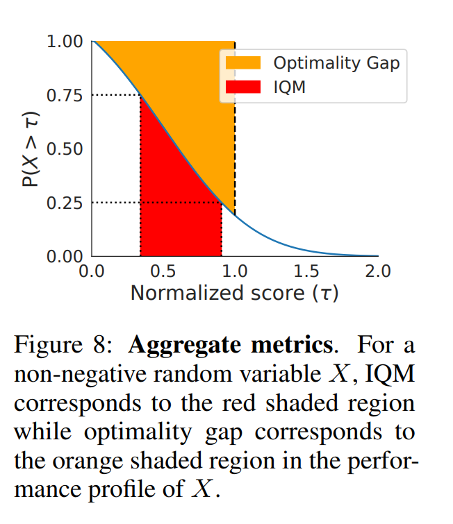
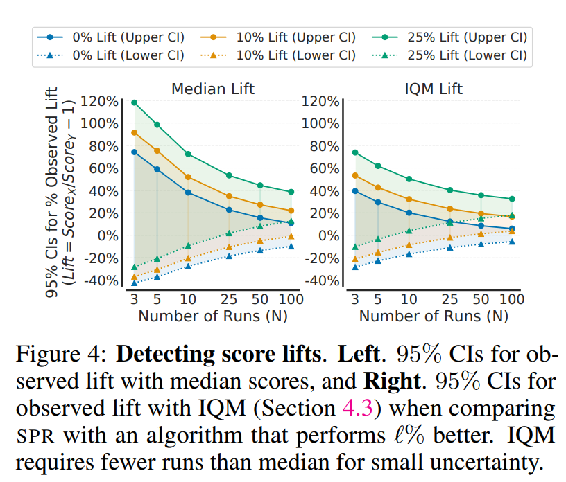

# Deep reinforcement learning at the edge of the statistical precipice

**Agarwal, Schwarzer, Castro, Courville and Bellemare (2021)** · *35th Conference on Neural Information Processing Systems (NeurIPS 2021), Outstanding Paper Award; arXiv:2108.13264v4* · [DOI 10.48550/arXiv.2108.13264](https://doi.org/10.48550/arXiv.2108.13264)

> **How to read this note.** Sections 1-4 summarise what the paper says, by section, equation, table and figure number. Section 5 is *our* interpretation for the thesis and is labelled as such.

---

## Key takeaways

- **What it did:** Shows with 100 independent runs per algorithm on Atari 100k that point estimates (mean, median) from 3-10 runs vary a lot and can reverse comparisons, and proposes a reporting protocol: stratified-bootstrap confidence intervals, run-score performance profiles, interquartile mean (IQM), optimality gap and average probability of improvement. It re-analyses published results on ALE, DM Control and Procgen with these tools.
- **Numbers to remember:** 3-10 runs are prevalent in deep RL; for Atari 100k, median CIs become small only around 50-100 runs; percentile stratified-bootstrap CIs have close to nominal coverage from about 10 runs (Fig. 6); per-task bootstrap CIs need 20-30 runs per task against 5-10 for aggregate CIs (Appendix A.3). IQM is the mean of the middle 50% of combined runs; optimality gap uses a threshold γ = 1.0 by default.
- **Used in the thesis for:** reporting benchmark results with intervals, IQM, optimality gap, probability of improvement and performance profiles.
- **Not evidence for:** terminal or dispatching results, a single best metric, or separating training-run from test-instance variance.

---

## 1. Summary in five points

1. The paper states that deep RL results are usually reported as point estimates of mean or median scores from 3-10 runs, which ignores statistical uncertainty and can lead to wrong conclusions about which method is better (Secs. 1, 3).
2. In a case study on Atari 100k with 100 runs for each of six algorithms, it reports high variability and bias in sample medians, and shows that non-standard evaluation protocols (maximum over evaluations or over hyperparameter settings) can account for claimed gains (Figs. 2-5).
3. It recommends interval estimates from stratified bootstrap, performance profiles built from run-score distributions (Eq. 1), and robust aggregate metrics: IQM, optimality gap and average probability of improvement (Sec. 4, Table 1).
4. It re-analyses published results on ALE (200M frames), DM Control and Procgen and reports that several claimed improvements are not supported once uncertainty is accounted for (Sec. 5, Figs. 9-12).
5. It argues that fixing random seeds and dichotomous significance tests do not fix the problem, urges papers to release all runs, and releases the library rliable (Sec. 6, Appendix A.1).

---

## 2. What the paper does

### 2.1 Setting and problem (Secs. 1-2)

**Introduction (Sec. 1).** The paper states that RL is usually evaluated as aggregate performance on a suite of tasks, summarised by mean or median over a few runs, and that 3-10 runs are prevalent because more runs are computationally prohibitive; for example 5 runs on 50+ Atari games need more than 1,000 GPU training days (cited from another paper). Fig. 1 (not reproduced here) shows that 5 or fewer runs have been common since DQN. It argues that ignoring uncertainty gives a false impression of fast progress, can steer researchers to superficially beneficial methods and lead better methods to be neglected, hides nuances, and makes results hard to reproduce. It names three tools in Table 1.

**Table 1. Recommendations for reliable evaluation, easily applicable with a handful of runs.**

| Desideratum | Current evaluation protocol | Our recommendation |
|---|---|---|
| Uncertainty in aggregate performance | Point estimates: ignore statistical uncertainty; hinder results reproducibility | Interval estimates via stratified bootstrap confidence intervals |
| Variability in performance across tasks and runs | Tables with mean scores per task: overwhelming beyond a few tasks; standard deviations often omitted; incomplete picture for multimodal and heavy-tailed distributions | Performance profiles (score distributions): show tail distribution of scores on combined runs across tasks; allow qualitative comparisons; easily read any score percentile |
| Aggregate metrics for summarising performance across tasks | Mean: often dominated by performance on outlier tasks. Median: requires a large number of runs to claim improvements; poor indicator of overall performance, zero scores on nearly half the tasks do not affect it | Interquartile mean (IQM) across all runs: performance on the middle 50% of combined runs; robust to outlier scores but more statistically efficient than median. To show other aspects, report average probability of improvement and optimality gap |

**Formalism (Sec. 2).** An algorithm is evaluated on M tasks with N independent runs each; each run gives a scalar normalised score x_{m,n}, obtained by linearly rescaling task scores between two reference points (for Atari, a random agent at 0 and an average human at 1). The score x_{m,n} is a realisation of a random variable X_{m,n} distributed as X_m. The tail distribution function of X_m is F_m(τ) = P(X_m > τ) and the empirical version for scores y_{1:K} is F̂(τ; y_{1:K}) = (1/K) Σ_k 1[y_k > τ]. With x̄_m the average of the N scores on task m, the mean and median normalised scores are Mean(x̄_{1:M}) and Median(x̄_{1:M}); these are point estimates of random variables, and the "true" mean and median are those for N → ∞. Randomness comes from task stochasticity, exploration, random initialisation and also software and hardware non-determinism (GPU, frameworks); a run "can be different from using a fixed random seed" (footnote 3). A 95% confidence interval is described through the coverage property over reruns. A Remark recommends confidence intervals and effect sizes and states that the paper avoids dichotomous significance tests (p < 0.05) because lack of significance does not show absence of effect and, given enough data, trivial effects become significant.

### 2.2 Method (Sec. 4, Appendix A.5, A.7)

**Stratified bootstrap CIs (Sec. 4.1).** Per-task bootstrap CIs with N runs are said to be less useful for small N, so the paper aggregates samples across tasks: resample runs with replacement independently for each task to build a bootstrap sample of N runs for each of M tasks, compute the statistic, and repeat to approximate its sampling distribution. Coverage is checked in Atari 100k by comparing nominal 95% with "true" coverage for four bootstrap methods (basic, percentile, bias-corrected bc, bias-corrected and accelerated bca; Appendix A.5). The paper finds percentile CIs give good interval estimates for as few as N = 10 runs for median and IQM; bca "is not as effective as percentile methods in the few-run deep RL regime". Unless stated otherwise it uses 50,000 resamples for aggregate metrics and 2,000 for pointwise confidence bands and average probability of improvement. With only 1-2 runs per task, bootstrapping over tasks is also possible (Appendix A.5, Fig. A.22) and gives much wider intervals.

**Performance profiles (Sec. 4.2).** The recommended profile is the run-score distribution: the fraction of runs with score above τ,

$$\hat F_X(\tau) = \hat F(\tau; x_{1:M,1:N}) = \frac{1}{M}\sum_{m=1}^{M}\hat F_m(\tau) = \frac{1}{M}\sum_{m=1}^{M}\frac{1}{N}\sum_{n=1}^{N}\mathbb 1[x_{m,n} > \tau] \tag{1}$$

with pointwise 95% bands from the stratified percentile bootstrap. The paper states that it is an unbiased estimator of the underlying distribution F(τ) (printed as "(1/N) Σ_{m=1}^{M} F_m(τ)", see 2.6), that one outlier run changes it by at most 1/(MN) at any τ, and that its variance is σ²_X = (1/(M²N)) Σ_m F_m(τ)(1 − F_m(τ)). The older average-score distribution, the profile of the task means X̄, is described as biased, a step function in 1/M, with variance σ²_X̄ = (1/M²) Σ_m F_{X̄_m}(τ)(1 − F_{X̄_m}(τ)). The τ where a profile crosses y = 0.5 gives the median and, for a non-negative score, the area under the profile gives the mean. If one profile is strictly above another the better method is said to stochastically dominate; with many tasks, profiles usually cross.

**Aggregate metrics (Sec. 4.3).** IQM (25% trimmed mean) discards the bottom and top 25% of the combined runs and averages the middle 50% (⌊NM/2⌋ runs); the paper describes it as interpolating between mean and median across runs, robust to outliers yet with much less bias than the median and smaller CIs. Optimality gap is the amount by which the algorithm falls short of a minimum score γ = 1.0 (a target beyond which improvements are not very important, for example human level); the threshold may be chosen differently. Average probability of improvement is

$$P(X > Y) = \frac{1}{M}\sum_{m=1}^{M} P(X_m > Y_m)$$

where, for X with N runs and Y with K runs on task m, P(X_m > Y_m) = (1/(NK)) Σ_i Σ_j S(x_{m,i}, y_{m,j}) with S(x, y) = 1 if y < x, 1/2 if y = x and 0 if y > x (Mann-Whitney U-statistic, Eq. A.2). It does not account for the size of improvement. Appendix A.7 adds: difficulty progress DP-25 (mean of the bottom 25% of runs), probability of being superhuman P(X > 1), and the optimality gap as a curve over γ (Fig. A.26); it states that if the probability of improvement exceeds 0.5 with CIs not containing 0.5 the result is statistically significant, and that an upper CI above 0.75 is "statistically meaningful" in the Neyman-Pearson sense of Bouthillier et al. The paper states that finding the best aggregate metric is an open question.

![Figure 7. Performance profiles on Atari 100k based on score distributions (left), which we recommend, and average score distributions (right). Shaded regions show pointwise 95% confidence bands based on percentile bootstrap with stratified sampling. The profiles on the left are more robust to outliers and have smaller confidence bands. We use 10 runs to show the robustness of profiles with a few runs. For SimPLe, we use the 5 runs from their reported results. The τ value where the profiles intersect y = 0.5 shows the median while for a non-negative random variable, area under the performance profile corresponds to the mean.](figure7.png)

### 2.3 Experimental design (Secs. 3, 5, Appendix A.2, A.4)

**Atari 100k case study (Sec. 3).** Atari 100k evaluates data efficiency on 26 games with 100k steps (2-3 hours of game play) against 200M frames in the standard ALE benchmark; prior results use mostly 3 or 5 runs, rarely 10 or 20. Five algorithms are compared (DER, OTR, DrQ with its variant DrQ(ε), CURL, SPR), chosen as representative; DrQ(ε) uses the standard ε-greedy parameters instead of DrQ's non-standard ones (training ε decayed to 0.01 rather than 0.1, evaluation ε 0.001 rather than 0.05; Appendix A.2). For each algorithm 100 independent runs were evaluated, where a run's score is the average return over 100 evaluation episodes after training and a run is a training on all 26 games; the 26 × 100 scores per algorithm were subsampled with replacement to 3-100 runs to measure the variability of estimates. DER and OTR were re-implemented in Dopamine; CURL and SPR used released code; DrQ used code from its authors. Compute (Appendix A.2): 15,600 runs plus 2,600 additional DER runs, 18,200 in total, each 3-5 hours on a Tesla P100 GPU. Coverage was checked for DER by sampling 10,000 sets of K runs without replacement from 200 runs.

**Re-evaluations (Sec. 5).** ALE with 200M frames on 55 games with sticky actions: DQN (Nature), DQN (Adam), C51, REM, IQN, Rainbow, Munchausen-IQN (M-IQN) and DreamerV2, with 5 runs per game except M-IQN (3) and DreamerV2 (11). DM Control on 6 tasks at 100k and 500k steps for nine algorithms (SAC+AE, SLAC, Dreamer, CURL, RAD, DrQ, PISAC, SUNRISE, CURL-D2RL), normalised by the maximum score of 1,000. Procgen easy mode, 16 tasks, 10 runs per task, for PPO, MixReg, UCB-DrAC, PLR, PPG and IDAAC. For algorithms whose authors gave individual runs the paper uses stratified bootstrap CIs; for CURL, CURL-D2RL and SUNRISE in Fig. 11 it uses 95% studentized CIs.

### 2.4 Results (Secs. 3, 5)

**Variability and bias of the median (Sec. 3).** Reported sample medians sit at the edges of the sampling distributions of the median (Fig. 2, left), so they can severely over- or underestimate the expected median. The paper reports that DER may in fact be better than OTR, unlike what the reported point estimates suggest. The sample median is biased in the few-run regime: for SPR the difference between expected medians at 5 and 100 runs (+0.03) is about 36% of its mean improvement over DrQ(ε) (+0.08) (Fig. 3, not reproduced). Folk wisdom of 20-30 runs is said to be closer to 50-100 runs for Atari 100k (Fig. 2, right). In Fig. 4, SPR is compared with an artificially inflated copy (lift ℓ); the paper states that with median scores a defensible improvement appears at 25 runs for ℓ = 25 and at 100 runs for ℓ = 10, and that with ℓ = 0 even 100 runs are insufficient, with deviations of 20% possible. IQM needs fewer runs.

![Figure 2. Left. Distribution of median normalized scores computed using 100,000 different sets of N runs subsampled uniformly with replacement from 100 runs. For a given algorithm, the sampling distribution shows the variation in the median scores when re-estimated using a different set of runs. The reported point estimates of median in publications, as shown by dashed lines, do not provide any information about the variability in median scores and severely overestimate or underestimate the expected median. We use the same number of runs as reported by publications: N = 5 runs for DER, OTR and DrQ, N = 10 runs for SPR and N = 20 runs for CURL. Right. 95% CIs for median and IQM scores for varying N. There is a substantial uncertainty in median scores even with 50 runs. IQM has much smaller CIs than median. Note that when CIs overlap, properly accounting for uncertainty entails computing CIs for score differences.](figure2.png)

Values read from Fig. 4 (≈, about ±3 percentage points), 95% CI for the observed lift: median, ℓ = 0: ≈(−42%, +74%) at 3 runs, ≈(−27%, +38%) at 10, ≈(−10%, +11%) at 100; median, ℓ = 10: ≈(−1%, +22%) at 100; median, ℓ = 25: lower bound above 0 from about 25 runs. IQM, ℓ = 0: ≈(−28%, +40%) at 3, ≈(−16%, +20%) at 10, ≈(−5%, +6%) at 100.

**Evaluation protocols (Sec. 3, Appendix A.4).** Protocols that insert a maximum (maximum evaluation score during training, or across runs or settings) give positively biased scores that are not comparable with end-of-training results. CURL reported the maximum over 10 evaluations during training; SUNRISE took the maximum over eight hyperparameter configurations with three runs each per game. Applying the same procedures to their baseline DER gives scores far above CURL's reported scores (CURL's protocol) and explains much of SUNRISE's reported gain (Fig. 5, not reproduced). Fixing seeds is also not enough: two sets of 100 DER runs using the same seeds had small score correlations because of GPU non-determinism (Fig. A.13).

**Validating stratified bootstrap CIs (Sec. 4.1, Fig. 6).** The paper states that percentile CIs have the best coverage with small width; with 3 runs bootstrap CIs underestimate the true 95% interval. Values read from Fig. 6 (≈) for percentile CIs: median coverage ≈86% (3 runs), ≈92% (5), ≈96% (10), ≈98% (20) and close to 100% at 50 and 100; IQM coverage ≈86% (3), ≈90% (5), ≈93-94% (10), ≈95% (20), ≈96% (50), ≈99% (100); average CI width at 10 runs about 0.065 for median and 0.04 for IQM. Appendix A.3 states that per-task CIs need at least 20-30 runs per task for near-95% coverage against 5-10 runs for stratified CIs on aggregate metrics (Figs. A.18, A.19). Appendix Fig. A.17 reports that IQM bias is small: for SPR, expected IQM differs by 0.006 points between 3 and 100 runs against 0.05 for the median.

![Figure 6. Validating 95% Stratified Bootstrap CIs for a varying number of runs for median and IQM scores for DER. The true coverage % is computed by sampling 10,000 sets of K runs without replacement from 200 runs and checking the fraction of 95% CIs that contains the true estimate approximation based on 200 runs. Note that we evaluate additional 100 runs for DER for an accurate point estimate. Percentile CIs has the best coverage while achieving a small width compared to other methods. Also, CI widths for IQM are much smaller than that of median. We also note that with 3 runs, bootstrap CIs underestimate the true 95% CIs and might require a larger nominal coverage rate to achieve true 95% coverage.](figure6.png)

**ALE (Sec. 5, Figs. 9, 10).** DreamerV2 shows a large amount of uncertainty in aggregate scores. M-IQN claimed a better median than Dopamine Rainbow but their intervals "strikingly overlap"; C51, said to be substantially better than DQN, has interval estimates and profiles that overlap significantly with DQN (Adam). The ordering of algorithms changes with the metric (median against IQM, optimality gap), because each metric captures one aspect. Large means relative to median and IQM show domination by a few tasks (for example DreamerV2 and M-IQN above 50 on one game). Profiles show IQN better than Rainbow above τ = 2 and worse below; the profiles of DreamerV2 and M-IQN intersect at multiple points for τ < 8.

**DM Control (Sec. 5, Fig. 11).** Papers claim improvements from higher mean scores per task; with uncertainty accounted for, most algorithms do not consistently rank above those they claimed to improve, and the 95% CIs of mean normalised scores overlap greatly. The paper concludes that many reported improvements "are spurious, resulting from randomness in the experimental protocol" (ranks from 200,000 bootstrap resamples; Fig. A.33 shows no algorithm ranks above the others on all tasks).

**Procgen (Sec. 5, Fig. 12).** PPO-normalised scores are heavy-tailed so mean scores depend on a few tasks; the paper recommends min-max normalisation. For algorithm pairs where X was claimed better than Y, it reports the probability of improvement: only 40-50% that UCB-DrAC improves on PLR, and a number of reported improvements are only 50-70% likely.

### 2.5 Conclusions (Sec. 6)

The paper states that statistical issues influence reported results in particular when point estimates are used or evaluation protocols differ within a comparison, and that earlier calls for rigour (Appendix A.3) have not been enough. Fixing seeds does not answer whether an algorithm performs well under other seeds and may favour some algorithms, and dichotomous tests do not solve it either. It urges reporting results in a more complete fashion with attention to bias and uncertainty, publishing all individual runs, and notes the incentive barrier (more rigour means more tempered claims) and that venue checklists now ask for error bars. It argues that more compute is unlikely to remove the issue for future benchmarks. The library rliable, a Colab notebook and the individual runs are released.

### 2.6 Gaps and inconsistencies in the printed paper

- **Eq. (1) text (Sec. 4.2).** The sentence on the unbiased estimator prints the underlying distribution as F(τ) = (1/N) Σ_{m=1}^{M} F_m(τ). With the definitions of Eq. (1) a factor 1/M would be expected (our reading); the printed form is reproduced above.
- **Significance wording.** Sec. 2 states the paper avoids significance tests, while Appendix A.7 says a probability of improvement above 0.5 with CIs excluding 0.5 is "statistically significant" and an upper CI above 0.75 "statistically meaningful".
- **Fig. 4 and its text.** The text says a defensible improvement at ℓ = 10 appears with 100 runs; the graph shows the lower CI for ℓ = 10 at about −1% at 100 runs, which is borderline (as read). The text says deviations of 20% are possible with ℓ = 0 and 100 runs; the graph shows ≈(−10%, +11%), a width of about 21 points (our reading).
- **Fig. 6 and its text.** The text says percentile CIs are good from N = 10 for median and IQM; IQM coverage reads ≈93-94% at 10 runs.
- **"36%".** 0.03 / 0.08 = 37.5% (our arithmetic with the rounded values printed; the paper states "about 36%").
- **Citation mismatch (Appendix A.1).** "MixReg [48]" is printed, while Sec. 5 and the Fig. 12 caption give MixReg [111] and PLR [48].
- **Test name (Appendix A.3).** "Welsh's t-test" is printed; the reference [113] is Welch.
- **Mixed CI methods.** In Fig. 11 percentile-bootstrap CIs are used for most algorithms and studentized CIs for CURL, CURL-D2RL and SUNRISE, so intervals in one panel come from different methods (as stated in the caption).

---

## 3. Structured summary

| Field | Value |
|---|---|
| Problem | Reliable comparison of deep RL algorithms from few runs on suites of tasks |
| Decision trigger | Not applicable |
| Decision | Not applicable (how to estimate and report performance) |
| Objective | Aggregate performance estimates with uncertainty |
| Scale | 26 Atari games × 100 runs × 6 algorithms; ALE 55 games; DM Control 6 tasks; Procgen 16 tasks |
| Randomness: quay-crane cycle time | Not applicable |
| Randomness: travel time / congestion | Not applicable |
| Randomness: task arrival | Not applicable |
| Randomness: stowage / workload | Not applicable |
| Randomness: yard crane | Not applicable |
| Randomness: AGV breakdown, battery | Not applicable |
| Method | Stratified bootstrap CIs, performance profiles, IQM, optimality gap, probability of improvement |
| Evaluation | 100-run case study; coverage validation on 200 runs; re-analysis of published per-run scores |
| Benchmarks | Mean and median point estimates, per-task tables, average-score distributions, per-task bootstrap CIs |

**Citation sentence supported by the paper:** *Agarwal et al. (2021) report, on Atari 100k with 100 runs per algorithm, that sample medians from 3-10 runs are variable and biased and can reverse comparisons, and recommend stratified-bootstrap confidence intervals, interquartile mean, optimality gap, probability of improvement and performance profiles for reporting results from a handful of runs.*

---

## 4. What the paper does not support

- No container-terminal, AGV or operations-research benchmark is studied; the benchmarks are Atari, DM Control and Procgen.
- The paper calls finding the best aggregate metric an open question, so it does not support IQM, optimality gap or any one metric as universally best; the optimality threshold γ = 1.0 and the normalisation depend on the benchmark.
- A run's score is the average over evaluation episodes; the paper does not separate variance from training runs and from evaluation instances.
- Coverage is validated on one algorithm (DER) in one benchmark (Atari 100k); coverage in other settings is not shown.
- With 3 runs the bootstrap CIs underestimate the true interval (Fig. 6).
- The paper does not give a rule for the number of runs; it says intervals shrink with more runs and that aggregate CIs need about 5-10 runs per task.
- The re-analyses use published scores and rely on individual runs obtained from the authors; claims of "spurious" improvements are statements about overlap of intervals and rank distributions, not about the algorithms' true performance.

---

## 5. Our reading (interpretation, not from the paper)

### 5.1 What we can use

- **Reporting protocol.** Treat scenarios or instance classes as "tasks" and independent training or simulation runs as "runs", then report IQM, optimality gap and probability of improvement with stratified-bootstrap percentile CIs, plus a performance profile, instead of mean and standard deviation tables.
- **Few-run regime.** The paper's coverage results (percentile CIs usable from about 10 runs) give a reference when deciding how many training seeds to afford per method.
- **Normalisation.** The paper shows scores must be rescaled between two reference points; which reference points suit a dispatching benchmark (for example a simple rule and a lower bound) is a thesis design choice.
- **Pitfalls to avoid.** Report end-of-training scores rather than the best evaluation, keep the evaluation protocol identical across methods, and release or keep all per-run results.

### 5.2 Cautions

- The paper's unit of independent variation is the training run. Our setting also has variation across simulated test instances; the paper does not tell us how to combine the two.
- The recommended tools describe uncertainty of a score estimate, not the operational meaning of a score such as quay-crane idle time.
