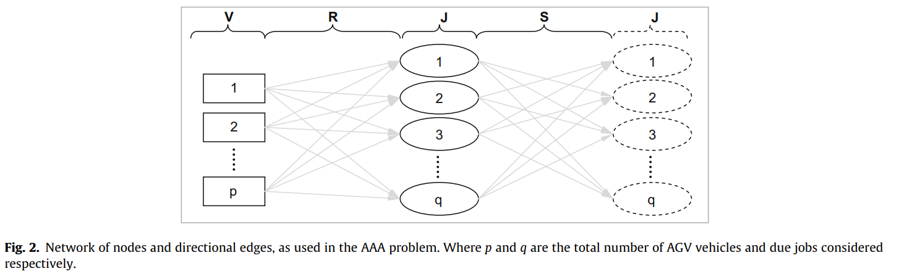
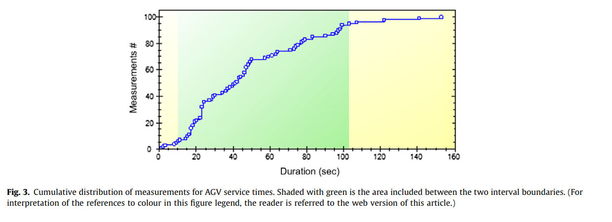
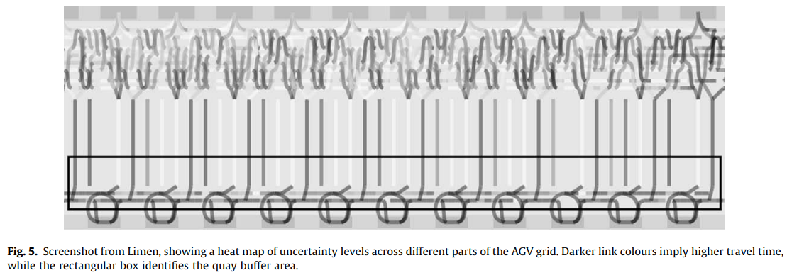
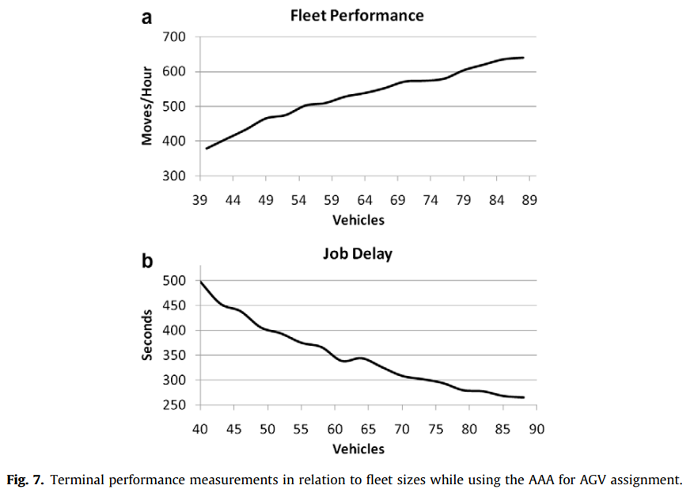
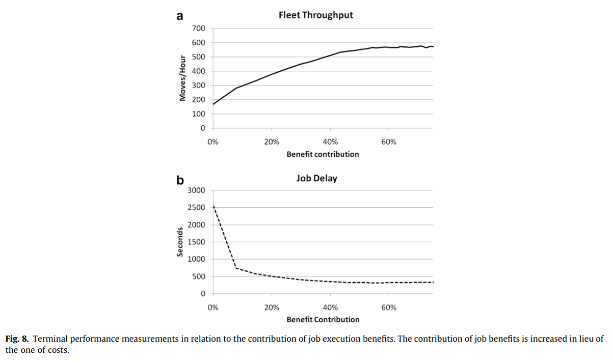
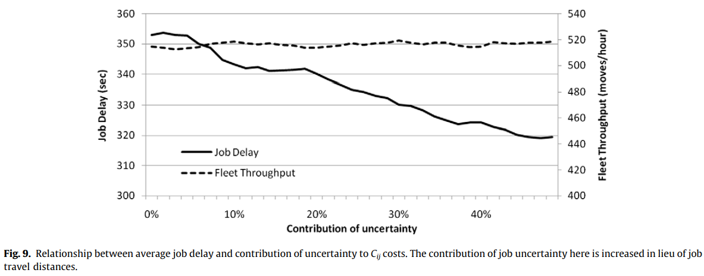
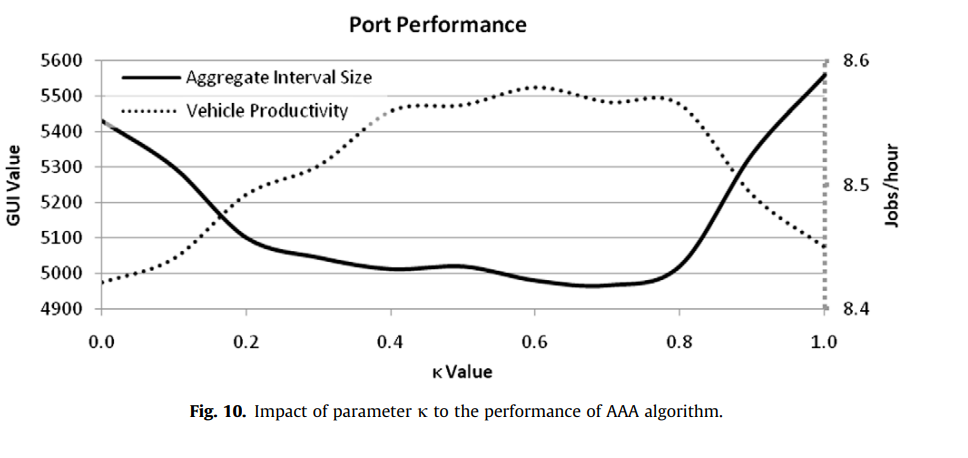

# An uncertainty-aware AGV assignment algorithm for automated container terminals

**Angeloudis and Bell (2010)** · *Transportation Research Part E, 46, 354-366* · [DOI 10.1016/j.tre.2009.09.001](https://doi.org/10.1016/j.tre.2009.09.001)

> **How to read this note.** Sections 1-4 summarise what the paper says, by section, equation, table and figure number. Section 5 is *our* interpretation for the thesis and is labelled as such.

---

## Key takeaways

- **What it did:** Formulates an AGV assignment algorithm (AAA) as a rolling-horizon 0-1 integer program with a net-benefit objective, adds an uncertainty index built from simulated duration intervals to the setup cost, and compares it in a microsimulation (Limen) with Closest, Greedy, First and mTSP.
- **Numbers to remember (Table 2, 70 AGVs):** productivity 8.87 moves/h (AAA) vs 7.77 (mTSP), 5.66 (Closest), 5.58 (Greedy), 5.43 (First); job overhead 355.92 m/job vs 363.4 (mTSP) and 713.71-744.78 (heuristics); fleet utilisation 93% vs 98-99%; CPU per instance 669 ms vs 520 ms (mTSP).
- **Used in the thesis for:** an uncertainty-aware optimisation benchmark; interval-based uncertainty measurement; indicator vocabulary.
- **Not evidence for:** quay-crane idle time, learning-based dispatching, disruption robustness, or statistical significance.

---

## 1. Summary in five points

1. The paper states that automated terminals still suffer from execution times that differ from plan by seconds to minutes, and proposes an assignment algorithm that uses known but unreliable information from the terminal operating system (Secs. 1, 9).
2. AAA is a rolling-horizon 0-1 integer program: due jobs are nodes, AGV current tasks are start nodes, setup (empty-travel) operations are edges, and each AGV receives at most two jobs beyond its current task (Secs. 4-5).
3. The setup cost combines distance, expected travel time, an uncertainty index and the remaining time of the AGV's current task; job benefit grows with the time a job has been due (Sec. 5).
4. Uncertainty is measured as a relative interval size between two percentile bounds of simulated durations; the interval midpoint serves as the expected duration (Sec. 6).
5. In a 5-hour, 70-AGV simulation the paper reports that AAA gives the highest vehicle productivity and the lowest uncertainty indices among the five engines, at 93% fleet utilisation (Table 2, Sec. 8).

---

## 2. What the paper does

### 2.1 Setting and problem (Secs. 1-4)

**Motivation (Sec. 1).** The paper states that AGVs are seen as a riskier option than automated stacking cranes, and that automated tasks, although planned precisely, show discrepancies between anticipated and observed execution times "between seconds to minutes". Sources named: interfaces between independently controlled equipment, AGV movement rules at junctions, crane buffers and deadlocks, maintenance and safety stops, and mislabelled or lost containers. Uncertainty "may eventually degrade the operational gains" of rolling-horizon optimisation.

**Related research (Sec. 2).** The paper describes, among others: Egbelu and Tanchoco's vehicle-initiated versus work-centre-initiated classification; Meersmans et al. (2001a, 2001b) integrated scheduling, which it says applies to single-loop layouts; Hartmann (2004), weighted lateness and setup time with genetic algorithms and dispatching heuristics; Liu and Ioannou (2002), heuristics compared in a simulation, with the minimum yard-crane queue rule reported best on throughput; Kim (1999); Lim et al. (1999), a bidding method; Kim and Bae (2004), a look-ahead method whose aim is to minimise delays of transfer cranes. It also lists reviews (Steenken et al. 2004; Vis and de Koster 2003; Vis 2003; Meersmans and Dekker 2001; Co and Tanchoco 1991; Ganesharajah 1998; Qiu et al. 2002).

**Terminal operations (Sec. 3).** A container move has six steps: the AGV travels to the origin crane's buffer; the origin crane obtains the container; the crane deposits it on the AGV at the buffer; the AGV transports it to the destination crane's buffer; the destination crane travels to the buffer; it obtains the container and deposits it in its domain. Containers have origin and destination within two separate crane domains; crane operations are assumed to be optimised by a separate procedure, outside the scope. For AGVs, step four is a fixed (primary) operation; step one is a helper (secondary) operation known only after assignment.

**Algorithm design (Sec. 4).** Minimising vessel turnaround is called the single most important goal of day-to-day operation; the paper adopts the industry interpretation of maximising quay-crane productivity by keeping a constant supply of AGVs to the quay (citing Kim and Bae 2004 and Liu and Ioannou 2002). It prefers one fleet-wide optimisation over clusters of dedicated equipment. Because activation times, vehicle availability and origin/destination details become known close to execution, it adopts a rolling horizon. With about 70 AGVs "something is bound to change somewhere", so the interval between optimisations should be comparable with the average length of an assigned job. A central job list covers the terminal; all assignments remain provisional until an AGV starts the job and may be reassigned in later cycles.

### 2.2 Method (Secs. 5-6)

**Network and sets (Sec. 5).** Earlier studies (Angeloudis and Bell 2007; Cheng et al. 2005) are said to show that Minimum Cost Flow or travelling-salesman style assignment, which can assign unlimited jobs to a vehicle, may give unpredictable solutions; AAA limits assignment to at most two jobs per AGV, not counting the job in execution. In the network G(N, E), jobs are nodes and secondary operations are edges that lead to the next job and start where the last assigned job ends. Sets as printed:

- J: set of due jobs (not assigned yet)
- V: set of current AGV tasks (assigned jobs, maintenance or idle state); an idle AGV is assumed to be executing a null (dummy) task and is readily available
- N: set of all nodes, printed "N = R ∪ S"
- R: operations (i, j) linking tasks i ∈ V and j ∈ J
- "JS": operations (i, j) linking tasks i, j ∈ J, i ≠ j
- E: all edges, E = R ∪ S

A job is removed from J once an AGV starts executing it; later runs overwrite earlier allocations of jobs still due.

**Cost and benefit (Sec. 5).** For an operation (i, j) linking jobs i and j the paper takes:

- L_ij: distance between the end of job i and the start of job j
- T_ij: expected travel time from the end of job i to the start of job j
- U_ij: the uncertainty index of transition (i, j)
- D_i: 0 if i ∉ V or if the AGV is initially idle; otherwise the expected remaining time until the current task i completes

$$C_{ij} = \alpha L_{ij} + \beta T_{ij} + \gamma U_{ij} + \delta D_i$$

where α, β, γ, δ are weights; the paper states that a weight may be set to 0 or more properties added. The benefit of assigning job i ∈ J uses Q_i, the time the job has been due:

$$B_i = \zeta Q_i$$

with ζ the weight of due times. Q_i and B_i keep increasing while a job stays unassigned.

**Objective and constraints (Sec. 5).** Boolean variables a_j, b_j (job j in first or second queue position) and t_ij (setup link i→j is in the schedule).

$$\max \; \sum_{j\in J}\Big(B_j a_j - \sum_{i\in V} C_{ij}t_{ij}\Big) + \kappa \sum_{j\in J}\Big(B_j b_j - \sum_{i\in J,\, i\neq j} C_{ij}t_{ij}\Big) \tag{1}$$

subject to

$$a_j + b_j \le 1 \quad \forall j \in J \tag{2}$$
$$\sum_{i\in V} t_{ij} = a_j \quad \forall j \in J \tag{3}$$
$$\sum_{i\in J,\, i\neq j} t_{ij} = b_j \quad \forall j \in J \tag{4}$$
$$\sum_{i\in N,\, i\neq j} t_{ij} \le 1 \quad \forall j \in J \tag{5}$$
$$\sum_{j\in J,\, j\neq i} t_{ij} \le 1 \quad \forall i \in N \tag{6}$$
$$a_i b_j \ge t_{ij} \quad \forall (i,j)\in J,\ i\neq j \tag{7}$$
$$a_j, b_j \in \{0,1\} \quad \forall j\in J \tag{8}$$
$$t_{ij} \in \{0,1\} \quad \forall (i,j)\in J,\ i\neq j \tag{9}$$

The paper states that κ lies between 0 and 1 and gives less weight to the net benefit of a job assigned as a later task, so immediate assignments have higher priority while later assignments with potentially volatile data are still taken into account. A job takes first or second position or stays unassigned, never both (2). Constraints (3)-(4) tie the single required setup operation to an assigned job; (5)-(6) allow one incoming secondary operation per assigned job and at most one outgoing per node. Constraint (7) keeps a secondary operation in the solution only when both connected jobs are assigned, but makes the problem a Mixed Integer Quadratically Constrained Problem; the paper replaces it with the linear

$$a_i + b_j \ge 1.5\, t_{ij} \quad \forall (i,j)\in J \tag{10}$$

giving a 0-1 integer program. Table 1 checks the equivalence on all eight combinations of (α_i, β_j, t_ij).

**Table 1. Verification of result equivalence between constraint equations 7 and 10** (as printed; see 2.6 for two cells)

| α_i | β_j | t_ij | Acceptable | a_i b_j ≥ t_ij | | a_i + b_j ≥ 1.5 t_ij | |
|---|---|---|---|---|---|---|---|
| 0 | 0 | 0 | Yes | 0 ≥ 0 | True | 0 ≥ 0 | True |
| 0 | 0 | 1 | No | 0 ≥ 1 | False | 0 ≥ 1.5 | False |
| 0 | 1 | 0 | Yes | 0 ≥ 0 | True | 1.5 ≥ 0 | True |
| 0 | 1 | 1 | No | 0 ≥ 1 | False | 1 ≥ 1.5 | False |
| 1 | 0 | 0 | Yes | 0 ≥ 0 | True | 1 ≥ 0 | True |
| 1 | 0 | 1 | No | 0 ≥ 1 | False | 1 ≥ 1.5 | False |
| 1 | 1 | 0 | Yes (a) | 1 ≥ 0 | True | 2 ≥ 0 | True |
| 1 | 1 | 1 | Yes | 1 ≥ 0 | True | 2 ≥ 1.5 | True |

(a) A pair of jobs (i, j) might be allocated, but not be set in sequence.

The paper states that the formulation does not require every job to be assigned even if slots exist (|J| ≤ 2|A|), which lets the controller defer a job whose expected benefit is greatly exceeded by the inferred travel costs. Interpreting the output gives chains of edges, one per AGV; the initial node in V identifies the vehicle (Fig. 4).

**Measuring uncertainty (Sec. 6).** Instead of fixed durations the paper uses intervals of presumed lower and upper bounds. Bounds "were determined through simulation": after enough observations of a task are collected and ranked, two values at predefined percentiles are chosen, which keeps the interval close to the core of the observations. The interval midpoint is the expected duration and the relative interval size is the uncertainty measure:

$$U_{ij} = 2\,(\overline{T_{ij}} - \underline{T_{ij}})\,/\,\overline{T_{ij}} + \underline{T_{ij}}$$

(as printed, with $\overline{T_{ij}}$ and $\underline{T_{ij}}$ the upper and lower bounds; see 2.6). Interval lists are regenerated constantly so the terminal operating system stays current; estimates are collected for the AGV grid, crane stacks and complete container moves. A static A* pathfinder generates shortest-distance paths and so indirectly affects setup costs. Collision-avoidance rules (speed changes, safety stops, junction priorities) cannot be anticipated, so they cause travel-time variation, counted as terminal uncertainty. The paper states that such variation, mostly from intersections, buffers and service points, can be identified from the interval data (Fig. 4 as cited there; see 2.6), and that AAA tends to avoid assignments with greater uncertainty. Delays around the quay-crane buffers (black box in Fig. 5) are captured by the intervals and penalised.

### 2.3 Experimental design (Secs. 7-8)

**Implementation (Sec. 7).** AAA was implemented in Limen, a C# microsimulation and optimisation framework (Angeloudis and Bell 2009) with time-step simulation at 1 s resolution, up to 1000 times real time. Routing and scheduling problems use Limen's algorithms plus ILOG CPLEX 11.2. Limen has a terminal emulation module (unit movement, maintenance, collision avoidance, loading, AGV behaviour in buffers) and a terminal operating system module that holds AAA and the comparison heuristics. No manipulation of CPLEX branch-and-bound was done; default settings solved instances "within 1250 ms on average". The paper states that a single instance with randomly generated interval data is straightforward, and that the long-term effect of AAA on the uncertainty intervals needs a simulation, hoping that AAA reduces uncertainty over time. (Figure 6, a Limen screenshot, is not reproduced in this note.)

**Indicators (Sec. 8).**

- Vehicle productivity: container moves per hour accomplished by a single vehicle.
- Execution notice: average period between a job entering the queue and its execution (jobs start with equal urgency).
- Vehicle utilisation: portion of the fleet participating in a handling operation at any point.
- Job overhead: average travelling distance between the end of one job and the start of another.
- Travelled distance: total fleet distance per hour of operation.
- Grid Unpredictability Index (GUI): variance of expected travel times across known route links of the AGV flowpath over the simulated period.
- Aggregate Interval Size (AIS): sum of all U_ij measurements calculated by the end of the simulation using all collected samples.

**Engines compared.** Closest: a newly idle AGV takes the job with the shortest setup operation. Greedy: an AGV takes the least costly job, with the same cost formula as AAA. First: a due job goes to the first available AGV. mTSP: built on the multiple travelling salesman problem (Angeloudis and Bell 2007), "only slightly modified" from Cheng et al. (2005).

**Scenario.** "A range of random seeds" was used while all terminal settings were fixed apart from the assignment engine. Container flow scenarios are collections of vectors linking quay cranes and stack blocks, each with a volume and an activation time, generating transport orders at a predefined frequency and other conditions. One scenario was common to all instances: roughly 1,400 move orders over 5 h, with moderate and heavy activity and up to three large vessels, in a terminal of CTA-like layout and proportions. Flow vectors connect nearby stacks and berths. Fleet size was fixed at 70 vehicles in all tests of Table 2.

### 2.4 Results (Sec. 8)

**Table 2. Simulation results for various optimisation approaches utilised by the AGV controller engine.** The paper states that bold is the best result and underlined the second best. Numbers as printed (Indian digit grouping retained).

| Optimisation engine | Closest | Greedy | First | mTSP | AAA |
|---|---|---|---|---|---|
| Grid Unpredictability Index | 425.82 | 432.01 | 457.37 | 405.89 (underlined) | **379.12** |
| Aggregate Interval Size | 9370.8 | 8932.3 | 9979.5 | 8015.1 (underlined) | **7781.6** |
| Job overhead (m/job) | 713.71 | 744.78 | 743.11 | 363.4 | **355.92** |
| Vehicle productivity (moves/h) | 5.66 | 5.58 | 5.43 | 7.77 | **8.87** |
| Fleet utilisation (%) | 99 | 99 | 99 | 98 | **93** |
| Execution notice (s) | 329 | 325 (underlined) | 329 | 516 | **304** |
| Fleet travelled distance (m/h) | 2,09,080 | 2,14,176 | 2,11,319 | 1,87,780 | **1,83,195** |
| CPU time per instance (ms) | 1 | 2 | 0 | 520 | 669 |

Our arithmetic from Table 2 (AAA relative to each engine): productivity +14.2% vs mTSP, +56.7% vs Closest, +59.0% vs Greedy, +63.4% vs First; GUI -6.6% vs mTSP, -11.0% to -17.1% vs the three heuristics; AIS -2.9% vs mTSP, -12.9% to -22.0% vs the three heuristics; job overhead -2.1% vs mTSP and about -50% to -52% vs the heuristics; execution notice -6.5% to -7.6% vs the heuristics and -41.1% vs mTSP.

**What the paper says about Table 2.** AAA "outperforms all heuristics by wide margins" and is superior to mTSP; its computational requirements are higher but "within acceptable levels". Job overhead is significantly reduced with both optimisation algorithms owing to the rolling-horizon approach. AAA reduced uncertainty (GUI and AIS) and raised productivity, while using a smaller portion of the fleet (93% against 98-99%).

**Fleet size (Fig. 7).** The paper reports that only 65 vehicles are required for AAA to match mTSP's productivity, implying lower investment, operational and maintenance costs. Values read from the graph (≈): fleet performance ≈378 moves/h at 40 vehicles rising to ≈640 at about 88; job delay ≈500 s at 40 vehicles falling to ≈265 s at about 88.

**Benefit contribution (Fig. 8).** When the contribution of job benefits is increased in lieu of costs, values read from the graph (≈): fleet throughput ≈165 moves/h at 0% rising to a plateau near ≈570 above about 55%; job delay ≈2,550 s at 0% falling to ≈330 s from about 40%. The paper states that raising all cost weights outright would shift the focus toward delay minimisation, so in the sweeps the weights were rebalanced to keep the mean cost unchanged.

**Uncertainty contribution (Fig. 9).** With the weight on U_ij increased at the expense of distance (mean cost held constant), the paper reports only minor increases in fleet throughput but a "considerably decreased" average delay between a job appearing and its execution. Values read from the graph (≈): job delay ≈353 s at 0% to ≈319 s at about 48%; fleet throughput ≈514-519 moves/h throughout.

**Parameter κ (Fig. 10).** The paper states that balancing immediate and later assignments raises throughput and lowers uncertainty, that "optimal values" of κ lie between 0.5 and 0.6, and that performance deteriorates outside this range. Values read from the graph (≈): AIS ≈5,430 at κ = 0, minimum ≈4,965 near κ ≈ 0.68, ≈5,560 at κ = 1; productivity ≈8.42 jobs/h at κ = 0, highest ≈8.58 near κ ≈ 0.6, ≈8.46 at κ = 1.

### 2.5 Conclusions (Sec. 9)

The paper states that its contribution is a dispatching algorithm built on a cost/benefit concept that uses known but unreliable information from terminal operating systems; that in simulation it performed better than other known alternatives and heuristics; and that uncertainty penalisation led to "significant operational benefits". It notes that interval-based uncertainty draws on robust optimisation (Kouvelis and Yu 1997) but, unlike robust formulations, AAA avoids large mathematical problems that cannot be easily solved. Future work: use equipment reliability data and present congestion levels in the AGV grid for the uncertainty penalties, and replace static routing by dynamic routing that seeks minimum-conflict routes for the whole fleet (Vis and de Koster 2003).

### 2.6 Gaps and inconsistencies in the printed paper

- **U_ij formula (Sec. 6).** Printed as $U_{ij} = 2(\overline{T_{ij}} - \underline{T_{ij}})/\overline{T_{ij}} + \underline{T_{ij}}$ without brackets; the text describes it as the relative interval size with the midpoint as the expected duration, which would read $2(\overline{T}-\underline{T})/(\overline{T}+\underline{T})$. The printed form is reproduced above as is.
- **Cost weight symbol (Sec. 5).** The printed cost formula shows its first weight as "a" (Latin letter), while the sentence after it lists the weights as α, β, γ, δ.
- **Node set (Sec. 5).** The text prints "N = R ∪ S", while R and S are edge sets and Fig. 2 shows nodes as V and J; the second edge set is printed "JS". The note keeps the printed symbols.
- **Table 1.** Row 3 prints "1.5 ≥ 0" for a_i + b_j with (α_i, β_j) = (0, 1), where the sum is 1; row 8 prints "1 ≥ 0" for a_i b_j ≥ t_ij with t_ij = 1, where the right side is 1. Neither changes the True/False entries. The table uses α_i and β_j for the binary variables, while the text and constraints use a_i and b_j, and α, β also denote cost weights. Constraint (10) is stated for (i, j) ∈ J, but (7) and the table are discussed for i ≠ j.
- **Cross-references.** Sec. 6 cites Fig. 4 for the identification of travel-time variation, but Fig. 4 shows assignment chain types; Fig. 5 is the uncertainty heat map. "The latter approach" in Sec. 8 (fleet-size comparison) is ambiguous between AAA and mTSP.
- **CPU time.** Sec. 7 reports instances solved "within 1250 ms on average"; Table 2 reports 669 ms for AAA.
- **Productivity and orders.** Sec. 8 defines productivity per vehicle. With 70 vehicles, 8.87 moves/h per vehicle gives 620.9 moves/h for the fleet (our arithmetic), whereas about 1,400 orders over 5 h is 280 orders/h, and Fig. 7a shows ≈575 moves/h near 70 vehicles. The paper does not reconcile these. For mTSP, 7.77 × 70 = 543.9 moves/h, close to Fig. 7a at 65 vehicles (≈545), which is consistent with the paper's statement about 65 vehicles.
- **Distance and overhead.** Dividing fleet travelled distance by fleet moves per hour (productivity × 70) gives about 295 m per move for AAA and 345-556 m for the others, which is less than the job overhead (empty travel alone) of 355.92 m and 363.4-744.78 m per job (our arithmetic). The paper does not explain the definitions that would reconcile these.
- **Base cases of the sweeps.** Fig. 9 shows fleet throughput ≈515 moves/h and Fig. 10 shows 8.4-8.6 jobs/h and AIS 4,965-5,560, none of which matches the AAA row of Table 2 (8.87 moves/h per vehicle, AIS 7781.6); the settings of the sweeps are not described. Fig. 10's left axis is labelled "GUI Value" while the series is Aggregate Interval Size, and Fig. 8b is titled "Job Delay" while Sec. 8 defines "Execution notice".
- **Fig. 7 axes.** Panel (a) has ticks at 39, 44, 49 ... and panel (b) at 40, 45, 50 ...
- **Fig. 8 and Eq. (1).** At 0% benefit contribution the plots show nonzero throughput; the paper does not say how Eq. (1) behaves at that point.
- **Table 2 formatting.** Utilisation 93% is set in bold as "best", though lower utilisation is described in the text as a favourable side effect rather than a goal; underlining is applied to GUI, AIS and execution notice only, and CPU time has no bold or underline.
- **κ.** The text states optimal κ between 0.5 and 0.6; Fig. 10 shows productivity near its highest from about 0.4 to 0.8 and AIS near its minimum from about 0.65 to 0.7.
- **Fig. 9 text.** The delay is described as "considerably decreased"; the graph shows ≈353 s to ≈319 s (≈9.6%, our arithmetic).
- **References.** The reference "Egbelu and Tanchoco (1986)" is titled on bi-directional guide paths, while the text uses it for the vehicle-initiated and work-centre-initiated classification. "Liu and Ioannou (2002)" is the ITSC 2002 paper (pp. 880-885). The ECC 2001 and T-ITS 2002 papers of Liu and co-authors are not cited. The abstract reads "automated guided in container terminal settings".

---

## 3. Structured summary

| Field | Value |
|---|---|
| Problem | Assign due container-move jobs to AGVs in real time, with uncertain execution and travel times |
| Decision trigger | Periodic rolling-horizon solve over all due jobs and the fleet; interval comparable with the average assigned-job length; assignments provisional until execution |
| Decision | Job-to-AGV assignment in first or second queue position (at most two jobs per AGV beyond the current task); jobs may be deferred |
| Objective | Maximise net benefit B_j minus setup costs C_ij, second position weighted by κ |
| Scale | 70 AGVs, about 1,400 orders over 5 h, up to three vessels, CTA-like layout |
| Randomness: quay-crane cycle time | Not described in the paper (crane operations are outside the optimisation scope) |
| Randomness: travel time / congestion | Emerges in simulation from collision-avoidance rules; measured with percentile intervals |
| Randomness: task arrival | Flow vectors with volume, activation time and predefined frequency; whether arrivals are drawn randomly is not described |
| Randomness: stowage / workload | One scenario common to all runs |
| Randomness: yard crane | Not described in the paper |
| Randomness: AGV breakdown, battery | Not described in the paper (maintenance appears as a possible current task) |
| Method | 0-1 integer program, CPLEX 11.2 default settings, rolling horizon |
| Evaluation | Limen simulation, 1 s step, "a range of random seeds", single reported values, no intervals |
| Benchmarks | Closest, Greedy, First, mTSP |

**Citation sentence supported by the paper:** *Angeloudis and Bell (2010) report, in a 5-hour simulation with 70 AGVs, that their uncertainty-aware assignment algorithm (AAA) reached 8.87 moves/h per vehicle against 7.77 for mTSP and 5.43-5.66 for three dispatching heuristics, with lower Grid Unpredictability Index and Aggregate Interval Size (Table 2).*

---

## 4. What the paper does not support

- No quay-crane measure is reported (idle time, waiting for AGVs, or crane productivity), although the paper motivates the work by quay-crane productivity (Sec. 4).
- No learning or reinforcement-learning method is used; the algorithm is an integer program in a rolling horizon.
- The number of random seeds, confidence intervals, tests and the values of the cost and benefit weights used for Table 2 are not described in the paper; the differences in Table 2 are single reported values.
- The percentile values defining the interval bounds are not stated (Fig. 3 shades an interval of roughly 10 s to 103 s, read from the graph).
- Breakdowns, battery limits, yard-crane delays and quay-crane cycle-time variation are not described, so robustness to them is not shown.
- Only one container-flow scenario and one fleet size (70) are used for the engine comparison; the fleet-size, benefit, uncertainty and κ sweeps are single curves without repeated runs shown.
- Whether the baselines were tuned is not described; Greedy shares AAA's cost formula.
- The claim that AAA reduces uncertainty is shown through the paper's own indices (GUI, AIS), which are computed from the interval data the algorithm itself uses.
- The paper does not claim to be the first uncertainty-aware AGV dispatching method.

---

## 5. Our reading (interpretation, not from the paper)

### 5.1 What we can use

- **Benchmark formulation.** AAA is a defined rolling-horizon, net-benefit model with a limited chain length (two jobs per AGV). It can serve as an optimisation benchmark whose decision structure (periodic, batch over fleet and due jobs) differs from event-by-event dispatching rules.
- **Uncertainty measurement.** Interval estimates from simulation percentiles, and the idea of penalising uncertain links in the cost, are a concrete way to turn observed travel-time variation into a decision input.
- **Indicator vocabulary.** Execution notice, job overhead, utilisation and GUI/AIS give names to quantities that the thesis may want to track next to a quay-crane measure.
- **Gap contrast.** The paper's objective and indicators do not include a quay-crane waiting or idle measure, so any quay-crane-centred objective would need to be defined separately.

### 5.2 Cautions

- Read the productivity figures with the reconciliation issues in 2.6 in mind before quoting fleet-level throughput.
- The "uncertainty" in this paper is mostly emergent traffic variation inside the simulator; other sources (crane cycle times, breakdowns, arrivals) are not described, so it should not be cited as a study of those.
