# A Machine Learning-Based Approach for Multi-AGV Dispatching at Automated Container Terminals

**Gao, Chen & Chang (2023)** · *Journal of Marine Science and Engineering* 11, 1407 · [DOI 10.3390/jmse11071407](https://doi.org/10.3390/jmse11071407)

> **How to read this note.** Sections 1-4 summarise what the paper says, by section, equation, table and figure number. Section 5 is *our* interpretation for the thesis and is labelled as such. Numbers marked ≈ are read from a graph. Equation numbers follow the order of the paper (Eqs. 1-12 first model, 13-21 second model, 22-26 Q-learning elements, 27 update rule).

---

## Key takeaways

- **What it did:** formulates multi-AGV dispatching between container blocks (supply sides) and quay cranes (demand points) as a two-stage model: stage 1 assigns tasks to AGVs against time windows, stage 2 chooses routes to lower a congestion rate. It solves the problem with QL-CNP, tabular Q-learning for the choice of edges combined with a contract net protocol (CNP) for task allocation, and compares it with CNA, Dijkstra, GA and PSO.
- **Numbers to remember:** 5 blocks, 2 quay cranes, 3 to 10 AGVs, 20 to 200 tasks. Q-learning: alpha = 0.1, gamma = 0.8, epsilon = 0.9, 1000 episodes on a 5x5 grid. For 60 tasks and 5 AGVs, delay 5750.67 (QL-CNP), 6728.90 (GA), 6398.50 (PSO); congestion rate 2.44% (QL-CNP) against 4.01% (GA); last task finishes at 2395, 2638 and 2695.
- **Used in the thesis for:** a worked tabular Q-learning example on AGV routing, the congestion-rate definition, and scale data points.
- **Not evidence for:** stochastic or disrupted operation, real-time dispatching, quay-crane idle time, or deep or multi-agent reinforcement learning.

---

## 1. Summary in five points

1. The paper treats AGVs as carriers between **supply sides** (container blocks) and **demand points** (quay cranes) and splits the problem into two stages: task assignment against time windows (Eq. 1, minimise earliness plus lateness) and route choice (Eq. 13, minimise the congestion rate t/T).
2. **QL-CNP** combines a contract net protocol, in which a manager agent announces tasks and AGV agents bid (Fig. 3a), with tabular Q-learning that evaluates the choice of edges (Fig. 3b, Eqs. 22-27, Table 4).
3. The Q-learning hyperparameters are chosen on a **5x5 grid** path-finding problem (Figs. 6, 7, Table 5): learning rate 0.1 and discount factor 0.8 over 1000 episodes.
4. Over **10 instances** (20 to 200 tasks, 3 to 10 AGVs) the delay time grows and the congestion rate falls from 3.14% to 1.63% (Table 7). Against CNA and Dijkstra at 50 and 100 tasks the congestion rate is about 37-38% lower (Table 8; our arithmetic).
5. On one case with **60 tasks and 5 AGVs**, QL-CNP gives lower delay (5750.67 against 6728.90 and 6398.50) and a lower congestion rate than GA and PSO, and its last task finishes earlier (2395 against 2638 and 2695; Figs. 9, 11).

---

## 2. What the paper does

### 2.1 Setting and problem (Secs. 1 and 3)

**Motivation (Sec. 1).** AGVs carry containers between the yard and the quay cranes (QCs) of an automated container terminal (ACT). The paper states that shortening the transport time of container tasks can reduce ship berth time, that using more AGVs shortens the makespan but raises energy use and the chance of congestion and conflict, and that balancing traffic over the routes between yard and quay is a way to reduce congestion at its origin. It describes the multi-AGV dispatching problem (MADP) as multiagent task allocation, with each AGV an agent, and proposes negotiation through the contract net protocol. Q-learning is added "to help multiple agents to choose better actions during the bid evaluation".

**Stated contributions (Sec. 1).** (1) The yard-to-quay relationship is treated as a supply chain, with container blocks as supply sides and QCs as demand points. (2) A two-stage mathematical model: delay time optimised in stage 1, the congestion rate (waiting time over transport time) in stage 2. (3) The QL-CNP algorithm. (4) Experiments of different sizes.

**Literature (Sec. 2).** Section 2.1 reviews AGV scheduling and path planning (priority rules, conflict-free paths, branch and bound, a receding horizon method, GA for integrated problems); Table 1 lists nine of these with their solution methods. Section 2.2 reviews machine learning for optimisation, including reinforcement learning for charging scheduling (Lin et al. [28]), batching, and vehicle routing. The paper states that Luo and Wu [19] assumed no traffic congestion for AGVs on the path. Only part of Sec. 2.2 is covered in this note (see 2.6, last item).

| Problems | Solutions | Authors (ref.) |
|---|---|---|
| AGV scheduling considering battery to minimize travel and tardiness costs | A metaheuristic-based adaptive large neighborhood search algorithm | Singh et al. [12] |
| Multi-AGV online scheduling in warehouses | Improved path planning algorithm with grid blocking degree | Yu et al. [13] |
| AGV conflict-free path planning to minimize distances | Dijkstra depth-first search algorithm | Zhong et al. [5] |
| AGV conflict-free path planning to minimize energy consumption | A branch and bound algorithm | Li et al. [16] |
| AGV path planning in MVPD problem | A receding horizon planning methodology | Xin et al. [17] |
| AGV dispatching and container storage allocation | GA | Luo & Wu [19] |
| Integrated scheduling considering AGV conflicts | An approach based on the conflict resolution strategy and bilevel adaptive GA | Ji et al. [21] |
| AGV online dispatching | An online preference learning algorithm | Choe et al. [34] |
| AGV anti-conflict path at ACT | MADDPG combining reinforcement learning | Hu et al. [35] |

*Table 1. Comparison of AGV optimization in problems and solutions.*

**Problem description (Sec. 3).** Each QC assigned to the vessel is one demand point and each block with stacked containers is one supply side. The numbers of containers handled by the QCs differ, so demand differs between demand points, and containers for one QC are stored at several blocks. One AGV transporting one container from a supply side to a demand point is one **task**. All containers to be shipped must be delivered.

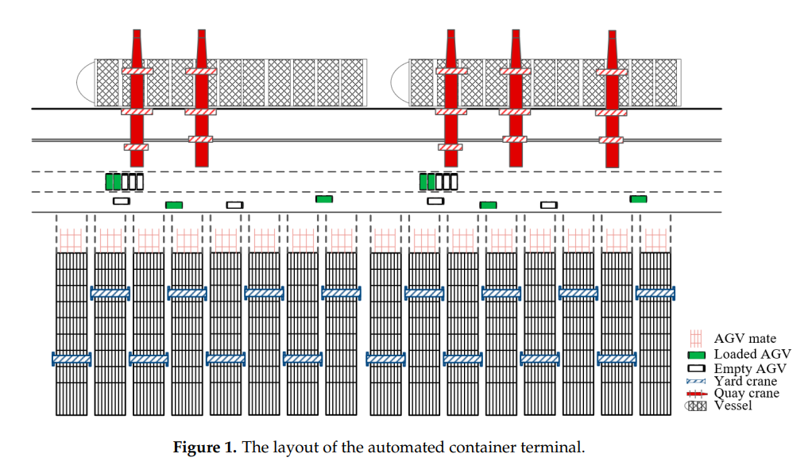

The figure shows a vessel with quay cranes, a horizontal transport lane with loaded and empty AGVs, AGV mates, and yard blocks with yard cranes.

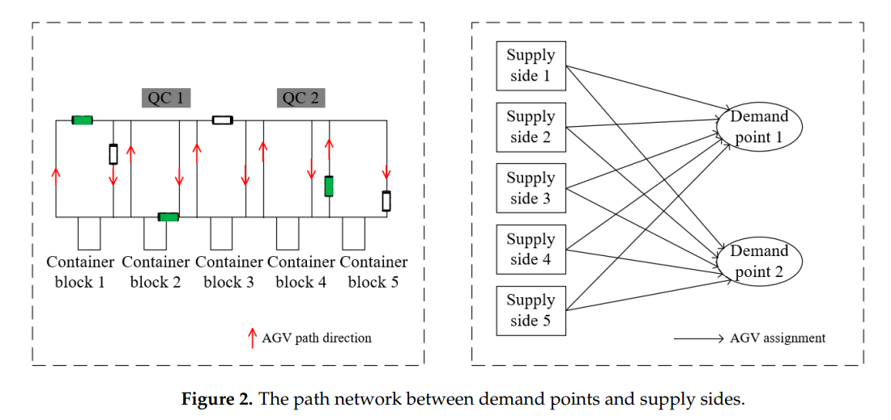

Left panel: five container blocks along the bottom, QC 1 and QC 2 above, one-way AGV path directions in red. Right panel: supply sides 1 to 5 each connected by an arrow ("AGV assignment") to demand points 1 and 2.

**Assumptions (Sec. 3).** (1) Virtual locations are the start points of AGVs; AGVs wait there before assignment and return there when done. (2) The task information of containers is known, and the blocks are already allocated. (3) Each AGV has enough battery to transport containers continuously; the paper mentions replacing the whole lithium battery. (4) Each AGV has its own transport capacity, which also means a travel time limit, so that tasks are shared and not all given to one AGV. Each AGV makes a loaded trip to the QC of its current task and an unloaded trip from that QC to the block of the next task.

### 2.2 Method (Secs. 3 and 4)

**Stage 1 model (Eqs. 1-12, Table 2).** Sets: tasks $N$, blocks $B$, QCs $Q$, AGVs $M$, virtual start locations $O$, and locations $L$ (starts, blocks, QCs). Parameters: transport time $t_{lp}$ between locations, task transport time $t_i$, time window $[ET_i, LT_i]$, AGV capacity $C_k$, large number $G$. Variables: $x_{ik}$ (task $i$ on AGV $k$), $y_{ijk}$ (AGV $k$ goes from task $i$ to task $j$), $z_k$ (AGV $k$ used), start time $st_i$, and the time differences $et_i$ and $lt_i$ from the earliest and latest times.

$$f=\min\sum_{i\in N}(et_i+lt_i)\qquad(1)$$

$$\sum_{k\in M}x_{ik}=1,\ \forall i\in N\qquad(2)$$

$$\sum_{j\in N}y_{ijk}=1,\ \forall i\in N,k\in M\qquad(3)$$

$$\sum_{j\in N}y_{ijk}=x_{ik},\ \forall i\in N,k\in M\qquad(4)$$

$$\sum_{i\in N}y_{q_ib_jk}=x_{jk},\ \forall j\in N,k\in M\qquad(5)$$

$$\sum_{b_i\in L}y_{o_kb_ik}=z_k,\ \forall k\in M\qquad(6)$$

$$\sum_{q_j\in L}y_{q_jo_kk}=z_k,\ \forall k\in M\qquad(7)$$

$$\sum_{i\in N}x_{ik}t_i+\sum_{i\in N}\sum_{j\in N}y_{ijk}t_{q_ib_j}\le C_kz_k,\ \forall k\in M\qquad(8)$$

$$st_i+t_i+t_{q_ib_j}\le st_j+G(3-y_{ijk}-x_{ik}-x_{jk}),\ \forall i,j\in N,k\in M\qquad(9)$$

$$st_j+t_j+t_{q_jb_i}\le st_i+G(2-x_{ik}-x_{jk}+y_{ijk}),\ \forall i,j\in N,k\in M\qquad(10)$$

$$st_i\ge ET_i-et_i,\ \forall i\in N\qquad(11)$$

$$st_i\le lt_i+LT_i,\ \forall i\in N\qquad(12)$$

The text reads these as follows. Eq. (1) minimises the delay time of all tasks. Eqs. (2) and (3) let one task be carried by one AGV. Eq. (4) says that an AGV dispatched to a task goes from the block to the QC of the task; Eq. (5) says it travels from that QC to the block of the next task; Eqs. (6) and (7) say it leaves from and returns to its start location. Eq. (8) keeps each AGV within its capacity. Eqs. (9) and (10) order two tasks on the same AGV, (9) when $i$ comes before $j$ and (10) when $j$ comes before $i$. Eqs. (11) and (12) define the time differences from the earliest and latest times.

**Stage 2 model (Eqs. 13-21, Table 3).** Once tasks are assigned, the AGVs drive between supply sides and demand points. When two AGVs need the same path one waits; the congestion rate is the waiting time over the transport time. Sets: path nodes $D$ and paths $P$ (each formed by two nodes). Parameters: acceleration $a$, deceleration and acceleration times $t_1, t_2$, safe distance $d_s$, path length $w_p$. Variables: $x_{pik}$ (AGV $k$ carrying task $i$ chooses path $p$), $y_{pkk'}$ (AGVs $k$ and $k'$ meet on path $p$), waiting time $t$, transport time $T$.

$$f=\min\frac{t}{T}\qquad(13)$$

$$t=\sum_{p\in P}\sum_{i\in N}\sum_{k,k'\in M}x_{pik}\,y_{pkk'}\,(t_1+t_2)\qquad(14)$$

$$T=\frac{\sum_{p\in P}\sum_{i\in N}\sum_{k\in M}x_{pik}\,w_p}{v}\qquad(15)$$

$$\sum_{p\in P}x_{pik}=1,\ \forall i\in N,k\in M\qquad(16)$$

$$\sum_{p\in P}y_{pkk'}=1,\ \forall k,k'\in M\qquad(17)$$

$$\sum_{k\in K}y_{pkk'}\le 1,\ \forall p\in P,k'\in M\qquad(18)$$

$$\sum_{k'\in K}y_{pkk'}\le 1,\ \forall p\in P,k\in M\qquad(19)$$

$$x_{pik}=\{0,1\},\ p\in P,i\in N,k\in M\qquad(20)$$

$$y_{pkk'}=\{0,1\},\ p\in P,k,k'\in M\qquad(21)$$

The text reads Eq. (16) as each AGV choosing one path for one task at a time, Eq. (17) as two AGVs meeting on the same path, and Eqs. (18) and (19) as at most one AGV meeting another on the same path "due to the one-way traffic rule", with (20) and (21) the variable ranges.

**Agents, state, action, reward (Sec. 4).** The multiagent system has one manager agent, which sends requirements and evaluates bids, and bidder agents, the AGVs. In the road network all AGVs have the same speed and the same transportation preference. The classic CNP is combined with Q-learning to assign path requirements; the Q-learning part evaluates the actions of the bidders.

The AGV state is

$$s_k=\{s_k^n,\;p_k^n,\;t_k^p\}\qquad(22)$$

with $s_k^n$ the task $n$ performed by agent $k$, $p_k^n$ the path chosen, and $t_k^p$ the time in the path. The task state is

$$s_n=\{m,\;p_1,p_2,\dots,p_m,\;C_{pm}\}\qquad(23)$$

with $m$ the number of paths passed, $p_m$ the path chosen, and $C_{pm}$ the remaining capacity of the path. The action is the choice of an edge between two nodes:

$$a_{kn}^p=\{0,1\}\qquad(24)$$

$$p_m=p_j^i,\ \text{nodes } i,j=\{1,2,\dots,86\}\ \text{formulates the path }p_m\qquad(25)$$

where $a_{kn}^p=1$ means that agent $k$ takes the edge formed by nodes $i$ and $j$ for task $n$. Action selection is $\varepsilon$-greedy with $\varepsilon=0.9$ "referring to [43]", stated to mean a random action with probability 0.1 and the best action with probability 0.9. The reward is

$$r_{nk}=\alpha\cdot\sum_m C_{p_m}\cdot a_{kn}^p-\beta\cdot m_n\qquad(26)$$

with $C_{p_m}$ the remaining capacity of the path, $m_n$ the number of paths passed, and $\alpha$, $\beta$ reward coefficients for capacity and number of paths. The paper states that more edges give less reward and more remaining capacity gives more reward, so that the traffic load is spread.

**Algorithm (Sec. 4, Fig. 3, Table 4).** QL-CNP runs in ten steps: (1) initialise the Q-table of state, action, reward and agent; (2) observe the environment; (3) the manager releases tasks; (4) agents submit proposals; (5) choose an action for the agent; (6) compute the reward; (7) update the Q-table; (8) the manager announces the bid result; (9) the manager and bidder contract; (10) repeat until all tasks are assigned. The Q-value update is

$$Q^{new}(s,a)\leftarrow Q(s,a)+\alpha\,\big(R(s,a)+\gamma\max Q(s',a')-Q(s,a)\big)\qquad(27)$$

where $\alpha$ is the learning rate and $\gamma$ the discount factor. Table 4 gives pseudocode: initialise an environment matrix, a reward matrix and the Q-learning parameters; for each episode obtain the state of tasks and agents, select all possible actions, compute their Q-values, take one action as the next state, find the best Q-value, update the Q-table, and break at the end.

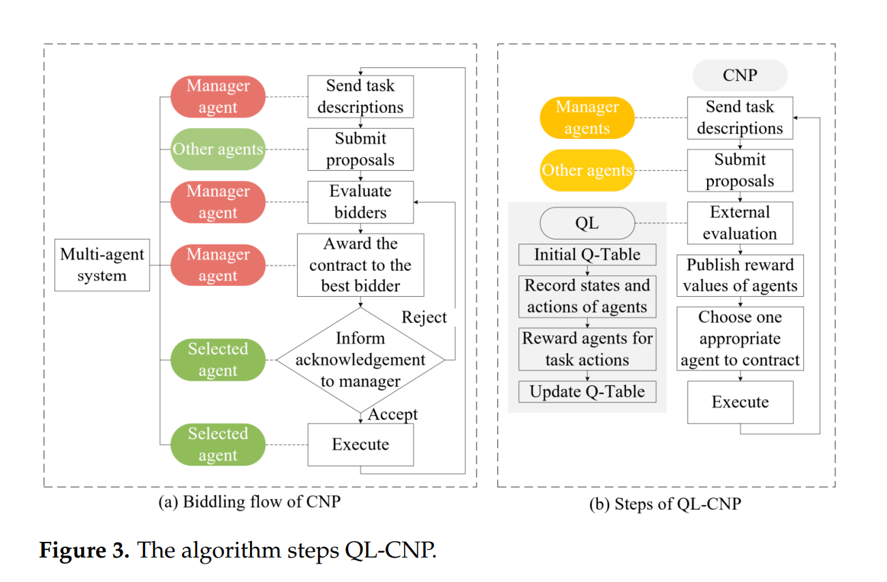

Panel (a) is the bidding flow of the CNP: the manager sends task descriptions, other agents submit proposals, the manager evaluates bidders and awards the contract, the selected agent accepts or rejects, and the accepted task is executed. Panel (b) adds Q-learning as an "external evaluation" step: initial Q-table, record states and actions of agents, reward agents for task actions, update the Q-table, then publish reward values of agents and choose one appropriate agent to contract.

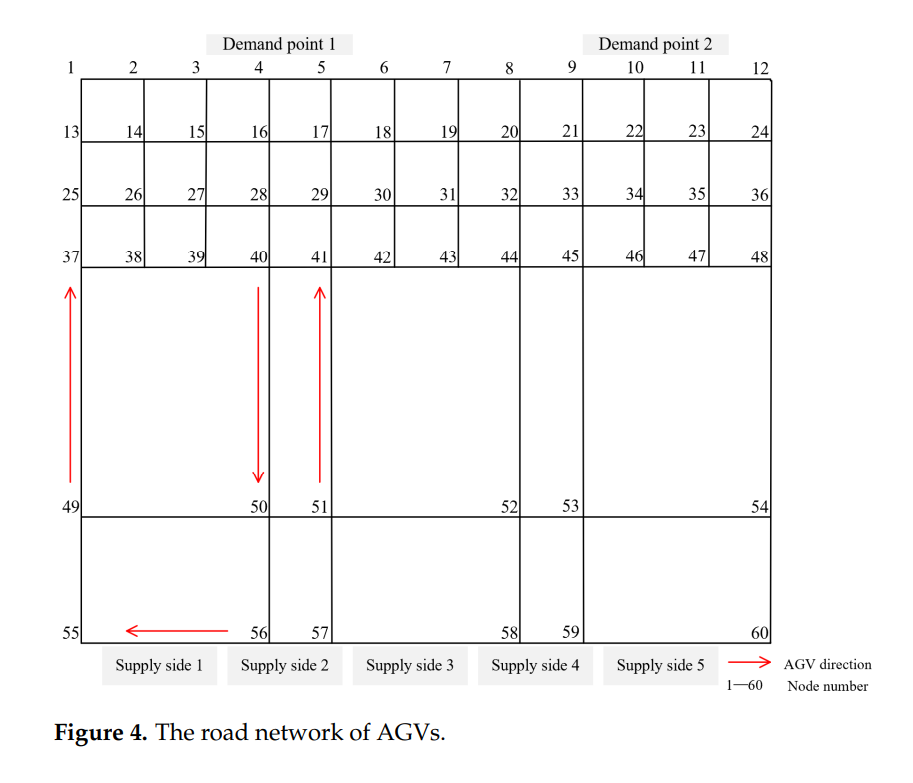

The network is drawn as a grid of nodes numbered 1 to 60, with demand point 1 above nodes 4 and 5, demand point 2 above nodes 9 to 12, and supply sides 1 to 5 along the bottom (nodes 55 to 60), with red arrows marking the AGV direction on some edges.

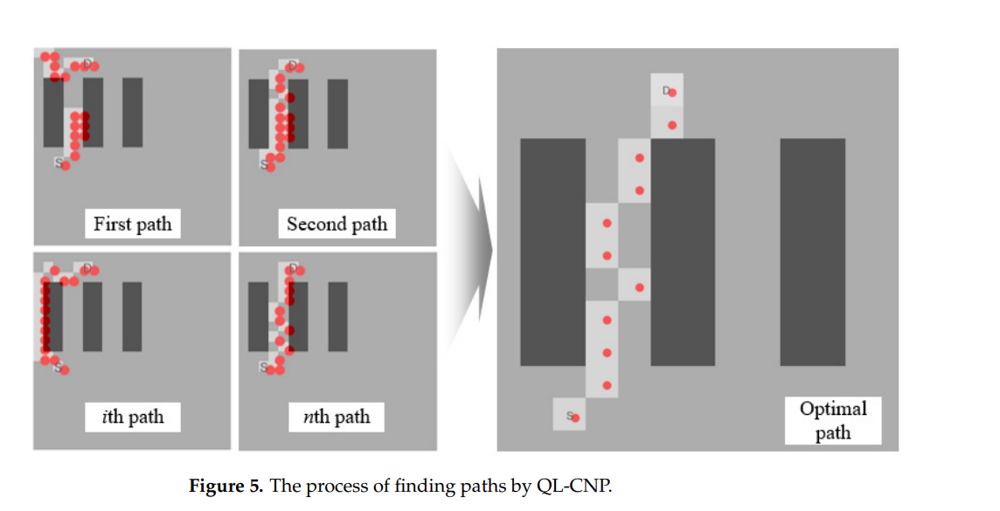

Four small panels (first, second, ith and nth path) show an AGV trying paths from S to D around dark blocks, and a large panel shows the final "optimal path" through the gap between blocks. The figure has no numbers.

### 2.3 Experimental design (Sec. 5)

**Case (Sec. 5.1).** The tasks of loading one vessel are the example. There are five container blocks and two QCs ("the proportion of equipment is set with 1:2.5"). The paper describes the task information as "incomplete but realistic" and gives samples in Appendix A (Table A1). The number of AGVs and tasks vary by experiment.

| Task ID | Container block | QC | Earliest time | Latest time |
|---|---|---|---|---|
| 15151050 | 5 | 2 | 0 | 2100 |
| 15150726 | 4 | 1 | 0 | 720 |
| 15151322 | 3 | 2 | 60 | 3600 |
| 15152214 | 1 | 1 | 60 | 8400 |
| 15155329 | 4 | 2 | 120 | 26520 |
| 15151520 | 2 | 1 | 180 | 4560 |
| 15151632 | 3 | 1 | 240 | 4740 |
| 15153108 | 2 | 1 | 240 | 13020 |
| 15151248 | 1 | 1 | 240 | 3240 |
| 15153185 | 3 | 1 | 300 | 13560 |

*Table A1. Some data samples of tasks (time converted to numeric format; the unit is not stated).*

**Q-learning training (Sec. 5.1).** The Q-learning is trained before use. A 5x5 grid taken from the road network is the environment and the agent finds a path from start to goal; learning rates (0.1, 0.2, 0.5) and discount factors (0.8, 0.9, 0.95) are compared over 1000 episodes (Fig. 6). The paper states that with learning rate 0.1 the convergence is better and stabler than with the other two, which show "obvious fluctuation", and that discount factor 0.8 performs best among the three "mainly because its fluctuation is minimal during the later episodes". It therefore sets the learning rate to 0.1 and the discount factor to 0.8.

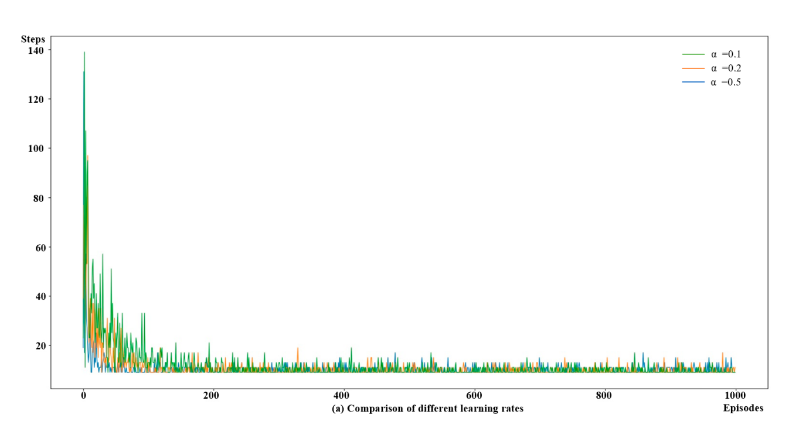

Steps per episode over 1000 episodes for alpha = 0.1, 0.2 and 0.5. The curves start at up to ≈139 steps and fall to ≈10 steps within ≈100 episodes, then show small spikes (≈15 to ≈19).

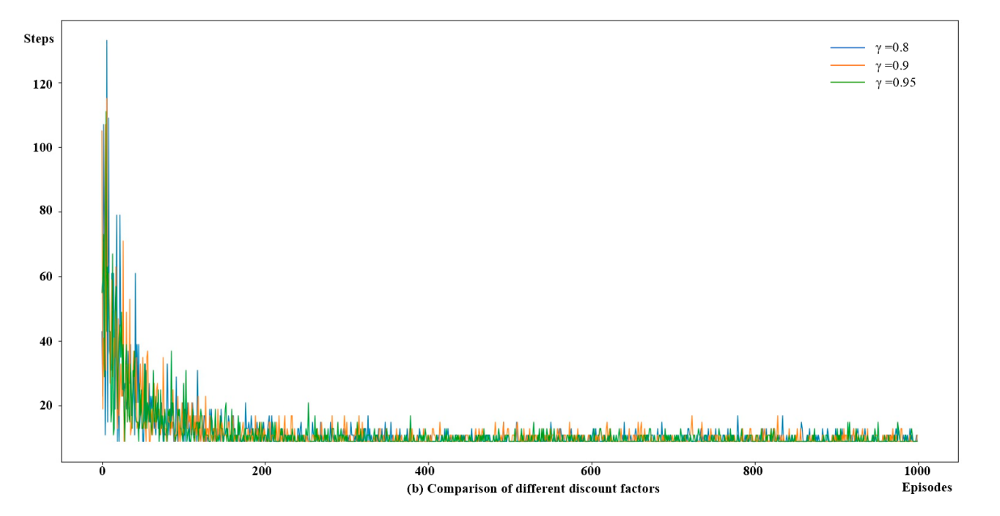

Steps per episode for gamma = 0.8, 0.9 and 0.95; the peak is ≈133 steps (gamma = 0.8) and the curves fall to ≈10 to ≈20 steps by ≈200 episodes.

In the grid the agent has four actions (up, down, left, right) and receives a reward for the action in a state. The Q-table is $m\times n$ for $m$ states and $n$ actions; Table 5 gives some Q-values. The implementation is in Python on an Intel Core i7-11800H at 2.30 GHz.

| State \ Action | 1 | 2 | 3 | 4 |
|---|---|---|---|---|
| 1 | 0.00 | 0.00 | 0.00 | 0.00 |
| 2 | 0.86 | 0.35 | 0.46 | 0.86 |
| 3 | 0.96 | 0.28 | 0.14 | 0.90 |
| 4 | 0.61 | 0.40 | 0.10 | 0.79 |
| 5 | 0.81 | 0.08 | 0.03 | 0.94 |

*Table 5. Part Q-values of the state and action.*

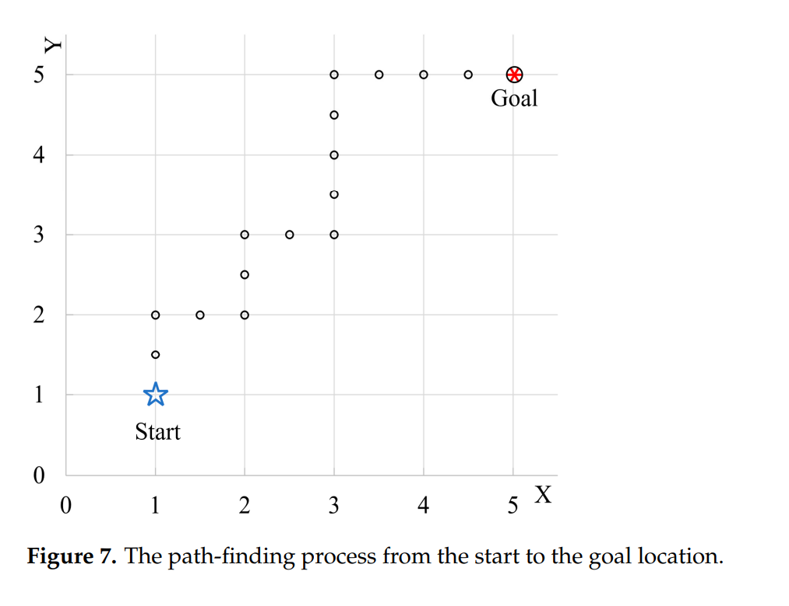

Start at (1, 1) and goal at (5, 5) on a 5x5 grid; the path drawn runs up and right with markers at whole and half steps.

**Comparisons (Sec. 5.2).** CNA and Dijkstra are compared with QL-CNP at three task scales (50, 100, 150) on congestion rate and solution time (Table 8). GA and PSO use crossover probability 0.9, mutation probability 0.1 and 500 maximum generations, "following previous studies", and are averaged over 10 independent runs on a scenario with 60 tasks and five AGVs.

**Small case (Sec. 5).** The abstract and conclusion state that the models were checked with the Gurobi solver on a small experiment. Table 6 and Fig. 8 give "the small-scale case": 3 AGVs and 10 tasks.

### 2.4 Results (Sec. 5)

**Scale sweep (Table 7).**

| Experiment | Tasks | AGVs | Delay time (s) | Congestion rate |
|---|---|---|---|---|
| 1 | 20 | 3 | 1754.83 | 3.14% |
| 2 | 30 | 4 | 3339.53 | 3.06% |
| 3 | 40 | 4 | 4222.47 | 2.74% |
| 4 | 50 | 5 | 4811.17 | 2.50% |
| 5 | 60 | 5 | 5750.67 | 2.44% |
| 6 | 80 | 6 | 8068.1 | 2.24% |
| 7 | 100 | 7 | 8773.6 | 1.93% |
| 8 | 120 | 8 | 10,346.24 | 1.82% |
| 9 | 150 | 9 | 12,860.38 | 1.75% |
| 10 | 200 | 10 | 12,994.32 | 1.63% |

*Table 7. Experimental results of different scale examples.*

The paper states that delay rose and the congestion rate fell with scale, that delay did not grow in proportion to the number of tasks, that "the growth rate of delay time became smaller when adding the number of tasks and AGVs at the same time", and that for the later large experiments "the gap in delay time ... became larger and larger even though more AGVs joined", which it attributes to the equipment configuration being saturated. It attributes the falling congestion rate to reduced waiting time from "reasonable paths", and takes this to show that the traffic load was balanced.

**Small-scale case (Table 6, Fig. 8).** The minimised delay at the first stage is 1981.6 s and the congestion rate 4.86%, "calculated as 29.5 s of waiting time and 606.6 s of transport time".

| AGV | Task sequence | Passed nodes |
|---|---|---|
| AGV 1 | Task 2, Task 4, Task 8 | [59, 58, 57, 56, 55, 49, 37, 25, 13, 14, 2, 3, 4]–[55, 49, 37, 38, 26, 14, 2, 3, 4]–[57, 56, 55, 49, 37, 38, 26, 14, 2, 3, 4] |
| AGV 2 | Task 3, Task 5, Task 6, Task 10 | [57, 56, 53, 45, 33, 21, 22, 10]–[59, 58, 57, 51, 41, 42, 30, 18, 6, 7, 8, 9, 10]–[57, 56, 55, 49, 37, 25, 26, 14, 2, 3, 4]–[59, 58, 57, 56, 55, 49, 37, 38, 39, 27, 15, 3, 4] |
| AGV 3 | Task 1, Task 7, Task 9 | [60, 59, 58, 57, 51, 41, 29, 30, 18, 6, 7, 8, 9, 10]–[57, 56, 55, 49, 37, 25, 13, 1, 2, 3, 4]–[55, 49, 37, 25, 26, 14, 2, 3, 4] |

*Table 6. The solution results of the small-scale case.*

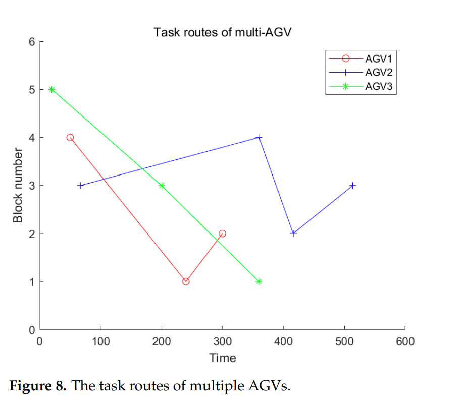

Block number against time for three AGVs, read as ≈ values: AGV1 (≈50, 4), (≈240, 1), (≈300, 2); AGV2 (≈65, 3), (≈360, 4), (≈415, 2), (≈515, 3); AGV3 (≈20, 5), (≈200, 3), (≈360, 1). The numbers of markers (3, 4, 3) equal the numbers of tasks in Table 6.

**CNA, Dijkstra and QL-CNP (Table 8).**

| Task scale | QL-CNP congestion | QL-CNP time | CNA congestion | CNA time | Dijkstra congestion | Dijkstra time |
|---|---|---|---|---|---|---|
| 50 | 2.50% | 444 | 3.99% | 4738 | 4.02% | 3049 |
| 100 | 1.93% | 529 | 3.06% | 7680 | 3.12% | 4738 |
| 150 | 1.75% | 1020 | NA | NA | 2.87% | 4918 |
| Average | 2.06% | 664.33 | 3.525% | 6209 | 3.34% | 4235 |

*Table 8. Experimental results of different scales with three approaches (the time unit is not stated).*

The paper states that CNA "struggled to find target values" at 150 tasks, that CNA has lower congestion than Dijkstra but much longer computation, that Dijkstra sends several AGVs on identical shortest routes and so has higher congestion, and that QL-CNP "balanced both metrics effectively".

**GA and PSO (Figs. 9-11).** The paper states that QL-CNP distributes tasks "more densely", with smaller gaps in the Gantt charts, and finishes its last task at 2395 against 2638 (GA) and 2695 (PSO); it adds that this balanced assignment lets all AGVs share the workload evenly. In Fig. 10 it states that the QL-CNP paths show a single cross node against five (GA) and three (PSO), meaning fewer routing conflicts. Delay times are 5750.67 (QL-CNP), 6728.90 (GA) and 6398.50 (PSO); the congestion rate is lowest for QL-CNP (about 2.44%), followed by PSO, with GA highest at 4.01%.

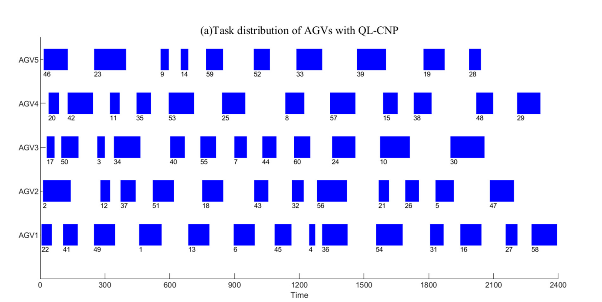

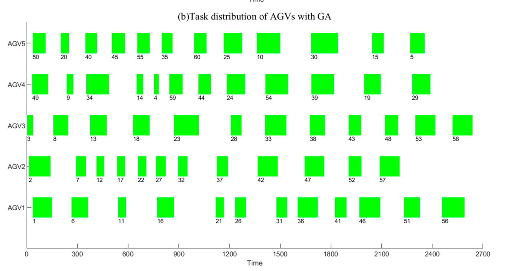

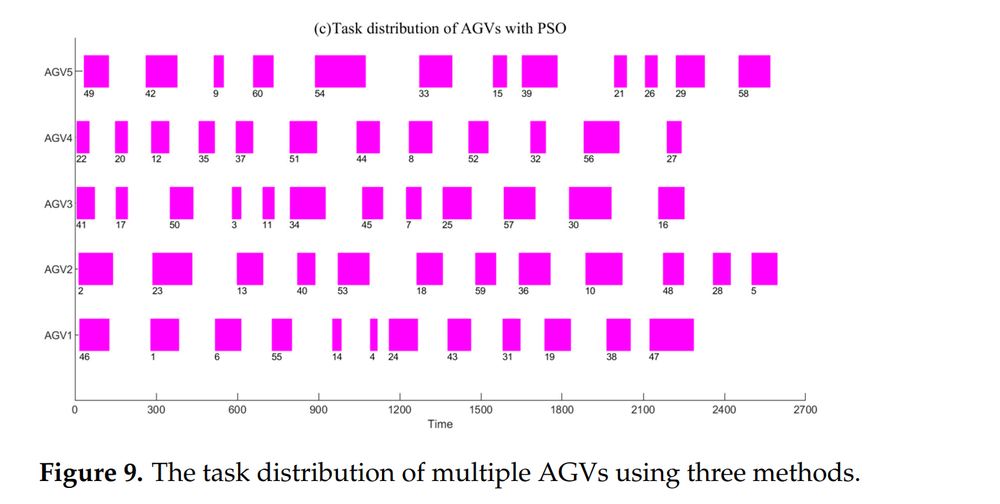

Gantt charts for five AGVs with task numbers 1 to 60 on the bars. Task counts per AGV, our count: QL-CNP 14, 12, 12, 12, 10 (AGV1 to AGV5); GA 12 each; PSO 12 each. Every task 1 to 60 appears once in each panel. In the GA panel AGV1, AGV2 and AGV3 receive tasks 1, 6, 11, ..., 56; 2, 7, ..., 57; and 3, 8, ..., 58. The last bars end at ≈2390 (QL-CNP), ≈2635 (GA) and ≈2600 (PSO); the x-axis runs to 2400 in panel (a) and 2700 in (b) and (c).

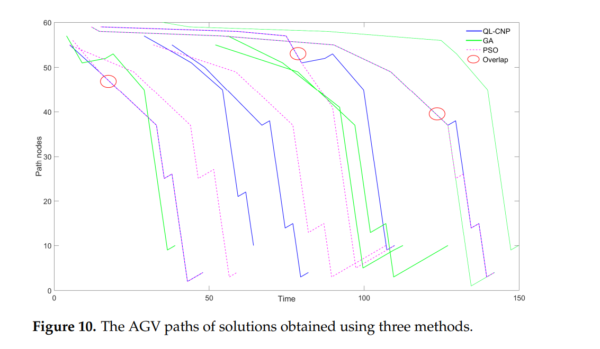

Path nodes (0 to 60) against time (0 to ≈150) for QL-CNP (blue), GA (green) and PSO (dashed magenta), with three red circles marked "Overlap".

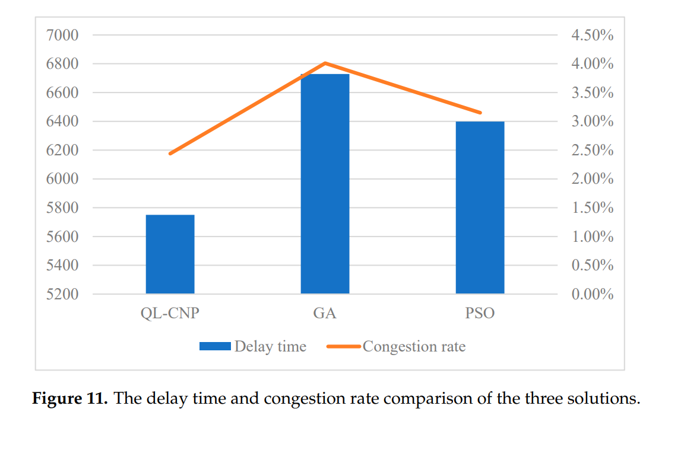

Delay time as bars (left axis starting at 5200) and congestion rate as a line (right axis): delay ≈5750, ≈6730, ≈6400 and congestion rate ≈2.45%, ≈4.0%, ≈3.15% for QL-CNP, GA and PSO.

### 2.5 Conclusions (Sec. 6)

The paper concludes that QL-CNP, combining Q-learning and the CNP, solves task allocation and path planning for multiple AGVs, that the two-stage model was checked with Gurobi on small cases, and that QL-CNP gave lower delay time and congestion rate than GA and PSO. It lists limitations: the traditional epsilon-greedy training could be replaced by a smarter action selection (for example combining Q-learning with PSO); the double-cycle process (loading and unloading together) should be studied; deep reinforcement learning could address integrated dispatching of AGVs and other equipment; path conflicts and AGV battery capacity should be added; and a digital twin could support decisions.

### 2.6 Gaps and inconsistencies in the printed paper

1. **Eqs. (3) and (4).** Eq. (3) sets $\sum_j y_{ijk}=1$ for every task $i$ and AGV $k$, while Eq. (4) sets the same sum equal to $x_{ik}$. If task $i$ is not on AGV $k$ ($x_{ik}=0$) the two equations disagree.
2. **Sums over tasks only.** In Eqs. (4) and (5) the sums run over $j\in N$ and $i\in N$, so as printed the last task of an AGV has no successor in $N$ and the first task has no predecessor in $N$; the start and return legs appear separately in Eqs. (6) and (7). We did not reconstruct how these fit.
3. **Index mixing.** $y_{ijk}$ is defined between tasks (Table 2), but Eqs. (5) to (7) write $y_{q_ib_jk}$, $y_{o_kb_ik}$ and $y_{q_jo_kk}$ between locations, and Eq. (8) uses both forms.
4. **Objective wording.** Eq. (1) sums earliness $et_i$ and lateness $lt_i$; the abstract and text speak of delay time, and the conclusion says the goal was "minimizing the lateness". Non-negativity of $et_i$ and $lt_i$ is not printed.
5. **Eq. (8) and capacity.** $C_k$ is described as transportation capacity and as a travel time limit (assumption 4) without a value.
6. **Stage 2 definitions.** Table 3 does not define the speed $v$ used in Eq. (15), and does not say how $t_1$, $t_2$ follow from $a$ and $d_s$ (which Eq. (14) does not use). Eq. (14) multiplies $x_{pik}$ and $y_{pkk'}$ and sums over $k$ and $k'$, which as printed can count a meeting of two AGVs twice (our reading).
7. **Eqs. (16)-(19).** Eq. (16) sums over paths to 1 for every task and every AGV, although a task is on one AGV, and paths are single edges between two nodes while a route in Table 6 passes up to 14 nodes. Eq. (17) requires every pair $k,k'$ (including $k=k'$) to meet on exactly one path. Eqs. (18) and (19) sum over a set $K$ that is not defined (the AGV set is $M$).
8. **Number of nodes.** Eq. (25) says nodes $1,\dots,86$; Fig. 4 and Table 6 use nodes 1 to 60.
9. **Symbol reuse.** $\alpha$ is the reward coefficient in Eq. (26) and the learning rate in Eq. (27); neither $\alpha$ (reward) nor $\beta$ has a stated value. "Remaining capacity of the path" $C_{p_m}$ is used in Eqs. (23) and (26) without a definition or value.
10. **No delay term in the learning part.** Eqs. (22)-(27) and Table 4 contain no time-window, earliness or lateness term; the reward in Eq. (26) uses remaining path capacity and the number of edges. How the CNP bid score is built from Q-values, and how the stage 1 delay of Table 7 is produced by QL-CNP, is not stated in Sec. 4.
11. **Hyperparameters from another problem.** The learning rate and discount factor are chosen on a 5x5 grid with four actions (Table 5, Fig. 7), whereas the dispatching problem of Eqs. (22)-(26) has edge actions on a 60-node (or 86-node) network. The reward of the grid problem is not given. The number of runs behind each curve in Fig. 6 is not stated; in our reading of Fig. 6a the three curves overlap after ≈200 episodes.
12. **Fig. 7 against Fig. 6.** The path drawn from (1, 1) to (5, 5) has 16 markers at half steps, which is 8 unit moves (our count); the curves of Fig. 6 level at ≈10 steps (graph read).
13. **Table 7 and its text.** The delay increments between successive rows are 1584.70, 882.94, 588.70, 939.50, 2317.43, 705.50, 1572.64, 2514.14 and 133.94 (our arithmetic), so they are not monotone, and the last increment (150 to 200 tasks, 133.94) is the smallest, whereas the text states the gaps among the later large-scale experiments "became larger and larger". The statement that the "growth rate ... became smaller" holds for only some rows.
14. **More AGVs and congestion.** Sec. 1 states that more AGVs raise the possibility of congestion; in Table 7 the congestion rate falls as AGVs rise from 3 to 10 together with tasks. Table 7 changes tasks and AGVs together, so it does not separate the two.
15. **Table 8.** The average for CNA is over two scales (3.525%, 6209) and for the others over three, so the averages are not comparable. The value 4738 appears as the CNA time at 50 tasks and as the Dijkstra time at 100 tasks. The time unit is not stated. The text states that CNA "achieved lower congestion rates than Dijkstra"; the differences are 0.03 and 0.06 percentage points (our arithmetic).
16. **GA and PSO settings.** Population size, swarm size, inertia and acceleration coefficients, encoding, and what problem (stage 1, stage 2, or both) GA and PSO solve are not stated. The number of runs for QL-CNP is not stated, and Fig. 9 shows one schedule per method while the text reports means over 10 runs for GA and PSO.
17. **Fig. 9 and its text.** The text states that QL-CNP "ensures all AGVs share the workload evenly"; by our count of bars QL-CNP gives 14, 12, 12, 12 and 10 tasks and GA and PSO give 12 each (bar widths differ, so the count is not the workload). The PSO last bar ends at ≈2600 in our reading, against 2695 in the text.
18. **Fig. 10 and its text.** The text calls the PSO paths "red", while Fig. 10 draws PSO as dashed magenta and uses red only for three overlap circles; the circles number three, while the text counts one, five and three cross nodes. The time axis (0 to ≈150) is not related to the 0 to 2700 scale of Fig. 9. The figure does not say which case it shows.
19. **Small case.** The 10-task, 3-AGV case in Table 6 has delay 1981.6 s and congestion rate 4.86% (29.5/606.6, our arithmetic), higher than the 20-task, 3-AGV row of Table 7 (1754.83, 3.14%); whether these use the same instance is not stated. In Table 6 the first node of several routes differs from the block numbers of Fig. 8 in a way we could not map (for example, taking the k-th route as the k-th marker, node 57 corresponds to block 2 for AGV1 and block 3 for AGV3), and the relation between block numbers and node numbers is not given.
20. **Table 1 and the text.** Table 1 gives Zhong et al. as [5] for the Dijkstra depth-first conflict-free path method; Sec. 2.1 describes that method under Zhong et al. [15], and Sec. 1 cites [5] for a model preventing conflict and deadlock. Table 1 describes Singh et al. [12] as "metaheuristic-based"; the reference list titles it "A matheuristic for AGV scheduling with battery constraints".
21. **References.** The text cites [42] for the CNP; entry 42 in the list is a review of multi-agent systems in energy optimization, while Smith (1980) is entry 36. Entries 43 to 46 are printed after the end of the bibliography environment. Entries 36 to 41 are not cited in the parts of the text covered here.
22. **Parts not covered in this note.** The opening of Sec. 3 (problem description, up to the reference to Fig. 2), the end of Sec. 2.2 after the sentence on Ahamed et al. [31], and the description of the Gurobi small experiment are not covered; statements here about them rest on the abstract and conclusion. The data are stated to be unavailable "due to privacy or ethical restrictions".

---

## 3. Structured summary

| Field | Value |
|---|---|
| Problem | Multi-AGV dispatching between container blocks and quay cranes: task assignment against time windows, then route choice to lower congestion |
| Decision trigger | Manager agent releases tasks and AGVs bid (Fig. 3); all tasks known in advance |
| Decision | Task-to-AGV assignment, task order per AGV, edges driven between supply side and demand point |
| Objective | Stage 1: sum of earliness and lateness (Eq. 1); stage 2: congestion rate t/T (Eq. 13) |
| Scale | 5 blocks, 2 QCs, 3 to 10 AGVs, 20 to 200 tasks; 60-node network |
| Randomness: quay-crane cycle time | Not described |
| Randomness: travel time / congestion | Congestion follows from routes (waiting at meetings); same speed for all AGVs; no random travel time |
| Randomness: task arrival | All task information known in advance; time windows given |
| Randomness: stowage / workload | Not described |
| Randomness: yard crane | Not described |
| Randomness: AGV breakdown, battery | Breakdown not described; battery assumed sufficient (assumption 3), listed as future work |
| Method | Tabular Q-learning for edge choice plus contract net protocol; stage 1 also written as a mixed-integer model |
| Evaluation | 10-instance scale sweep; CNA and Dijkstra at 3 scales; GA and PSO on one 60-task case, 10 runs |
| Benchmarks | CNA, Dijkstra, GA, PSO; Gurobi on a small case (abstract) |

**Citation sentence supported by the paper:** *Gao et al. (2023) report, for a terminal with 5 container blocks and 2 quay cranes and a case of 60 tasks and 5 AGVs, a delay time of 5750.67 for their Q-learning and contract-net method (QL-CNP) against 6728.90 for GA and 6398.50 for PSO, and a congestion rate of 2.44% against 4.01% for GA.*

---

## 4. What the paper does not support

- **Stochastic or disrupted operation.** Task information, time windows, speeds and battery are fixed inputs; no random travel time, task arrival, breakdown or crane delay is described.
- **Real-time dispatching.** The paper reports solution times in Table 8 (444 to 1020 for QL-CNP) without a unit and without timing a single decision; all tasks are known in advance.
- **Quay-crane idle time.** Neither the delay of Eq. (1) (earliness plus lateness against time windows) nor the congestion rate is a quay-crane waiting measure.
- **Reinforcement learning beating GA or PSO in general.** The comparison is one 60-task, 5-AGV case; population and swarm settings, encoding and the problem solved by GA and PSO are not stated; Fig. 9 shows one schedule per method.
- **A learned dispatcher.** The Q-learning chooses edges; task allocation is by the contract net, and no term of the learning reward measures delay (Eq. 26).
- **Deep or multi-agent reinforcement learning.** The learner is a tabular Q-table; the conclusion lists deep reinforcement learning as future work.
- **Balanced workload.** The statement that QL-CNP shares work evenly is not supported by a workload measure; task counts per AGV are unequal (Fig. 9a).
- **Hyperparameter choice for the dispatching problem.** Learning rate and discount factor are chosen on a 5x5 grid path problem, one curve per setting in Fig. 6.
- **Statistical support.** Runs of QL-CNP, seeds, intervals and tests are not described.
- **Reproducibility.** Task data are not available; $\alpha$ and $\beta$ of the reward, the capacities, $v$, the GA and PSO settings and the CNP bid score are not given.

---

## 5. Our reading (interpretation, not from the paper)

### 5.1 What we can use

- **A concrete tabular Q-learning example.** Eq. (27), epsilon-greedy selection, learning rate 0.1, discount factor 0.8 and 1000 episodes show what a small tabular learner looks like in this literature. Its state is a path-and-capacity description and its action an edge, so it is a path-choice learner and not a fleet dispatcher; a tabular baseline for dispatching would need its own state and action.
- **Scale data points.** 2 QCs with 3 to 10 AGVs is 1.5 to 5 AGVs per QC (our arithmetic), and 20 to 200 tasks, i.e. 6.7 to 20 tasks per AGV (our arithmetic). The delay per task from Table 7 is about 88, 111, 106, 96, 96, 101, 88, 86, 86 and 65 (our arithmetic), which does not fall steadily.
- **Congestion measure.** The congestion rate (waiting time over transport time) is a simple, computable output of a route plan; its values in Tables 7 and 8 are 1.6% to 4.9%.
- **Two-stage idea.** Assigning tasks against time windows and routing afterwards is a decomposition we can compare with a single dispatching decision.
- **Contract net vocabulary.** Manager, bidder, award and execute (Fig. 3a) are terms for decentralised allocation.
- **Leads.** Hu et al. [35] (multi-agent reinforcement learning for AGV anti-conflict paths), Lin et al. [28] (feature-based reinforcement learning for real-time AGV charging) and Roy et al. [7] (traffic flow and AGV speed) are cited here and are worth reading.
- **Cautions.** Eqs. (3), (4), (16) to (19) cannot be implemented as printed without choices of our own (Sec. 2.6), the node count differs between Eq. (25) and Fig. 4, and the reward contains no time term, so the link between the Q-learning and the reported delay needs an assumption of our own.
