# Strategies for dispatching AGVs at automated seaport container terminals

**Grunow, Günther and Lehmann (2006)** · *OR Spectrum, 28, 587-610* · [DOI 10.1007/s00291-006-0054-3](https://doi.org/10.1007/s00291-006-0054-3)

> **How to read this note.** Sections 1-4 summarise what the paper says, by section, equation, table and figure number. Section 5 is *our* interpretation for the thesis and is labelled as such.

---

## Key takeaways

- **What it did:** Builds a scalable event-driven simulation (eM-Plant) of an AGV guide path between quay cranes and storage blocks, and compares an on-line rule combination (nearest vehicle for new orders, first come first served for freed vehicles) with an off-line pattern-based heuristic that plans a look-ahead window of orders, for single-load and dual-load AGVs, at four levels of crane cycle-time variance, against a per-instance lower bound.
- **Numbers to remember (Fig. 10, read from the graph):** pattern heuristic 4.5-14% (small), 2.5-10% (medium), 1.5-7.5% (large) above the lower bound; NV/FCFS 17-33%; large terminal, normal stochasticity, dual-load: below 5%. Dispatching requests per order (large): about 1.6 on-line and 1.4 off-line when deterministic, 2.5 off-line at high stochasticity (Fig. 12). Runtime under 1 s per dispatching request.
- **Used in the thesis for:** an event-driven on-line benchmark and an off-line look-ahead benchmark; a way to vary stochasticity through crane cycle-time variance; the lower-bound gap as an evaluation idea; scenario sizes.
- **Not evidence for:** quay-crane idle time as a measured quantity, travel-time uncertainty, MILP scalability, learning-based dispatching, or statistical significance.

---

## 1. Summary in five points

1. The paper states that AGV dispatching must handle stochastic handling times of quay and stacking cranes and uncertain release times of orders, and studies AGVs that carry one 40-ft or two 20-ft containers (dual-load) as well as single-load AGVs (abstract, Sec. 1).
2. It describes an on-line strategy (decisions triggered when an order is released or an AGV becomes available) and an off-line strategy (a predictive schedule for a look-ahead window of orders, rebuilt when a new order is released or a delay threshold is exceeded) (Secs. 3, 4).
3. The off-line strategy is a pattern-based constructive heuristic: orders are taken one by one, tested against every available AGV and against three sequencing patterns (aann, anan, anna), and the lowest-cost option is kept (Figs. 4-7).
4. In simulations of three terminal sizes at four stochasticity levels, the paper reports that the off-line heuristic stays within 1.5-14% of a lower bound while the on-line rule stays within 17-33% (Fig. 10).
5. The paper reports that dual-load use helps the off-line heuristic in most cases, that the on-line rule is worse in dual-load than in single-load mode, and that each dispatching request takes under 1 s (Secs. 5.3, 6).

---

## 2. What the paper does

### 2.1 Setting and problem (Secs. 1-3)

**Introduction (Sec. 1).** The paper states that automated terminals need more sophisticated control to use advanced equipment, and that dual-load AGVs are still run in single-carrier mode "mainly because adequate dispatching strategies ... are missing". It describes related work: Bae and Kim (2000) and Koo et al. (2004b) on single-load dispatching; Kim and Bae (2004), a look-ahead heuristic for single-load AGVs that is reported to outperform conventional rules; Nishimura et al. (2005), a genetic-algorithm dispatching approach for multi-load yard trailers that it calls barely applicable in real time; and Grunow et al. (2004), a heuristic for dual-load AGVs compared with a MILP benchmark on two idealised configurations. Contributions listed: (i) multi-load capability is taken into account; (ii) the approach of Grunow et al. (2004) is extended to an off-line approach that assigns all orders in the planning horizon, which the paper says is less myopic, needs no availability restrictions during assignment, no longer needs vehicle-initiated dispatching, and reduces information-system complexity; (iii) a comprehensive simulation model reflecting conditions of a real automated terminal, plus a lower bound as an additional measure. Deadlock handling is covered in a companion paper (Lehmann et al. 2006).

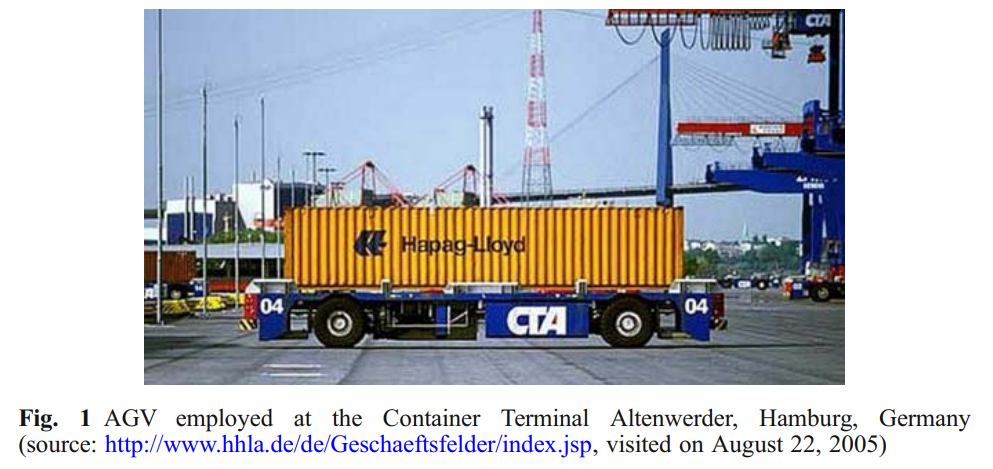

**AGV dispatching (Sec. 2).** A terminal has a berthing area (quay cranes), an AGV area and a storage area (blocks served by stacking cranes). The paper assumes that berth positions, quay cranes, unloading sequences and final storage destinations are known when a vessel arrives, so detailed quay-crane schedules can be derived. It states that "AGV pick-up and drop-off times for each container have to coincide with the schedules of the quay and stacking cranes to avoid idle times of this equipment and to guarantee short berthing of the vessels". Dispatching has three sub-problems (assignment, routing, traffic control); routing and traffic control are said to come with the manufacturer's control software, so only assignment is studied. For single-load carriers the problem reduces to an m:n assignment (cited: Bish et al. 2005) that minimises the cost of missing target times from the quay-crane schedule ("quay crane waiting times directly affect the vessels' turnover time"); for multi-load carriers the pick-up and drop-off operations must also be sequenced. Assumptions: each AGV carries one 40-ft or two 20-ft containers; identical AGVs; no pooling or crane dedication; AGV travel times deterministic and congestion neglected; no special-purpose containers.

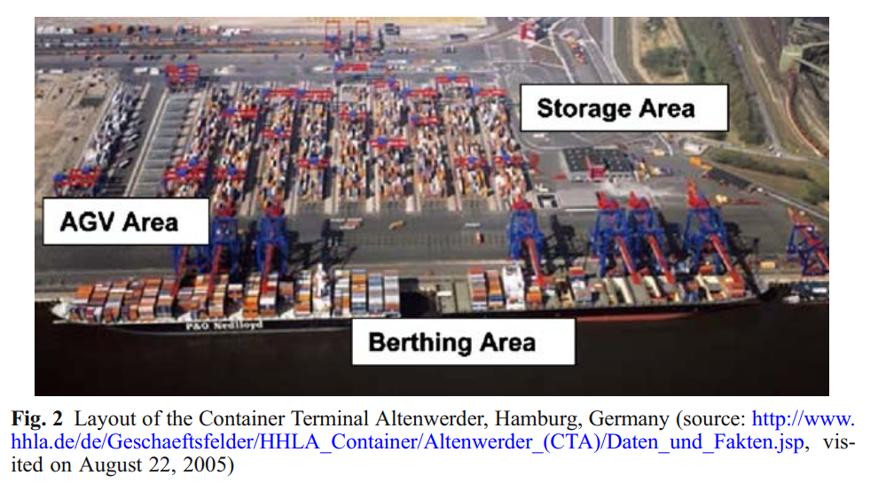

**On-line and off-line mode (Sec. 3).** The paper states that the choice is not obvious for dual-load AGVs: stochasticity seems to favour myopic on-line strategies, while predictive plans promise gains from combining orders into joint tours. It names internal sources of stochasticity (for example quay-crane operators changing the handling sequence) and external ones (weather, unknown container state, congestion). On-line dispatching decides when needed and executes at once; off-line dispatching schedules all orders in a short-term look-ahead and may revise when deviations occur (late AGVs, equipment breakdown, delays in loading or unloading). Rescheduling policies are periodic, event-driven or hybrid; this paper uses an event-based logic.

### 2.2 Method (Sec. 4)

**Dispatching problem (Sec. 4.1).** Assign orders to AGVs and sequence the orders of each AGV; for dual-load AGVs also sequence the individual pick-ups and drop-offs.

**On-line strategies (Sec. 4.2).** Triggering events are the release of a new order (transportation-order-initiated) and an AGV becoming available (vehicle-initiated). An order is released once execution of the previous order has begun (for a discharge order, when the quay crane starts lifting the predecessor container; for a charge order, when the predecessor's pick-up starts at the storage area). Availability is logical, not physical: a single-load AGV is available during its trip to the drop-off; a dual-load AGV is fully available on its trip to its last drop-off and partially available on its trip to the first pick-up of a 20-ft container or the first drop-off; parked AGVs are available. Vehicle-initiated dispatching occurs when a vehicle becomes fully available. Known single-load rules are named: nearest vehicle (NV), least utilised vehicle (LUV), first come first served (FCFS), shortest travel time (STT). After "some initial experiments" the paper chose the combination NV (order-initiated) plus FCFS (vehicle-initiated), based on "numerical experience". For dual-load AGVs it adds: the second container's pick-up always follows that of the container already assigned, and the drop-off order follows the nearest-destination rule. Rules from manufacturing that select extra orders along the route are said not to carry over, because routing in a terminal guide path is complex and routing software is a black box.

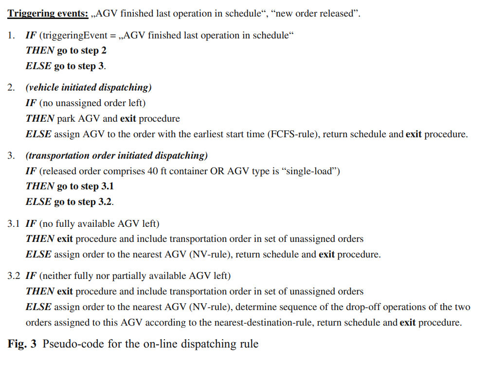

**Off-line strategies (Sec. 4.3).** A schedule is made for the next t orders at each quay crane (t times the number of quay cranes). Two triggering events are named: completion of a quay-crane operation and a delay exceeding a threshold (the later pseudo-code and Sec. 5.2 name a new order release and the delay threshold). Assignments are temporary except the order actually being performed, which is fixed. The pattern-based heuristic (Grunow et al. 2004, extended) solves an m:n assignment by iteratively solving m:1 problems: orders in the planning horizon are taken one by one, evaluated against every fully or partially available AGV, and for a partially available AGV the sequencing patterns of the new order against the one already assigned are tested. Each pattern lists the four operations in sequence, a for an operation of the already assigned order and n for one of the new order (pick-up before drop-off within each order): "aann" (new order after the assigned one), "anna" (new order nested inside the assigned one), "anan" (alternating), consistent with the chains of Fig. 6; "nnaa", "naan", "nana" start with the new pick-up and are excluded to avoid re-routing a vehicle already en route and to avoid delaying an assigned order indefinitely (Fig. 4). The basic version assigns at most two orders per AGV; the extended version allows longer chains, but each order may be interlocked with at most one other order (never with a third unless the first order's drop-off is done) and a 40-ft order cannot be interlocked. Each AGV is labelled "S|pd" (last order is a 20-ft pick-up and drop-off scheduled successively) or "S" (last order interlocked with another, or a 40-ft order). Fig. 5 gives the transitions between labels and Fig. 6 the generation of chains of up to three 20-ft orders (nodes 0-9). The option with the lowest cost, for example quay-crane waiting time, is chosen, labels updated, and the procedure repeats until all orders in the horizon are assigned (Fig. 7). The paper states that the heuristic could also run on-line but shows its potential only off-line. A MILP model (Grunow et al. 2004) is mentioned as the clearest off-line approach; the paper states that for realistic sizes its runtime "often exceeds 1 min", which it calls not acceptable, and that it is therefore not used here.

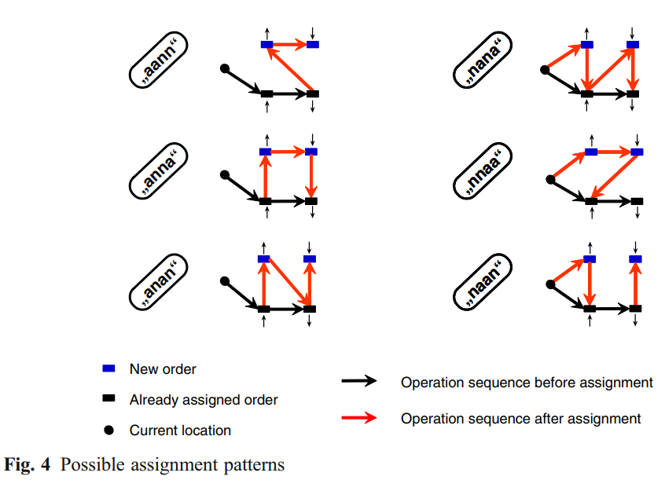

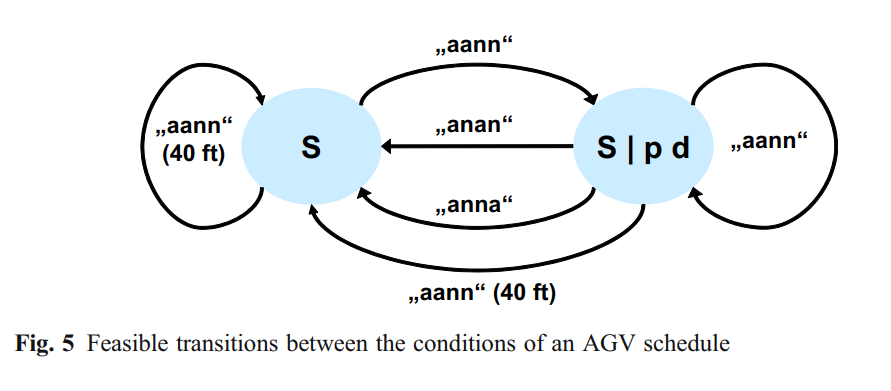

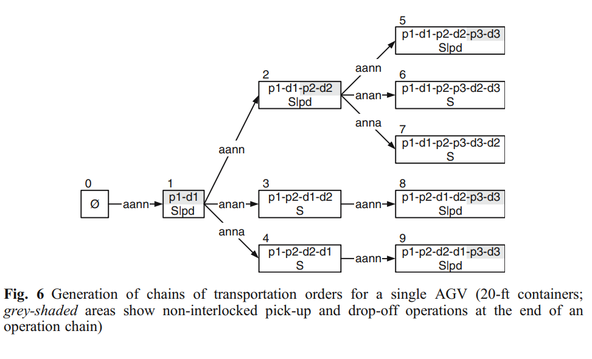

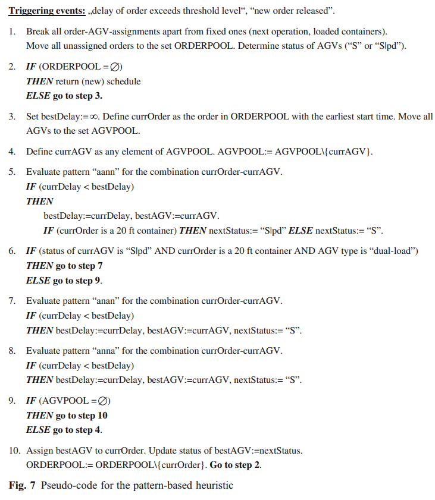

### 2.3 Experimental design (Secs. 5.1-5.2)

**Simulation model (Sec. 5.1).** A discrete-event model in eM-Plant 6.0 built around an AGV guide path, a fleet carrying 20- or 40-ft containers, quay cranes on the berth side and automated stacking cranes at storage blocks on the opposite side. Not included: stowage and berth planning, storage planning inside blocks, the hinterland interface, and traffic control of the AGV system. Terminals of different size are built from a basic module: a four-lane uni-directional loop guide path, a fleet, one quay crane, and two storage blocks with two stacking cranes each; detailed stacking-crane operations are not simulated. Optional modules omit a storage block or the quay crane. AGVs are not dedicated to a module. A configuration needs five parameters: number of quay cranes, number of storage blocks, number of AGVs, AGV travel time between two quay or stacking cranes, and AGV travel time between the storage area and the berth side. Example (Fig. 9): 10 quay cranes, 30 blocks, 20 s between quay cranes, 10 s between storage blocks, 10 s between storage and berth side, on a uni-directional mesh guide path that is bi-directional only between quayside and storage yard. Major assumptions: loading and unloading sequences known; deterministic travel times; quay-crane and stacking-crane cycle times from the empirical distributions of Vis and Harika (2004); one of the two stacking cranes per block serves the AGVs, the other the hinterland; orders generated according to the quay cranes' working cycle, with the storage block of each order randomly selected.

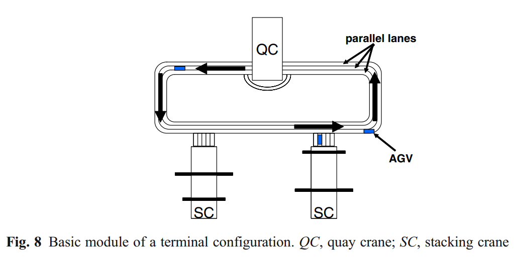

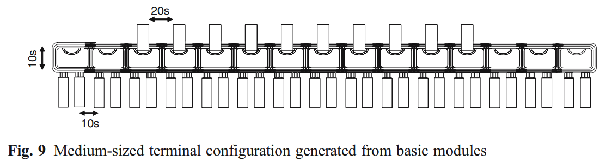

**Scenarios (Sec. 5.2).** A very high workload was simulated: no quay crane runs short of jobs; berth planning is outside the boundaries. Scenario data were generated following Hartmann (2004b). Factors:

| Factor | Levels |
|---|---|
| Terminal size | small, medium, large: 5, 10, 15 quay cranes; 15, 30, 45 storage blocks |
| AGV fleet (determined experimentally) | 32, 72, 120 |
| Stochasticity of crane cycle times | deterministic (means of the Vis/Harika distributions); low (variance halved); normal (original distributions); high (variance doubled; "for instance" adverse weather) |
| AGV mode | single-load carrier (SLC); dual-load, multi-load carrier (MLC) |
| Share of 40-ft containers | 50% |

Each scenario was repeated ten times with different randomly generated input data; 1,000, 2,000 and 3,000 orders for the small, medium and large configuration, "based on the minimal cycle time for the quay cranes". Strategies per data set, in SLC and MLC mode: on-line NV/FCFS, which uses only the next order of each quay crane or storage block, and the off-line extended pattern heuristic ("Pattern") with a look-ahead of four orders per quay crane. Reassignment of everything scheduled at the last request is allowed, except the operation the vehicle is en route to and drop-offs of containers already picked up. The off-line heuristic is also triggered by a significant deviation between schedule and system state, measured as the delay of a pick-up or drop-off, with a threshold of 60 s.

### 2.4 Results (Sec. 5.3)

**Measure and lower bound.** Because minimising vessel turnover time is called the most important criterion, strategies are compared on the overall processing time needed to complete all orders, against a lower bound computed per instance from the quay-crane sequences, the derived stacking-crane sequences and the realised handling times. The bound is an uncapacitated project-scheduling problem (precedence constraints from crane sequences and from pick-up before drop-off), modelled in ILOG OPL Studio and solved with CPLEX 8.1. Sets and parameters as printed: I+ pick-up operations, I- drop-off operations, I = I+ ∪ I-; Π̃ the ordered pairs (i1, i2) with i1 the direct predecessor of i2 in the actual schedule of a crane (as realised in the simulation); S locations on the guide path; t̃_i^h actual duration of operation i; s_i the location of operation i; d(s_i, s_k) travel time between locations. Variables: t_i^start, t_i^end earliest start and finish of operation i; F makespan.

$$\min F$$
$$F \ge t_i^{end} \quad \forall i \in I$$
$$t_i^{start} + \tilde t_i^{h} = t_i^{end} \quad \forall i \in I$$
$$t_{i1}^{end} \le t_{i2}^{start} \quad \forall (i1,i2) \in \tilde\Pi$$
$$t_{+}^{end} + d(i^+, i^-) \le t_{-}^{start} \quad \forall (i^+ i^-) \quad \text{(as printed; see 2.6)}$$
$$t_i^{start}, t_i^{end} \ge 0 \quad \forall i \in I, \qquad F \ge 0$$

The paper says the first two constraints define makespan and the operation times, the next two enforce the crane-schedule precedence and the pick-up before drop-off relation, and the minimum makespan is the lower bound. The bounds take values of 6 h and more, against an average quay-crane operation time of 3 h ("average cycle time of 1:05 · 200 transportation orders per quay crane"). The paper states that the gap can only be closed by better storage-block selection and stacking-crane sequencing, which are outside its scope, and that the AGV system is regarded as a service system operated on fixed target data supplied by the quay and stacking cranes. Deadlocks seen in preliminary tests led to deadlock handling strategies (companion paper) being included in the simulation.

**Research questions.** Effect of stochasticity; effect of terminal size on relative performance; on-line against off-line; value of the multi-load capability.

**Fig. 10 (values read from the graph, ≈, about ±1 percentage point; relative deviation from the lower bound).**

| Terminal | Strategy | det | low | normal | high |
|---|---|---|---|---|---|
| Small | NV/FCFS_MLC | ≈19% | ≈25% | ≈23% | ≈31% |
| Small | NV/FCFS_SLC | ≈17.5% | ≈20.5% | ≈20.5% | ≈26.5% |
| Small | Pattern_MLC | ≈4.5% | ≈8.5% | ≈8% | ≈10.5% |
| Small | Pattern_SLC | ≈8.5% | ≈9.5% | ≈10% | ≈14% |
| Medium | NV/FCFS_MLC | ≈21% | ≈24% | ≈24% | ≈28.5% |
| Medium | NV/FCFS_SLC | ≈20% | ≈22% | ≈24% | ≈26.5% |
| Medium | Pattern_MLC | ≈2.5% | ≈4% | ≈5% | ≈7% |
| Medium | Pattern_SLC | ≈3.5% | ≈6% | ≈7% | ≈9.5% |
| Large | NV/FCFS_MLC | ≈24% | ≈26% | ≈26% | ≈32.5% |
| Large | NV/FCFS_SLC | ≈22% | ≈22.5% | ≈24.5% | ≈29% |
| Large | Pattern_MLC | ≈2.5% | ≈3% | ≈4% | ≈5.5% |
| Large | Pattern_SLC | ≈1% | ≈3.5% | ≈6% | ≈7% |

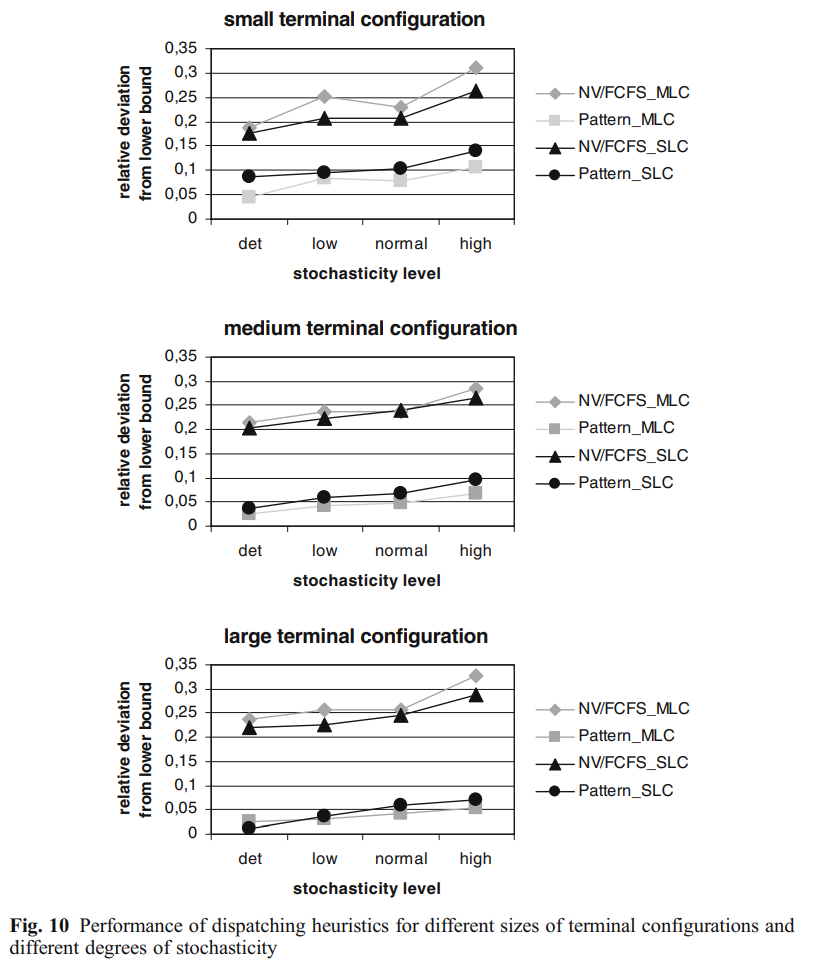

**What the paper reports.** The extended pattern heuristic "clearly outperforms" NV/FCFS in all cases: 4.5-14% above the lower bound (small), 2.5-10% (medium), 1.5-7.5% (large); on-line 17-33%. It states that the better results for larger configurations are mainly due to a higher scheduling frequency (on average a new order triggers a dispatching request every 4.3 s in the large configuration against 13 s in the small). For the large configuration at normal stochasticity, which it calls the most realistic, the deviation is under 5% (the abstract adds: when the dual-load capability is used; in Fig. 10 the single-load pattern value is ≈6%). Higher stochasticity impairs all approaches; the paper says the decline for the pattern heuristic is "far less than expected", that no convergence of off-line and on-line is seen, and that the off-line character "is apparently not very distinctive", probably owing to the high scheduling frequency and the extra delay-triggered requests. The multi-load version of the pattern heuristic does better than its single-load version, but the advantage shrinks for larger terminals and in one case turns negative; the paper attributes this to random storage-block assignment, which lengthens distances between blocks and makes combining orders less attractive. A less simplistic block assignment is said to help. The on-line rule in multi-load mode is worse than in single-load mode, which the paper explains by a limited choice of partly loaded AGVs, forced assignments to them and no later revision of those decisions.

**Fig. 11 (≈), share of 20-ft containers moved as dual loads.** NV/FCFS_MLC: small ≈24%, medium ≈29%, large ≈32%. Pattern_MLC: small ≈37.5%, medium ≈27.5%, large ≈23.5%. The paper states the on-line share rises with terminal size while the pattern heuristic's share falls.

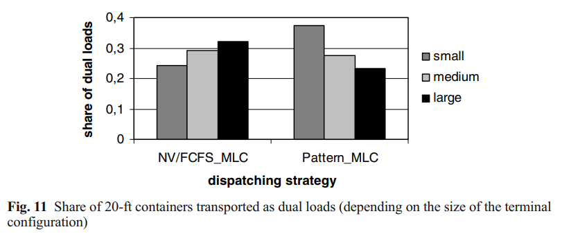

**Fig. 12 (≈), dispatching requests per order, large scenario.** Deterministic, low, "medium", high: NV/FCFS_MLC ≈1.65, 1.70, 1.72, 1.69; NV/FCFS_SLC ≈1.67, 1.72, 1.76, 1.73; Pattern_MLC ≈1.45, 1.88, 2.15, 2.52; Pattern_SLC ≈1.50, 1.92, 2.16, 2.52. The paper explains one order-initiated request per order, plus about 0.6 vehicle-initiated requests (on-line) or about 0.4 delay-triggered requests (pattern) in the deterministic case, and 2.5 requests per order for the pattern heuristic at high stochasticity.

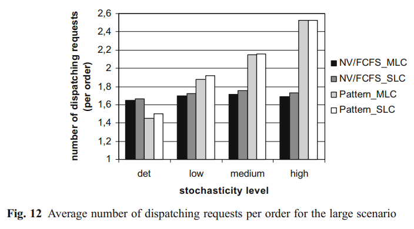

**Fig. 13 (≈), requests per order for the pattern heuristic by terminal size (det, low, "medium", high).** Small ≈1.68, 2.10, 2.33, 2.80; medium ≈1.47, 1.92, 2.20, 2.57; large ≈1.45, 1.88, 2.15, 2.52. The paper states the number of requests per order decreases with scenario size, since order-initiated requests are more frequent in larger terminals and fewer delay-triggered requests are needed.

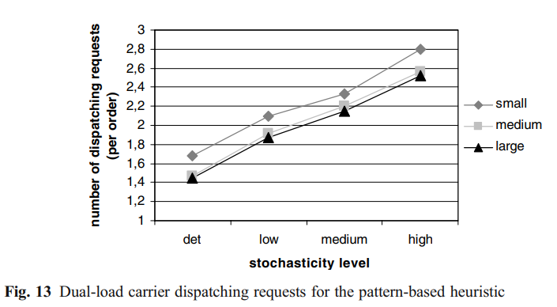

**Runtime.** Average runtime per dispatching request was under 1 s even for the large configuration, in the interpreter mode of eM-Plant, which the paper says meets real-time requirements.

### 2.5 Conclusions (Sec. 6)

The paper states that its main contribution is rule-based strategies for AGV dispatching and their evaluation in a scalable event-driven simulation of practical size. It reports that all approaches were rather insensitive to terminal size, that runtimes under 1 s meet real-time needs, and that the off-line heuristic clearly outperformed the on-line rule, with a deviation under 5% from the lower bound for the large configuration at a stochasticity level that "corresponds to results observed in empirical studies"; dual-load capability is called a key role in this result and is "employed for more than 30% of all 20-ft containers". Future work: improvement heuristics such as neighbourhood search on the pattern heuristic's solution, and integrating storage-block assignment and stacking-crane sequencing.

### 2.6 Gaps and inconsistencies in the printed paper

- **Lower-bound constraint 4 (Sec. 5.3).** Printed as t₊^end + d(i⁺, i⁻) ≤ t₋^start for all (i⁺ i⁻): the time variables carry only the subscripts "+" and "-", d is applied to operations although it is defined between locations d(s_i, s_k), and the quantifier has no comma. The printed form is reproduced above.
- **Lane count (Sec. 5.1, Fig. 8).** The text says a four-lane uni-directional loop; Fig. 8 labels "parallel lanes" and shows three when counted from the figure.
- **Trigger lists.** Sec. 4.3 names completion of a quay-crane operation and exceeding a delay threshold as the off-line triggers; Fig. 7 and Sec. 5.2 name a new order released and the delay threshold. Sec. 4.3 also states that a completed quay-crane operation requires a new order to be included in the schedule, which may connect the two.
- **Boundaries and deadlocks.** Sec. 5.1 lists traffic control of the AGV system as outside the model and Sec. 2 neglects congestion, but Sec. 5.3 states deadlock handling strategies were included in the simulation (details in the companion paper).
- **Single or dual load at the terminal.** Sec. 2 first says transport from berth to yard is realised by dual-load AGVs, then that the terminal considered operates AGVs in single-load mode and shall use dual-load in the future.
- **Quay-crane time (Sec. 5.3).** "1:05 · 200" orders is given as 3 h; reading 1:05 as 65 s, 65 × 200 = 13,000 s ≈ 3.6 h (our arithmetic). The paper does not state the unit of 1:05. The reported request intervals match 65 s divided by the number of quay cranes: 65/15 ≈ 4.3 s and 65/5 = 13 s (our arithmetic).
- **Dual-load share.** The conclusion says dual loads are used for more than 30% of 20-ft containers in the sentence on the large-terminal result; Fig. 11 shows ≈23.5% for Pattern_MLC in the large configuration (≈37.5% in the small).
- **Labels.** Figs. 12 and 13 label the third stochasticity level "medium"; Fig. 10 and the text call it "normal"; "medium" is also a terminal size. Fig. 13's caption names dual-load carrier requests, and its large series matches the Pattern_MLC series of Fig. 12 (our comparison).
- **Heuristic cost.** Fig. 7 compares "currDelay" values, which the paper does not define further; Sec. 4.3 gives "for example waiting time of the quay crane".
- **Fig. 10 trend.** The text says increasing stochasticity impairs all approaches; in the small configuration some curves are not monotone (for example NV/FCFS_MLC ≈25% at low and ≈23% at normal; Pattern_MLC ≈8.5% and ≈8%, as read from the graph).
- **Range readings.** The text gives 1.5% as the lowest pattern deviation in the large configuration; the graph reads ≈1% (Pattern_SLC, deterministic). This is within reading precision.

---

## 3. Structured summary

| Field | Value |
|---|---|
| Problem | Assign orders to single- or dual-load AGVs and sequence pick-ups and drop-offs between quay cranes and storage blocks |
| Decision trigger | On-line: order release (nearest vehicle) and AGV fully available (first come first served). Off-line: order release or a delay above 60 s |
| Decision | Order-to-AGV assignment and, for dual-load, the pattern (aann, anan, anna) |
| Objective | Overall processing time to complete all orders (gap to a lower bound); heuristic picks the lowest-delay option |
| Scale | 5/10/15 quay cranes, 15/30/45 blocks, 32/72/120 AGVs, 1,000/2,000/3,000 orders, 10 replications |
| Randomness: quay-crane cycle time | Empirical distributions (Vis and Harika 2004); four variance levels |
| Randomness: travel time / congestion | Deterministic travel times; congestion neglected |
| Randomness: task arrival | Orders released by the quay-crane working cycle |
| Randomness: stowage / workload | Storage block of each order randomly selected; crane sequences known; cranes always have work |
| Randomness: yard crane | Stacking-crane cycle times from the same distributions |
| Randomness: AGV breakdown, battery | Not described in the paper |
| Method | On-line NV/FCFS rule; off-line pattern-based constructive heuristic; eM-Plant simulation; CPLEX lower bound |
| Evaluation | 10 replications per scenario; relative deviation from the lower bound; no intervals shown |
| Benchmarks | NV/FCFS; lower bound; MILP described but not run |

**Citation sentence supported by the paper:** *Grunow, Günther and Lehmann (2006) report, in an eM-Plant simulation of small, medium and large terminals with randomly varied crane cycle times, that an off-line pattern-based heuristic stays 1.5-14% above a lower bound on the overall processing time, against 17-33% for an on-line nearest-vehicle/first-come-first-served rule (Fig. 10).*

---

## 4. What the paper does not support

- No quay-crane idle or waiting time is reported; the measure is overall processing time (makespan) against a lower bound, and quay cranes are kept saturated (Sec. 5.2).
- AGV travel times are deterministic and congestion is neglected, so travel-time uncertainty is not studied (Sec. 2).
- The MILP model is not run in this paper; its limits are stated from runtimes ("often exceed 1 min"), not shown here.
- No learning or reinforcement learning is used.
- The delay measure inside the heuristic ("currDelay"), the way the lower-bound deviation is aggregated over replications, intervals or tests, the seeds, and breakdown or battery models are not described in the paper.
- The explanations for the size effect (scheduling frequency) and for the shrinking dual-load advantage (random block assignment) are the authors' interpretations; no experiment that isolates them is reported.
- The lower bound is far above the quay-crane working time (6 h and more against about 3 h, Sec. 5.3), so a gap below 5% is a gap to that bound, not to the quay-crane time.
- The paper does not state a 5% target for dispatching heuristics.
- The fleet sizes (32, 72, 120) are said to be determined experimentally; the procedure is not described.

---

## 5. Our reading (interpretation, not from the paper)

### 5.1 What we can use

- **Two benchmark dispatchers.** NV/FCFS is an event-driven rule with both triggers, and the pattern heuristic is an off-line look-ahead method with an explicit trigger (new order or delay above a threshold). Both come with full pseudo-code (Figs. 3, 7).
- **A way to vary stochasticity.** Scaling the variance of crane cycle-time distributions by 0.5, 1 and 2 with the mean kept gives four levels from one empirical distribution; the paper uses it on quay-crane and stacking-crane cycle times, not on travel times.
- **An evaluation device.** The lower bound uses the realised handling times of each instance, so the gap measures only the dispatching loss. Reading the printed model, every variable is continuous and the AGV count does not appear in it, so it looks like a linear program that ignores fleet size (our reading).
- **Scenario sizes.** Five, ten and fifteen quay cranes with 32, 72 and 120 AGVs and 1,000-3,000 orders give a range of terminal scales to compare with our own instance sizes.

### 5.2 Cautions

- The paper's objective is makespan against a lower bound, with saturated quay cranes; it should not be quoted as evidence on quay-crane idle time.
- Travel times are fixed, so the "stochastic" label applies to handling times only.
- Check the labels in Figs. 12 and 13 ("medium" is the third stochasticity level) before quoting numbers.
