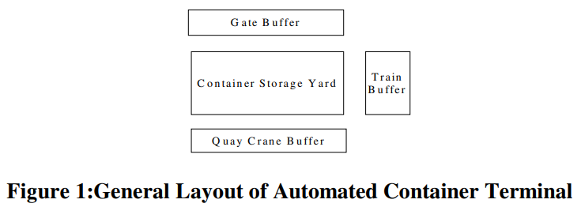
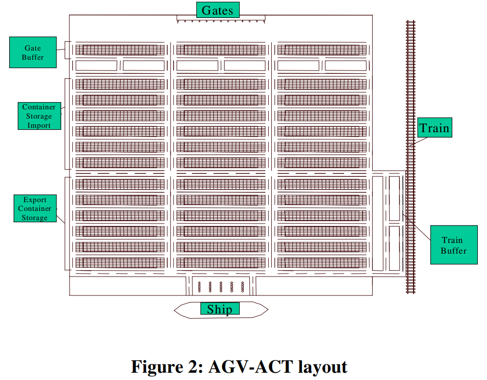
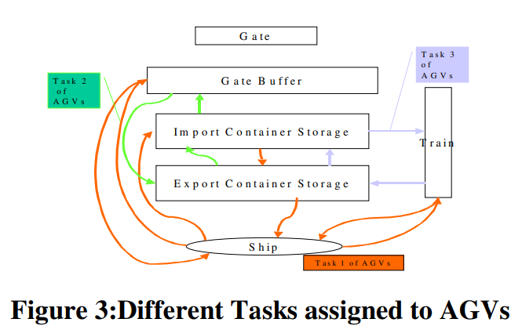
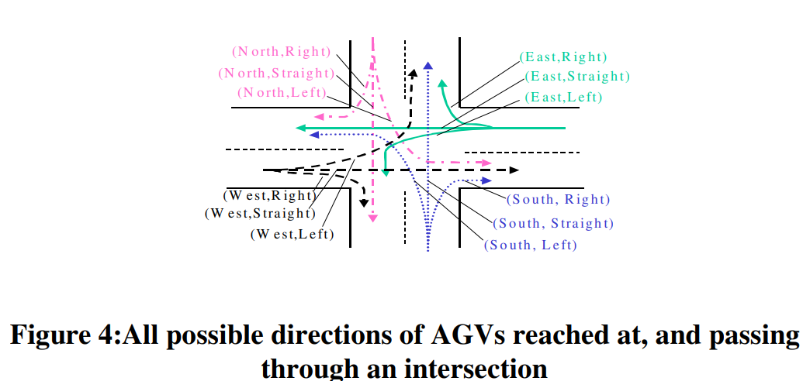
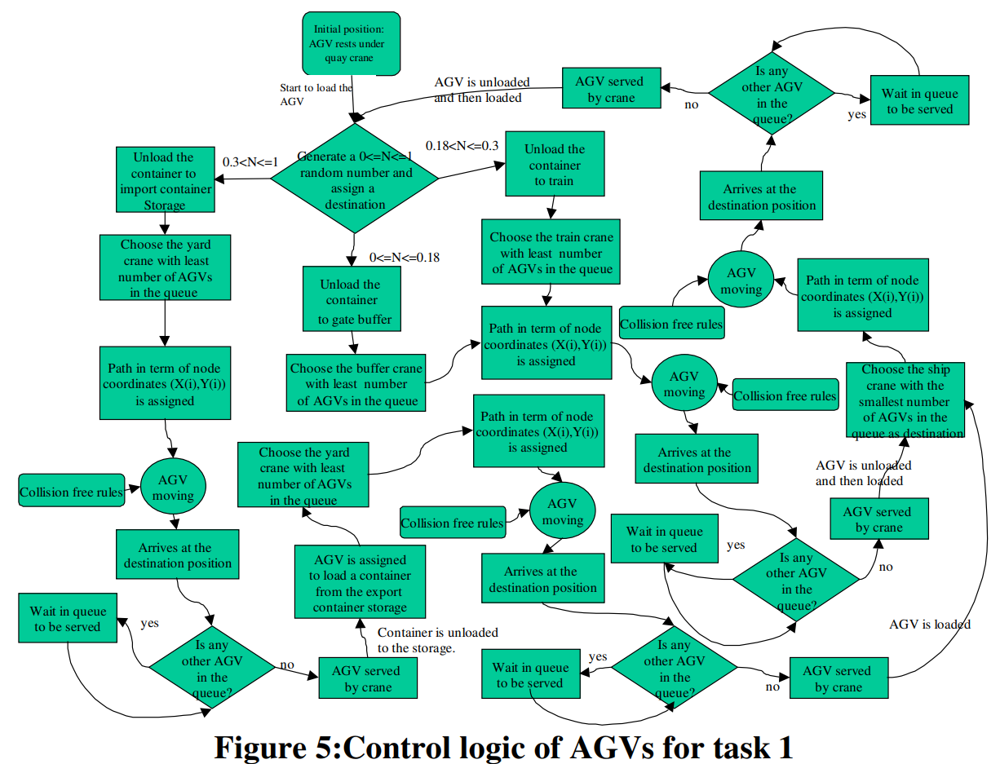
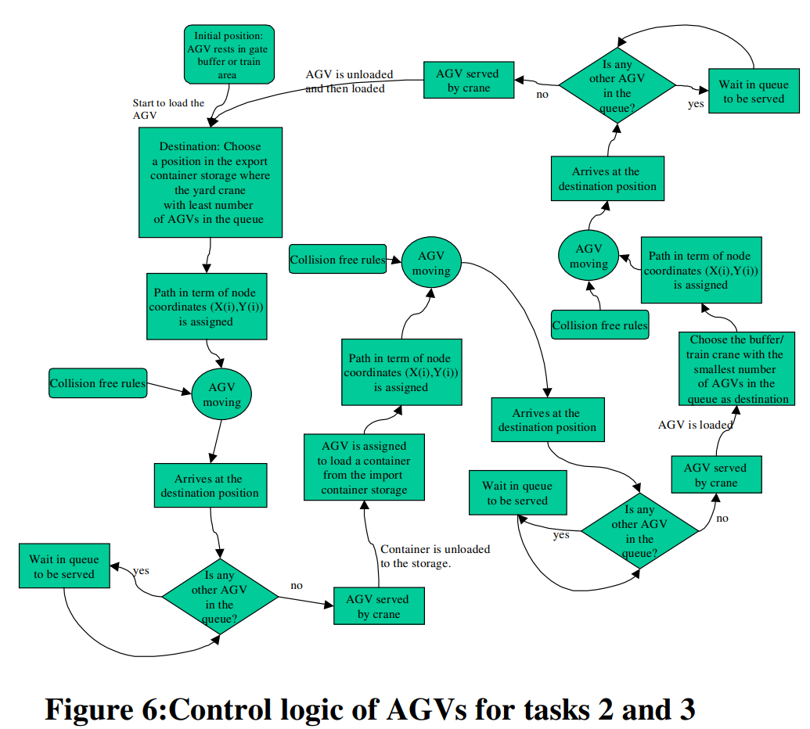
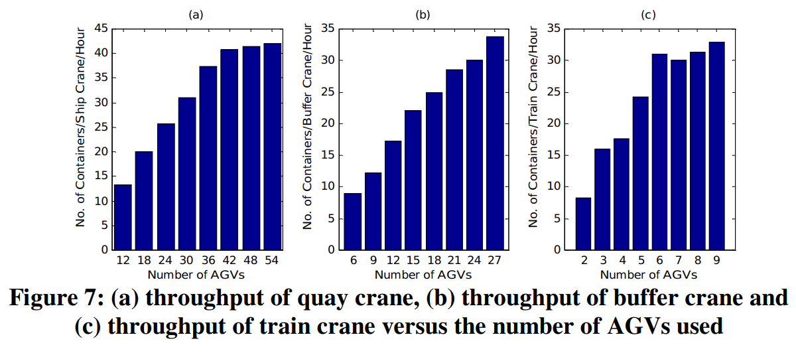

# Design and Simulation of Automated Container Terminal Using AGVs

**Liu, Jula & Ioannou (2001)** · *Proceedings of the European Control Conference (ECC) 2001*, Porto, Portugal, 4-7 September 2001 · ISBN 978-3-9524173-6-2

> **How to read this note.** Sections 1-4 summarise what the paper says, by section, equation, table and figure number. Section 5 is *our* interpretation for the thesis and is labelled as such.

---

## Key takeaways

- **What it did:** designs an AGV-based automated container terminal for a projected demand (one 8,000 TEU ship per day, truck and rail traffic), sizes its equipment analytically, and reports a microscopic simulation of one 24-hour day. AGV behaviour is given as fixed control flowcharts: each AGV chooses the crane with the fewest AGVs in its queue, with a random draw deciding where a quay-side container goes.
- **Numbers to remember:** storage 22,464 TEU (36 stacks x 288 containers x 2 TEU plus 1,728 TEU gate buffer); 5 quay cranes, 1 berth; 36 yard cranes; fleet of 80 AGVs, chosen as (48, 26, 6) for Tasks 1, 2 and 3. Table 4.1 (one 24-hour run): ship turnaround 16.81 h (best possible 16.2 h), idle rate 36.3% for AGVs, 31.7% for ship cranes, 70.2% for yard cranes, gate utilisation 66.03%, container dwell time 19.1 h.
- **Used in the thesis for:** context on an early AGV-terminal design study, and the paper's definition of idle rate (percent of time idle over 24 h) as a contrast with QC waiting for an AGV.
- **Not evidence for:** any dispatching method, QC waiting for an AGV, behaviour under stochastic disruptions, or superiority over another terminal (no comparison is reported).

---

## 1. Summary in five points

1. The paper proposes and sizes an AGV-based automated container terminal (AGV-ACT) for a projected demand taken from port projections, using five design considerations (Sec. 2.1).
2. Equipment is sized analytically: storage, quay cranes, gate lanes (a queueing argument) and buffer cranes (Sec. 2.2-2.5); the AGV-ACT adds a 36-stack yard with one crane per stack (Sec. 4).
3. AGV movement is defined by three task groups and fixed flowcharts (Figs. 3, 5, 6) with intersection, speed and spacing rules (Sec. 4.1).
4. The AGV fleet is sized by simulation at AGV numbers in a 6:3:1 ratio under an always-loaded assumption, giving (48, 26, 6) = 80 AGVs (Sec. 4.2, Fig. 7).
5. One 24-hour simulation gives a ship turnaround of 16.81 h and the idle rates of Table 4.1; the conclusion states that the concept can meet future demand with much less land and higher efficiency, without a comparison being reported (Sec. 4.3, 5).

---

## 2. What the paper does

### 2.1 Setting and problem (Sec. 1-2)

The Introduction motivates automated terminals by container-trade growth, larger ships and scarce yard land, and says the authors' earlier work studied AGVs and linear-motor shuttles. The terminal layout is a quay-crane buffer, a storage yard, a gate buffer and a train buffer (Fig. 1).

**Design considerations (Sec. 2.1).**

1. The terminal serves ships of 8,000 TEU, arriving every 24 hours 85% loaded, served in under 24 h with a desired turnaround of about 16 h.
2. About 60% of containers arrive by truck and 40% by rail.
3. Export containers arrive 20% in the second day before the ship, 50% in the day before and 30% the same day.
4. Import containers are retrieved 50%, 30% and 20% over three days; of the 50% taken the same day, 30% leave directly and 20% are stored temporarily.
5. Trucks and trains operate in 24-hour cycles.

**Sizing (Sec. 2.2-2.5).**

- *Storage.* About 6,120 TEU of exports and 9,520 TEU of imports are stored per day, 15,640 TEU in total; the desired capacity is "about 45% higher", about 22,000 TEU.
- *Quay cranes.* Maximum 50 moves/h in single mode and an average of 42 moves/h in double mode, with "a 15% variance to the maximum capacity" considered. The number of cranes follows from

$$ST = \frac{3{,}400}{42} \cdot \frac{1}{NC}$$

where $ST$ is the ship turnaround time and $NC$ the number of quay cranes (3,400 40-foot containers); for 16 h this gives 5 cranes in one berth.
- *Gate lanes.* Trucks arrive as a Poisson process and are served first-in-first-out with exponentially distributed service times of mean 3 min (inbound) and 2 min (outbound). With 2,040 containers/day arriving by truck plus 816 trucks arriving empty (40% of incoming loaded trucks), 2,856 trucks/day, $\lambda = 119$/h = 1.98/min, and $\lambda/\mu = 1.98/0.33 < 6$ inbound and $1.98/0.5 < 4$ outbound, the minimum is 6 inbound and 4 outbound lanes; the paper increases them to 9 and 6.
- *Buffer cranes.* Yard cranes at the gate buffer move at 5 mph, take 15 s to line up, an average 65 s to unload and load an AGV and 20 s of lateral motion, 100 s per move or about 36 moves/h. The gate buffer must process $2{,}040 \times 2 + 816 = 4{,}896$ containers/day, 204/h, so 6 cranes (34 moves/h each); the train buffer processes 1,360/day (56.67/h), so 2 cranes (28.3 moves/h each).

### 2.2 Method (Sec. 3-4.2)

**Performance criteria (Sec. 3).** Throughput (moves per hour per quay crane); throughput per acre; ship turnaround time; truck turnaround time (time to enter, be served and exit the gate minus the actual processing time); gate utilisation (percent of time the gate serves traffic); container dwell time; and idle rate of equipment (percent of time the equipment is idle).

**Layout (Sec. 4, Fig. 2).** A storage yard of 36 stacks in two sections (import near the gate, export near the quay cranes), each stack 288 containers at four-high, so 10,368 containers and, as 40-foot containers, 20,736 TEU; the gate buffer adds up to 1,728 TEU, a total of 22,464 TEU. The terminal is 1,633 x 1,875 ft² (70.29 acres). Transit roads (dashed) carry AGVs without loading; loading and unloading take place on working roads.

**Tasks (Sec. 4.1, Fig. 3).** AGV work is divided into Task 1 (between the quay cranes and the gate buffer, the storage area and the train buffer), Task 2 (gate buffer and storage area) and Task 3 (train buffer and storage area).

**Traffic rules (Sec. 4.1, Fig. 4).** AGVs travel on the right lane; once pick-up and drop-off points are assigned the path is unique. Three conflict types are handled: (1) arrival at an intersection, by a modified first-come-first-pass (MFCFP) protocol in which non-conflicting AGVs proceed together and otherwise the first arrival has the right of way; (2) different speeds on one path, by low-speed zones where an entering AGV slows to the loaded speed (the zone is the part of the horizontal transit lane next to the berth); (3) a stopped AGV ahead, by a 45 ft spacing between AGVs in a lane.

**Control logic (Sec. 4.1, Figs. 5-6).** Read from the flowchart labels:

- *Task 1 (Fig. 5).* An AGV resting under a quay crane draws a random number $N$ between 0 and 1 that assigns a destination: $0 \le N \le 0.18$ gate buffer, $0.18 < N \le 0.3$ train, $0.3 < N \le 1$ import container storage. It chooses the buffer, train or yard crane "with least number of AGVs in the queue", is given a path of node coordinates, moves under collision-free rules, arrives, waits if another AGV is in the queue, and is served. For the import-storage branch the container is unloaded, the AGV is assigned a container from export storage, chooses the yard crane with the fewest AGVs in its queue, and is loaded. The AGV then chooses "the ship crane with the smallest number of AGVs in the queue as destination", travels there, queues and is served (unloaded and then loaded).
- *Tasks 2 and 3 (Fig. 6).* An AGV resting in the gate buffer or train area chooses a position in export storage where the yard crane has the fewest AGVs in its queue, is served (container unloaded), is assigned a container from import storage, then chooses the buffer or train crane with the smallest number of AGVs in its queue, travels there, queues and is served (unloaded and then loaded).

**Equipment (Sec. 4.2).** Yard cranes: 5 mph, 15 s to line up, an average of 45 s to unload or load an AGV, one crane per stack (36 in total), a choice made "mainly to simplify the control logic". AGV speed: 10 mph empty, 5 mph loaded.

### 2.3 Experimental design (Sec. 4.2-4.3)

**Fleet sizing (Sec. 4.2).** The minimum number of AGVs is found by running the simulation for different AGV combinations; the aim is enough AGVs to feed the quay cranes so that they operate close to maximum capacity. The system is assumed to be loaded, with containers always ready at each buffer. The numbers of AGVs for Tasks 1, 2 and 3 are in a ratio of 6:3:1 in the runs (for example 24, 12 and 4). Fig. 7(a) shows that 48 AGVs are sufficient for the expected 42 moves/h per quay crane; with expected maximum throughputs of 34 (gate buffer) and 28.3 (train buffer) moves/h/crane, the combination (48, 26, 6), a total of 80 AGVs, is chosen.

Values read from Fig. 7 (≈): in (a) throughput rises from ≈13 at 12 AGVs to ≈41.4 at 48 and ≈42 at 54; in (b) from ≈9 at 6 AGVs to ≈33.7 at 27; in (c) from ≈8 at 2 AGVs to ≈31 at 6, ≈30 at 7, ≈31 at 8 and ≈33 at 9.

**Performance run (Sec. 4.3).** The equipment characteristics are inputs to the simulation together with the container arrival and departure patterns of Sec. 2; the patterns are assumed to repeat every 24 hours, so one 24-hour simulation is taken as enough for annual projections. The simulation software, number of runs and random seeds are not described.

### 2.4 Results (Sec. 4.3)

**Table 4.1. AGV-ACT: Performance results for one-day (24-hour) simulation.**

| Measure | Value |
|---|---|
| Ship turnaround time | 16.81 hours |
| Throughput of terminal | 40.45 containers |
| Per acre throughput of terminal | 0.576 containers |
| Gate utilization | 66.03% |
| Truck turnaround time | 126.75 sec. |
| Throughput (train crane) | 29.42 containers/hour/crane |
| Throughput (buffer crane) | 33.7 containers/hour/crane |
| Idle rate of AGVs | 36.3% |
| Idle rate of yard cranes | 70.2% |
| Idle rate of buffer cranes | 12.7% |
| Idle rate of train cranes | 23.0% |
| Idle rate of ship cranes | 31.7% |
| Container dwell time | 19.1 hours |

The paper states that 16.81 h is close to the desired 16 h and that the best possible time at 42 moves/h per crane is 16.2 h, the difference being "mainly due to the variance introduced in simulations". Idle rates are calculated over 24 hours: with the ship at the berth for 16.81 h, the quay cranes are idle for 24 − 16.81 = 7.19 h, "30.0% of the time", close to the 31.73% from the simulation, which the paper reads as the quay cranes operating very close to maximum capacity while the ship is at the berth. The AGVs serving the ship are idle until the next ship arrives about 7 hours later, which the paper says accounts for most of the 36.3% idle rate. The high yard-crane idle rate is attributed to reshuffling not being considered and to the number of yard cranes not being optimised.

### 2.5 Conclusions (Sec. 5)

The paper states that, based on port projections, a fully automated container terminal concept is proposed, analysed and evaluated, and that the results show it can meet future demand "requiring much less land and with higher efficiency". No future work is listed.

### 2.6 Gaps and inconsistencies in the printed paper

Listed as printed; none has been corrected.

- **Storage margin (Sec. 2.2).** The desired capacity is described as "about 45% higher" than 15,640 TEU, i.e. "about 22,000 TEUs". 22,000 / 15,640 = 1.41 and 22,464 / 15,640 = 1.44; 45% would give 22,678 (our arithmetic). How 6,120 and 9,520 follow from Design Considerations 3-4 is not shown.
- **Throughput units.** Sec. 3 defines throughput as moves per hour per quay crane, and "Throughput per acre" as "the throughput per acre". Table 4.1 gives "Throughput of terminal 40.45 containers" and "Per acre throughput 0.576 containers" without a unit. 40.45 / 70.29 = 0.575 (our arithmetic; the printed 0.576 is within the rounding of 40.45).
- **Table 4.1 labels.** "Throughput (buffer crane)" does not say whether it is the gate buffer; the corresponding requirement in Sec. 4.2 is 34 moves/h/crane and the table value is 33.7, below it.
- **Fleet (48, 26, 6).** The runs are in a 6:3:1 ratio, and the x-axes of Fig. 7 follow it: 12 to 54 AGVs in (a), 6 to 27 in (b), 2 to 9 in (c) (for example 48, 24 and 8). 26 is not a plotted point in Fig. 7(b), and 6 AGVs for Task 3 pairs with 36 in (a) on the ratio grid, not with 48. The paper does not say how the combination was selected from the three panels.
- **Fig. 7 against the requirement.** Fig. 7(a) shows ≈41.4 at 48 AGVs and ≈42 at 54, against the stated requirement of 42 moves/h per crane; the paper states that 48 are sufficient. Fig. 7(b) shows ≈33.7 at 27 AGVs against 34 (and the design uses 26). Fig. 7(c) is not monotonic: ≈31 at 6 AGVs, ≈30 at 7 (all read from the graph). Table 4.1 gives 29.42 for the train crane, against ≈31 at 6 AGVs in Fig. 7(c).
- **Idle-rate arithmetic.** 7.19 / 24 = 29.96% (printed 30.0%); the text quotes 31.73% for the ship cranes against 31.7% in Table 4.1. A 7-hour wait for the next ship is 29% of 24 h, against the 36.3% AGV idle rate the paper says it mostly explains (our arithmetic).
- **Fidelity of the claim.** The abstract and conclusion refer to "less land" and "higher efficiency"; no comparison with a conventional terminal, another layout or a baseline rule is reported in the paper.
- **References.** Reference [4] is a technical report and reference [7] is listed as "submitted to Transportation Research Part C"; the simulation details may be in them but are not given in this paper.

---

## 3. Structured summary

| Field | Value |
|---|---|
| Problem | Design and sizing of an AGV-based automated container terminal for a projected demand |
| Decision trigger | Not named; each AGV is given its next destination after being served by a crane (our classification) |
| Decision | Destination crane (fewest AGVs in queue); Task 1 destination type drawn at random |
| Objective | None optimised; equipment sized to demand targets; Sec. 3 criteria reported |
| Scale | 5 QCs, 1 berth, 36 yard cranes, 6 gate-buffer and 2 train cranes, 80 AGVs; one 24-hour run |
| Randomness: quay-crane cycle time | 15% variance considered (Sec. 2.3); distribution not described |
| Randomness: travel time / congestion | Fixed speeds; congestion arises from the traffic rules and crane queues |
| Randomness: task arrival | Fixed daily patterns repeated every 24 h; always-loaded assumption for fleet sizing |
| Randomness: stowage / workload | Task 1 destination drawn from a random number; no stowage structure |
| Randomness: yard crane | Average handling times; reshuffling not considered |
| Randomness: AGV breakdown, battery | Not described |
| Method | Analytical sizing plus microscopic simulation with fixed control flowcharts |
| Evaluation | One 24-hour simulation (Table 4.1); fleet sizing runs in Fig. 7; no runs, seeds or intervals described |
| Benchmarks | None |

**Citation sentence supported by the paper:** *Liu, Jula and Ioannou (2001) design an AGV-based automated container terminal for a projected demand of one 8,000 TEU ship per day, choose 5 quay cranes and 80 AGVs using simulation runs under an always-loaded assumption, and report from one 24-hour simulation a ship turnaround of 16.81 h with AGVs idle 36.3% of the 24 hours; no comparison with another terminal or dispatching rule is reported.*

---

## 4. What the paper does not support

- No dispatching or assignment method is studied: AGV behaviour is a set of fixed flowcharts, the destination type of a Task 1 cycle is drawn at random, and cranes are chosen by queue length. No alternative rule is compared.
- Idle rate is defined as the percent of time equipment is idle, calculated over 24 hours, and so includes periods with no ship at the berth (Sec. 4.3). It is not a measure of a quay crane waiting for an AGV.
- Results are a single 24-hour simulation; the number of runs, seeds and confidence intervals are not described, and the simulation software is not named.
- The "less land and higher efficiency" statement is not backed by a comparison with a conventional terminal or another layout.
- Fleet size is determined under an always-loaded assumption and a 6:3:1 ratio grid; the selected (48, 26, 6) does not appear as one point of Fig. 7. The size is not shown for disturbed conditions.
- Stochastic disruptions are not studied: no breakdown or battery model is described, yard-crane reshuffling is excluded, and the form of the 15% quay-crane variance is not described.
- The paper does not give the simulation's inputs for ship or container arrival times within a day beyond the daily proportions.

---

## 5. Our reading (interpretation, not from the paper)

### 5.1 What we can use

- **Contrast on "idle" (our reading).** Here idle rate is the share of a 24-hour day that equipment is idle, so the ship cranes' 31.7% includes the 7.19 h with no ship at the berth (29.96%, our arithmetic). It differs from the Zheng 2022 definition (time a QC waits for an AGV) and from any definition counting only periods when work is waiting. It is a published example of the broader meaning; it is not a precedent for QC idle caused by AGVs.
- **Fleet sizing under saturation (our reading).** The paper sizes the fleet by simulating an always-loaded system and adding AGVs until crane throughput stops rising (Fig. 7). It is a reference for how fleet size was approached in an early design study, and a point from which to ask how the answer changes under disturbances; the paper does not address that.
- **Rule vocabulary (our reading).** "Crane with the fewest AGVs in its queue" is a simple queue-length destination rule used throughout the flowcharts. It is part of a terminal design rather than a tested dispatching baseline.
- **Cautions.** Do not cite it for dispatching performance, for QC waiting, or for any claim needing comparison with another terminal, and note that the paper is a design study with one simulated day.
