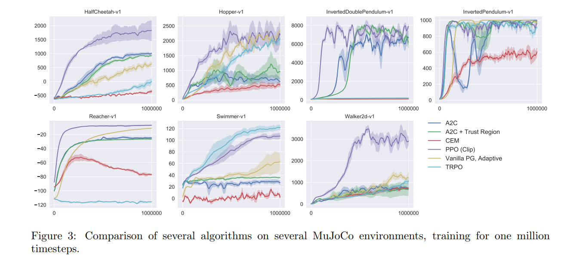

# Proximal Policy Optimization Algorithms

**Schulman, Wolski, Dhariwal, Radford and Klimov (2017)** · *arXiv:1707.06347v2 [cs.LG], 28 Aug 2017 (OpenAI)*

> **How to read this note.** Sections 1-4 summarise what the paper says, by section, equation, table and figure number. Section 5 is *our* interpretation for the thesis and is labelled as such.

---

## Key takeaways

- **What it did:** Proposes PPO, a family of policy-gradient methods that alternate between sampling data from the policy and optimising a surrogate objective with several epochs of minibatch updates. The main variant clips the probability ratio (Eq. 7); an adaptive KL-penalty variant (Eq. 8) is reported as a baseline. It tests PPO on seven MuJoCo tasks, three Roboschool humanoid tasks and 49 Atari games.
- **Numbers to remember:** Table 1 (7 tasks × 3 seeds = 21 runs per setting, scores rescaled to random = 0, best = 1): clipping ε = 0.2 scores 0.82 (ε = 0.1: 0.76; ε = 0.3: 0.70); no clipping or penalty −0.39; best adaptive KL 0.74; best fixed KL 0.72. Table 2 (49 Atari games, 3 trials): over all of training PPO wins 30 games, ACER 18, A2C 1; over the last 100 episodes ACER wins 28, PPO 19, A2C 1, with one tie. Reference settings: MuJoCo T = 2048, Adam 3×10⁻⁴, 10 epochs, minibatch 64, γ = 0.99, λ = 0.95; Atari T = 128, 3 epochs, 8 actors, ε = 0.1×α, c1 = 1, c2 = 0.01.
- **Used in the thesis for:** the PPO objective, combined loss, advantage estimator and algorithm outline; reference hyperparameters from other domains.
- **Not evidence for:** anything about terminals or dispatching, a comparison with DQN, multi-agent use, or statistical significance.

---

## 1. Summary in five points

1. The paper states that existing approaches each have drawbacks: Q-learning with function approximation "fails on many simple problems" and is poorly understood, vanilla policy gradient has poor data efficiency and robustness, and TRPO is complicated and not compatible with noise (dropout) or parameter sharing (Sec. 1).
2. It proposes a surrogate objective with clipped probability ratios (Eq. 7) that forms a pessimistic (lower-bound) estimate of the policy's performance and permits several epochs of minibatch updates on the same sampled data using only first-order optimisation (Secs. 1, 3, 5).
3. An alternative with an adaptive KL penalty (Eq. 8) is included as a baseline; the paper reports that it performed worse than clipping (Sec. 4, Table 1).
4. On seven simulated robotics tasks the clipped version with ε = 0.2 scores best among the surrogate variants (Table 1), and it ends above TRPO, CEM, vanilla policy gradient, A2C and A2C with trust region on most of the seven tasks (Fig. 3).
5. On 49 Atari games PPO is reported to learn faster than A2C and to be similar to ACER, which wins more games on final performance (Table 2, Appendix B).

---

## 2. What the paper does

### 2.1 Setting and problem (Secs. 1-2)

**Motivation (Sec. 1).** The paper names three leading approaches for reinforcement learning with neural-network function approximators: deep Q-learning, "vanilla" policy gradient and trust region / natural policy gradient methods. It seeks a method that is scalable, data-efficient and robust "(i.e., successful on a variety of problems without hyperparameter tuning)". Footnote 1 notes that DQN works well on game environments with discrete action spaces such as ALE, but has not been demonstrated on continuous control benchmarks.

**Policy gradient (Sec. 2.1).** The usual estimator is

$$\hat g = \hat{\mathbb{E}}_t\left[\nabla_\theta \log \pi_\theta(a_t \mid s_t)\,\hat A_t\right] \tag{1}$$

obtained by differentiating

$$L^{PG}(\theta) = \hat{\mathbb{E}}_t\left[\log \pi_\theta(a_t \mid s_t)\,\hat A_t\right] \tag{2}$$

where $\hat A_t$ estimates the advantage. The paper states that taking several optimisation steps on $L^{PG}$ with the same trajectory "is not well-justified" and empirically often leads to destructively large policy updates, and refers to Sec. 6.1 for results that "are not shown" but were similar or worse than the "no clipping or penalty" setting.

**Trust region methods (Sec. 2.2).** TRPO maximises a surrogate subject to a KL constraint,

$$\underset{\theta}{\text{maximize}}\ \hat{\mathbb{E}}_t\left[\frac{\pi_\theta(a_t \mid s_t)}{\pi_{\theta_{\text{old}}}(a_t \mid s_t)}\hat A_t\right] \tag{3}$$

$$\text{subject to}\ \hat{\mathbb{E}}_t\left[\text{KL}\left[\pi_{\theta_{\text{old}}}(\cdot \mid s_t), \pi_\theta(\cdot \mid s_t)\right]\right] \le \delta \tag{4}$$

solved approximately with conjugate gradient. The theory behind TRPO suggests a penalty instead of a constraint,

$$\underset{\theta}{\text{maximize}}\ \hat{\mathbb{E}}_t\left[\frac{\pi_\theta(a_t \mid s_t)}{\pi_{\theta_{\text{old}}}(a_t \mid s_t)}\hat A_t - \beta\,\text{KL}\left[\pi_{\theta_{\text{old}}}(\cdot \mid s_t), \pi_\theta(\cdot \mid s_t)\right]\right] \tag{5}$$

The paper states that TRPO uses a hard constraint because a single β is hard to choose across problems or even within one problem, and that experiments show that a fixed β with SGD is not sufficient.

### 2.2 Method (Secs. 3-5)

**Clipped surrogate objective (Sec. 3).** With $r_t(\theta) = \pi_\theta(a_t \mid s_t)/\pi_{\theta_{\text{old}}}(a_t \mid s_t)$, so $r(\theta_{\text{old}}) = 1$, TRPO maximises

$$L^{CPI}(\theta) = \hat{\mathbb{E}}_t\left[\frac{\pi_\theta(a_t \mid s_t)}{\pi_{\theta_{\text{old}}}(a_t \mid s_t)}\hat A_t\right] = \hat{\mathbb{E}}_t\left[r_t(\theta)\hat A_t\right] \tag{6}$$

where CPI refers to conservative policy iteration [KL02]. The paper states that without a constraint maximising $L^{CPI}$ would lead to an excessively large policy update. The main objective proposed is

$$L^{CLIP}(\theta) = \hat{\mathbb{E}}_t\left[\min\left(r_t(\theta)\hat A_t,\ \text{clip}\left(r_t(\theta), 1-\epsilon, 1+\epsilon\right)\hat A_t\right)\right] \tag{7}$$

"where epsilon is a hyperparameter, say, ε = 0.2". The paper explains that the first term is $L^{CPI}$; the clipped second term removes the incentive for moving $r_t$ outside $[1-\epsilon, 1+\epsilon]$; and taking the minimum makes the final objective a lower bound (a pessimistic bound) on the unclipped objective. It states that the change in probability ratio is ignored only when it would improve the objective and included when it makes the objective worse, and that $L^{CLIP}(\theta) = L^{CPI}(\theta)$ to first order around $\theta_{\text{old}}$ but they differ as θ moves away.

Values read from Fig. 2 (≈): at interpolation factor 1, $L^{CPI}$ ≈ 0.05, KL ≈ 0.016, the clipped term alone ≈ 0.038 and $L^{CLIP}$ ≈ 0.034 (near its maximum); at the right edge (factor about 2), $L^{CPI}$ ≈ 0.13, KL ≈ 0.115 and $L^{CLIP}$ ≈ 0.009. The paper states that $L^{CLIP}$ is a lower bound on $L^{CPI}$ with a penalty for too large a policy update.

**Adaptive KL penalty (Sec. 4).** An alternative, or an addition, to clipping. In each policy update the paper runs several epochs of minibatch SGD on

$$L^{KLPEN}(\theta) = \hat{\mathbb{E}}_t\left[\frac{\pi_\theta(a_t \mid s_t)}{\pi_{\theta_{\text{old}}}(a_t \mid s_t)}\hat A_t - \beta\,\text{KL}\left[\pi_{\theta_{\text{old}}}(\cdot \mid s_t), \pi_\theta(\cdot \mid s_t)\right]\right] \tag{8}$$

then computes $d = \hat{\mathbb{E}}_t[\text{KL}[\pi_{\theta_{\text{old}}}(\cdot \mid s_t), \pi_\theta(\cdot \mid s_t)]]$; if $d < d_{\text{targ}}/1.5$ then β ← β/2, and if $d > d_{\text{targ}} \times 1.5$ then β ← β × 2. The factors 1.5 and 2 are "chosen heuristically", the algorithm is "not very sensitive" to them, and the initial β is another hyperparameter that is "not important in practice". The paper states that the KL penalty performed worse than clipping and is included as an important baseline.

**Algorithm (Sec. 5).** The loss $L^{CLIP}$ or $L^{KLPEN}$ replaces $L^{PG}$ in a typical policy-gradient implementation, with several steps of stochastic gradient ascent. If the policy and value function share parameters, the objective combines the surrogate with a value-error term and can add an entropy bonus:

$$L_t^{CLIP+VF+S}(\theta) = \hat{\mathbb{E}}_t\left[L_t^{CLIP}(\theta) - c_1 L_t^{VF}(\theta) + c_2 S[\pi_\theta](s_t)\right] \tag{9}$$

with coefficients $c_1, c_2$, entropy bonus $S$ and squared-error loss $L_t^{VF} = (V_\theta(s_t) - V_t^{\text{targ}})^2$. For fixed-length trajectory segments of T timesteps (T much less than the episode length) the advantage estimator of [Mni+16] is, as printed,

$$\hat A_t = -V(s_t) + r_t + \gamma r_{t+1} + \cdots + \gamma^{T-t+1} r_{T-1} + \gamma^{T-t} V(s_T) \tag{10}$$

with t in [0, T]. A truncated generalized advantage estimation, which reduces to Eq. (10) when λ = 1, is printed as

$$\hat A_t = \delta_t + (\gamma\lambda)\delta_{t+1} + \cdots + \cdots + (\gamma\lambda)^{T-t+1}\delta_{T-1} \tag{11}$$

$$\text{where}\quad \delta_t = r_t + \gamma V(s_{t+1}) - V(s_t) \tag{12}$$

(see 2.6 for the printed exponents and ellipsis). Algorithm 1 (PPO, actor-critic style): in each iteration, each of N parallel actors runs $\pi_{\theta_{\text{old}}}$ for T timesteps and computes advantage estimates $\hat A_1, \dots, \hat A_T$; the surrogate L is then optimised with respect to θ over the N·T samples with K epochs and minibatch size M ≤ NT (minibatch SGD or, "usually for better performance", Adam); finally $\theta_{\text{old}} \leftarrow \theta$.

### 2.3 Experimental design (Sec. 6, Appendix A)

**Comparison of surrogate objectives (Sec. 6.1).** Variants: no clipping or penalty ($L_t = r_t\hat A_t$), clipping (Eq. 7), and KL penalty with fixed or adaptive coefficient. Seven MuJoCo tasks in OpenAI Gym (footnote 2: HalfCheetah, Hopper, InvertedDoublePendulum, InvertedPendulum, Reacher, Swimmer, Walker2d, all "-v1"), one million timesteps each. ε, β and $d_{\text{targ}}$ were searched; other hyperparameters are in Table 3. The policy is a fully connected MLP with two hidden layers of 64 units and tanh nonlinearities, outputting the mean of a Gaussian with variable standard deviations; parameters are not shared between policy and value function (so $c_1$ is irrelevant) and no entropy bonus is used. Each algorithm setting ran on all 7 tasks with 3 seeds each; a run's score is the average total reward of the last 100 episodes, shifted and scaled per task so that the random policy scores 0 and the best result 1, then averaged over the 21 runs. The paper also tried clipping in log space and found performance "no better".

**Continuous-domain comparison (Sec. 6.2).** PPO with the clipped objective (ε = 0.2, hyperparameters of Sec. 6.1) against "tuned implementations" of TRPO, the cross-entropy method (CEM), vanilla policy gradient with adaptive stepsize (footnote 3: the Adam stepsize is adjusted after each batch from the KL divergence between the original and updated policy), A2C and A2C with trust region. The number of seeds and the meaning of the shaded bands in Fig. 3 are not described in the paper.

**Humanoid tasks (Sec. 6.3).** Roboschool: (1) RoboschoolHumanoid, forward locomotion; (2) RoboschoolHumanoidFlagrun, with the target position changed every 200 timesteps or when reached; (3) RoboschoolHumanoidFlagrunHarder, where the robot is pelted by cubes and must get up. Learning curves are in Fig. 4 and still frames in Fig. 5 (not reproduced here); hyperparameters in Table 4. The paper notes that in concurrent work Heess et al. used the adaptive KL variant to learn locomotion policies for 3D robots.

**Atari (Sec. 6.4, Appendix B).** PPO against "well-tuned implementations" of A2C and ACER on the 49-game ALE benchmark, with the same policy network architecture as [Mni+16] for all three. PPO hyperparameters are in Table 5; for the other two the paper used hyperparameters "tuned to maximize performance on this benchmark". Two scoring metrics: (1) average reward per episode over the entire training period (favours fast learning) and (2) average reward per episode over the last 100 episodes (favours final performance); the winner per game is computed by averaging the metric over three trials. Appendix B shows learning curves for three random seeds (Fig. 6, not reproduced here) and mean final scores (Table 6).

**Hyperparameters (Appendix A).**

| Hyperparameter | Table 3 (MuJoCo, 1M timesteps) |
|---|---|
| Horizon (T) | 2048 |
| Adam stepsize | 3 × 10⁻⁴ |
| Num. epochs | 10 |
| Minibatch size | 64 |
| Discount (γ) | 0.99 |
| GAE parameter (λ) | 0.95 |

| Hyperparameter | Table 4 (Roboschool) |
|---|---|
| Horizon (T) | 512 |
| Adam stepsize | * |
| Num. epochs | 15 |
| Minibatch size | 4096 |
| Discount (γ) | 0.99 |
| GAE parameter (λ) | 0.95 |
| Number of actors | 32 (locomotion), 128 (flagrun) |
| Log stdev. of action distribution | LinearAnneal(−0.7, −1.6) |

(Caption: Adam stepsize was adjusted based on the target value of the KL divergence.)

| Hyperparameter | Table 5 (Atari) |
|---|---|
| Horizon (T) | 128 |
| Adam stepsize | 2.5 × 10⁻⁴ × α |
| Num. epochs | 3 |
| Minibatch size | 32 × 8 |
| Discount (γ) | 0.99 |
| GAE parameter (λ) | 0.95 |
| Number of actors | 8 |
| Clipping parameter ε | 0.1 × α |
| VF coeff. c1 (9) | 1 |
| Entropy coeff. c2 (9) | 0.01 |

(Caption: α is linearly annealed from 1 to 0 over the course of learning.)

### 2.4 Results (Sec. 6)

**Surrogate objectives (Table 1).** Average normalised scores over 21 runs (7 tasks × 3 seeds); β was initialised at 1.

| Algorithm | Avg. normalised score |
|---|---|
| No clipping or penalty | −0.39 |
| Clipping, ε = 0.1 | 0.76 |
| **Clipping, ε = 0.2** | **0.82** |
| Clipping, ε = 0.3 | 0.70 |
| Adaptive KL, d_targ = 0.003 | 0.68 |
| Adaptive KL, d_targ = 0.01 | 0.74 |
| Adaptive KL, d_targ = 0.03 | 0.71 |
| Fixed KL, β = 0.3 | 0.62 |
| Fixed KL, β = 1 | 0.71 |
| Fixed KL, β = 3 | 0.72 |
| Fixed KL, β = 10 | 0.69 |

The paper states that the score is negative without clipping or penalty because one task (HalfCheetah) gives a very negative score, worse than the initial random policy.

Values read from Fig. 3 (≈, end of training; PPO against the best other method in each panel):

| Task | PPO (Clip) | Best other method |
|---|---|---|
| HalfCheetah-v1 | ≈1800 | A2C ≈1000 |
| Hopper-v1 | ≈2200 | vanilla PG (adaptive) ≈2250, TRPO ≈2050 |
| InvertedDoublePendulum-v1 | ≈7500-8000 | A2C with trust region ≈6700 |
| InvertedPendulum-v1 | ≈1000 | several others also ≈900-1000 |
| Reacher-v1 | ≈−7 | vanilla PG (adaptive) ≈−10 |
| Swimmer-v1 | ≈105 | TRPO ≈120 |
| Walker2d-v1 | ≈2900 | vanilla PG (adaptive) ≈1200 |

In InvertedDoublePendulum several methods stay near ≈0-200 and CEM reaches only ≈600 in InvertedPendulum. The paper states that PPO "outperforms the previous methods on almost all the continuous control environments" (Sec. 6.2); in the graph TRPO ends above PPO on Swimmer and vanilla policy gradient ends close to PPO on Hopper.

**Atari (Table 2).** Number of games "won" by each algorithm, winner computed from the average over three trials.

| | A2C | ACER | PPO | Tie |
|---|---|---|---|---|
| (1) avg. episode reward over all of training | 1 | 18 | **30** | 0 |
| (2) avg. episode reward over last 100 episodes | 1 | **28** | 19 | 1 |

Table 6 gives mean final scores (last 100 episodes) after 40M game frames (10M timesteps). The paper's introduction states that on Atari PPO performs better in sample complexity than A2C and similarly to ACER, "though it is much simpler".

**Mean final scores on 49 Atari games (Table 6; bold = best as printed).**

| | A2C | ACER | PPO |
|---|---|---|---|
| Alien | 1141.7 | 1655.4 | **1850.3** |
| Amidar | 380.8 | **827.6** | 674.6 |
| Assault | 1562.9 | 4653.8 | **4971.9** |
| Asterix | 3176.3 | **6801.2** | 4532.5 |
| Asteroids | 1653.3 | **2389.3** | 2097.5 |
| Atlantis | 729265.3 | 1841376.0 | **2311815.0** |
| BankHeist | 1095.3 | 1177.5 | **1280.6** |
| BattleZone | 3080.0 | 8983.3 | **17366.7** |
| BeamRider | 3031.7 | **3863.3** | 1590.0 |
| Bowling | 30.1 | 33.3 | **40.1** |
| Boxing | 17.7 | **98.9** | 94.6 |
| Breakout | 303.0 | **456.4** | 274.8 |
| Centipede | 3496.5 | **8904.8** | 4386.4 |
| ChopperCommand | 1171.7 | **5287.7** | 3516.3 |
| CrazyClimber | 107770.0 | **132461.0** | 110202.0 |
| DemonAttack | 6639.1 | **38808.3** | 11378.4 |
| DoubleDunk | −16.2 | **−13.2** | −14.9 |
| Enduro | 0.0 | 0.0 | **758.3** |
| FishingDerby | 20.6 | **34.7** | 17.8 |
| Freeway | 0.0 | 0.0 | **32.5** |
| Frostbite | 261.8 | 285.6 | **314.2** |
| Gopher | 1500.9 | **37802.3** | 2932.9 |
| Gravitar | 194.0 | 225.3 | **737.2** |
| IceHockey | −6.4 | −5.9 | **−4.2** |
| Jamesbond | 52.3 | 261.8 | **560.7** |
| Kangaroo | 45.3 | 50.0 | **9928.7** |
| Krull | **8367.4** | 7268.4 | 7942.3 |
| KungFuMaster | 24900.3 | **27599.3** | 23310.3 |
| MontezumaRevenge | 0.0 | 0.3 | **42.0** |
| MsPacman | 1626.9 | **2718.5** | 2096.5 |
| NameThisGame | 5961.2 | **8488.0** | 6254.9 |
| Pitfall | −55.0 | **−16.9** | −32.9 |
| Pong | 19.7 | **20.7** | 20.7 |
| PrivateEye | 91.3 | **182.0** | 69.5 |
| Qbert | 10065.7 | **15316.6** | 14293.3 |
| Riverraid | 7653.5 | **9125.1** | 8393.6 |
| RoadRunner | 32810.0 | **35466.0** | 25076.0 |
| Robotank | 2.2 | 2.5 | **5.5** |
| Seaquest | 1714.3 | **1739.5** | 1204.5 |
| SpaceInvaders | 744.5 | **1213.9** | 942.5 |
| StarGunner | 26204.0 | **49817.7** | 32689.0 |
| Tennis | −22.2 | −17.6 | **−14.8** |
| TimePilot | 2898.0 | 4175.7 | **4342.0** |
| Tutankham | 206.8 | **280.8** | 254.4 |
| UpNDown | 17369.8 | **145051.4** | 95445.0 |
| Venture | 0.0 | 0.0 | 0.0 |
| VideoPinball | 19735.9 | **156225.6** | 37389.0 |
| WizardOfWor | 859.0 | 2308.3 | **4185.3** |
| Zaxxon | 16.3 | 29.0 | **5008.7** |

**Humanoid tasks (Sec. 6.3).** Results are shown only as learning curves (Fig. 4, not reproduced here); the text reports no numbers.

### 2.5 Conclusions (Sec. 7)

The paper states that PPO methods use multiple epochs of stochastic gradient ascent per policy update, have "the stability and reliability of trust-region methods" but are much simpler to implement (a few lines of code change to vanilla policy gradient), are applicable in more general settings (for example a joint policy and value architecture) and have better overall performance.

### 2.6 Gaps and inconsistencies in the printed paper

- **Eq. (10).** The last reward term is printed as $\gamma^{T-t+1} r_{T-1}$. With $r_t$ undiscounted, a reward at index T−1 would be discounted by $\gamma^{T-1-t}$ (our reading); the printed form is reproduced above.
- **Eq. (11).** The last term is printed as $(\gamma\lambda)^{T-t+1}\delta_{T-1}$, with the same offset as Eq. (10) (our reading expects $T-t-1$), and the ellipsis is printed twice ("⋯ + ⋯ +").
- **Table 6 caption.** It names PPO and A2C only, but the table has an ACER column, and the Appendix B text speaks of a comparison of PPO against A2C; Table 2 compares all three.
- **Table 2 against Table 6 (our arithmetic).** Each row of Table 2 sums to 49 games. Counting bold entries in Table 6 gives ACER 28, PPO 19, A2C 1 and one all-zero row (Venture), matching row (2) of Table 2; Pong (ACER and PPO both 20.7 at the printed precision) is bold for ACER. Row (1), based on average reward over training, cannot be checked from Table 6.
- **Sec. 2.1.** The paper refers to Sec. 6.1 for results of multi-epoch optimisation on $L^{PG}$ but states they "are not shown".
- **Fig. 3.** The caption does not state the number of seeds or what the shaded bands show.
- **Fig. 2.** The caption gives a KL of "about 0.02" at the maximum of $L^{CLIP}$; the curve reads ≈0.016 at interpolation factor 1.
- **Table 4.** The Adam stepsize is printed as "*", explained only in the caption.

---

## 3. Structured summary

| Field | Value |
|---|---|
| Problem | Data-efficient, reliable policy-gradient optimisation with first-order methods |
| Decision trigger | Not applicable |
| Decision | Not applicable (how the policy is updated) |
| Objective | Clipped surrogate $L^{CLIP}$ (Eq. 7), with optional value and entropy terms (Eq. 9) |
| Scale | 7 MuJoCo tasks (1M timesteps, 3 seeds); 3 Roboschool tasks; 49 Atari games (10M timesteps, 3 trials) |
| Randomness: quay-crane cycle time | Not applicable |
| Randomness: travel time / congestion | Not applicable |
| Randomness: task arrival | Not applicable |
| Randomness: stowage / workload | Not applicable |
| Randomness: yard crane | Not applicable |
| Randomness: AGV breakdown, battery | Not applicable |
| Method | Clipped (or adaptive-KL) surrogate, truncated GAE, K epochs of minibatch updates (Algorithm 1) |
| Evaluation | Seven-task ablation with 3 seeds; comparison with TRPO, CEM, vanilla PG, A2C (Fig. 3); Atari win counts against A2C and ACER (Table 2) |
| Benchmarks | TRPO, CEM, vanilla policy gradient (adaptive stepsize), A2C, A2C with trust region, ACER |

**Citation sentence supported by the paper:** *Schulman et al. (2017) propose proximal policy optimization, which maximises a clipped probability-ratio surrogate with several epochs of minibatch updates on each batch of sampled data, and report in simulation that it outperforms the other online policy-gradient methods compared on most continuous-control tasks and, on 49 Atari games, learns faster than A2C and performs similarly to ACER (Eq. 7, Table 1, Fig. 3, Table 2).*

---

## 4. What the paper does not support

- No container-terminal, dispatching, scheduling or operations-research problem is studied; the benchmarks are MuJoCo, Roboschool and Atari.
- No comparison with DQN or any value-based method is reported; DQN appears only in the introduction and in footnote 1.
- The paper does not study large or masked discrete action spaces, multi-agent settings, long-horizon sparse-reward settings or simulators with injected randomness.
- Hyperparameters differ by domain (Tables 3-5), ε, β and $d_{\text{targ}}$ were searched for each variant, and the baselines in Secs. 6.2 and 6.4 are described as tuned; the paper does not show that PPO works without tuning.
- The MuJoCo score in Table 1 is rescaled so that the best result in each task is 1, so scores are relative to the settings tested; there are 3 seeds per task and no intervals or tests.
- Fig. 3 gives no number of seeds and no definition of its shaded bands; Table 2 reports win counts from 3-trial averages, not differences with uncertainty.
- The paper does not report a theoretical guarantee for PPO; the clipped objective is described as a lower-bound heuristic around $\theta_{\text{old}}$.

---

## 5. Our reading (interpretation, not from the paper)

### 5.1 What we can use

- **Algorithm reference.** Eq. (7), Eq. (9), Eq. (11)-(12) and Algorithm 1 are the objects a PPO implementation for the thesis simulator follows; the printed exponents in Eq. (10)-(11) should be checked against the original GAE paper or a reference implementation before they are written into the thesis.
- **Reference settings.** Tables 3 and 5 give two different sets (for example 10 epochs and minibatch 64 for MuJoCo against 3 epochs for Atari), which shows that the paper itself changes settings by domain. Which values to start from, and how much to tune, is a thesis design choice.
- **Baseline tuning.** The paper tunes the comparison methods on the benchmark (Secs. 6.2, 6.4). Whether the thesis baselines get a comparable tuning budget is an open design question.
- **Vocabulary.** Probability ratio, surrogate objective, clipping, advantage, GAE, actor-critic, KL penalty.

### 5.2 Cautions

- The only discrete-action evidence is Atari with small action sets; the paper says nothing about how PPO behaves with the large, partly invalid action sets of a dispatching decision.
- The evaluation is thin by the standard of the evaluation paper we also read (3 seeds, single scores, no intervals); this paper is a source for the algorithm, not for a benchmark protocol.
- The paper does not state that PPO was designed to fix the instability of DQN, nor that it is the dominant on-policy algorithm; its stated comparisons are with TRPO, A2C, ACER, CEM and vanilla policy gradient.
