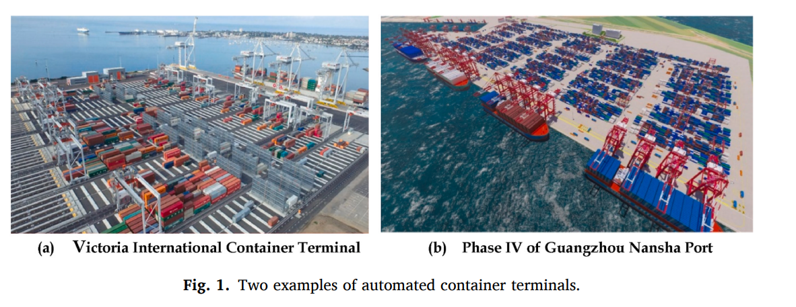
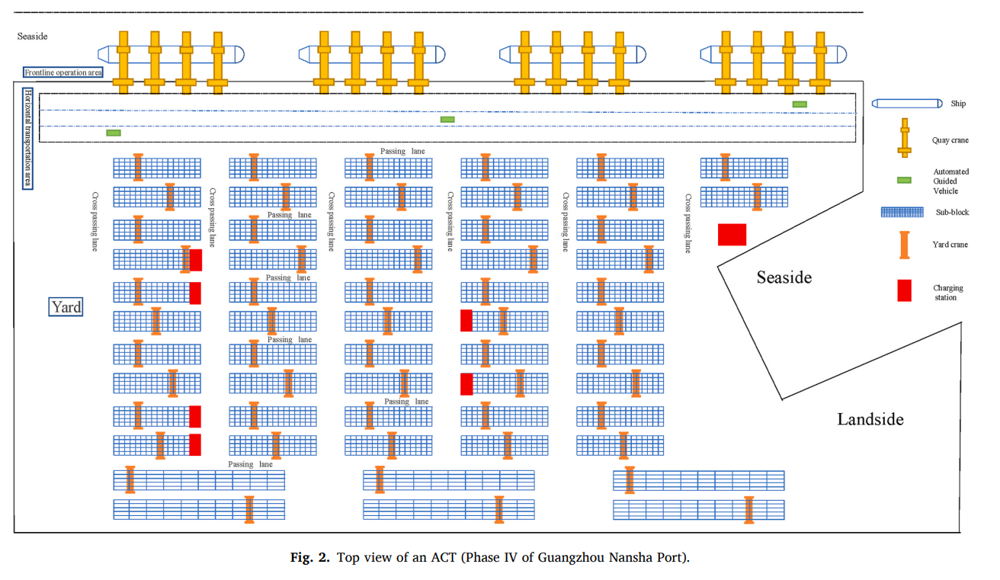
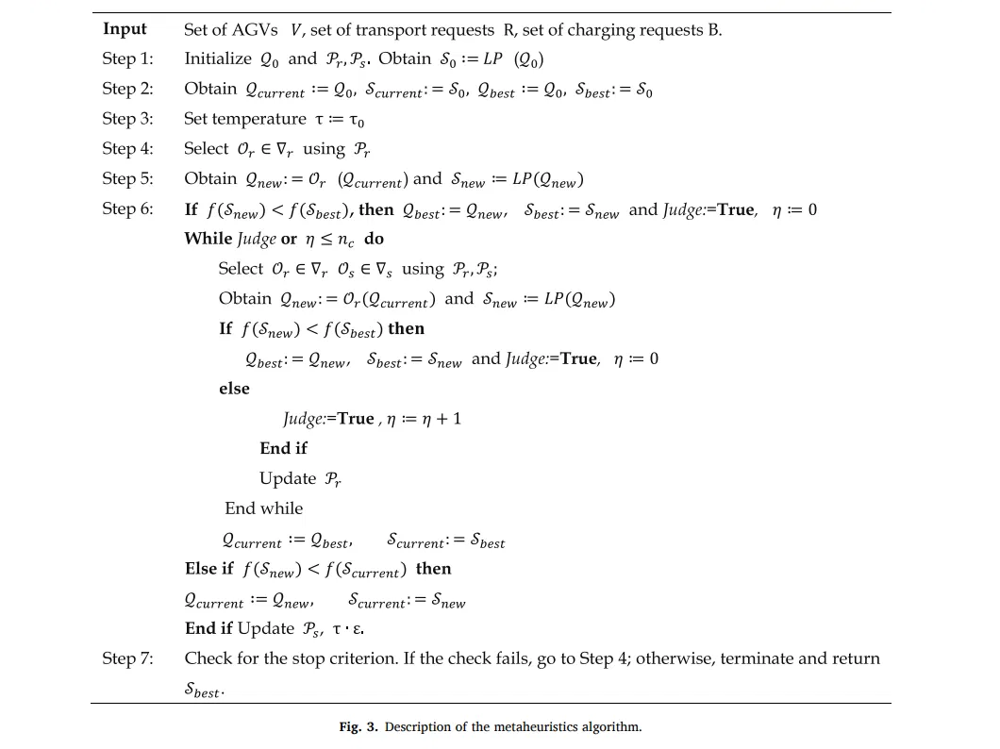
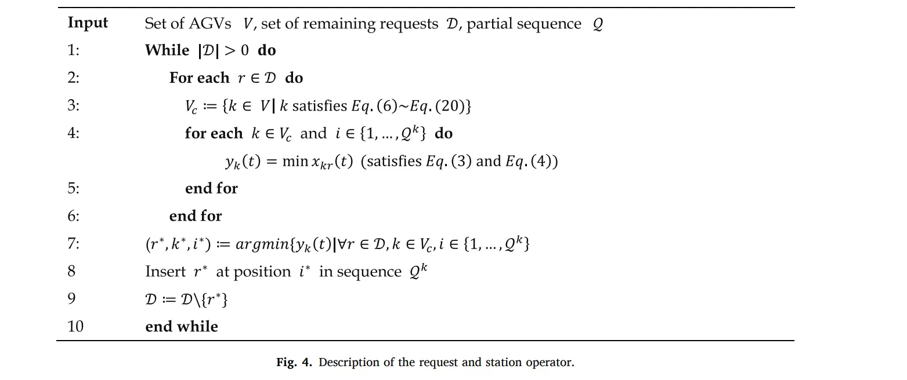
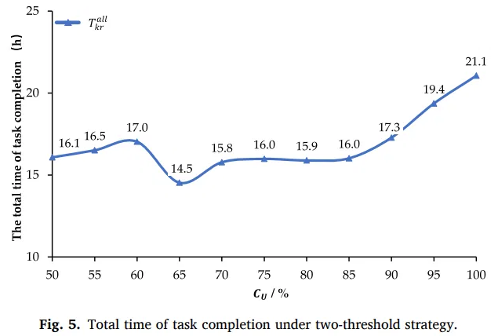
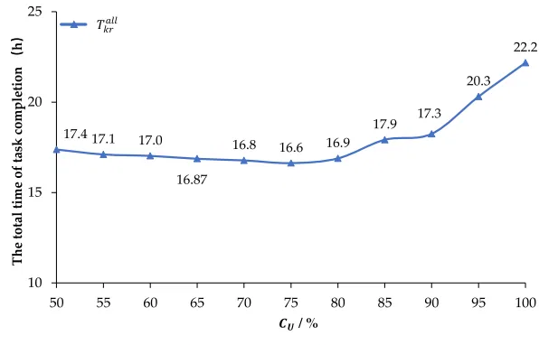

# Novel AGV resilient scheduling for automated container terminals considering charging strategy

**Song, Chen, Zhao, Wu, Liao & Ye (2024)** · *Ocean and Coastal Management* 250, 107014

> **How to read this note.** Sections 1-4 summarise what the paper says, by section, equation, table and figure number. Section 5 is *our* interpretation for the thesis and is labelled as such.

---

## Key takeaways

- **What it did:** builds an AGV scheduling model for a parallel-layout automated container terminal in which AGVs have a battery. Power use differs between empty and loaded travel, and charging is nonlinear in time. It adds a *dual-threshold* rule for stopping charging, and solves the model with a metaheuristic that combines adaptive large neighbourhood search and linear programming. The case is Phase IV of Guangzhou Nansha Port.
- **Numbers to remember:** 16 quay cranes, 64 AGVs (ratio 1:4), 7 charging piles; consumption 0.001% per metre empty and 0.002% per metre loaded; C_L = 20%, alpha = 0.4, beta = 0.6. Dual-threshold best: 14.53 h at C_U = 65% (Table 1); one-threshold best: 16.63 h at C_U = 75% (Table 3). With 80 AGVs the best is 12.32 h (65%) and with 96 AGVs 10.68 h (70%); average utilisation falls from 85.97% to 82.77% to 78.76% (Table 6). Computation time about 4190 s.
- **Used in the thesis for:** the battery and charging model, a worked example of a stop-charging threshold rule, fleet-size data points, and vocabulary.
- **Not evidence for:** resilience to disruptions, real-time dispatching, quay-crane idle time, congestion, or superiority over other algorithms.

---

## 1. Summary in five points

1. The paper schedules AGVs between the quay and the yard with a **battery constraint**: empty and loaded travel use different power per metre, and charging is linear below 60% battery and cubic above it (Eq. 1).
2. It proposes a **dual-threshold stop-charging rule** (Sec. 2.2, 3.3, 4.2): an AGV stops charging when it has enough for the largest remaining task plus the minimum level and other AGVs are queuing; otherwise it continues to a second threshold C_U, where it stops if others are waiting and otherwise charges to full.
3. Tasks are chosen by a **weighted score** of distance level and task urgency (Eqs. 2-4), and schedules are searched by a **metaheuristic** combining adaptive large neighbourhood search with linear programming (Sec. 3.4, Figs. 3-4).
4. On a **Guangzhou Nansha Phase IV case** (16 quay cranes, 64 AGVs) the best total completion time is 14.53 h with the dual-threshold rule (C_U = 65%) against 16.63 h for the best one-threshold setting (Tables 1, 3). More AGVs shorten the completion time and lower utilisation (Tables 4-6).
5. The paper states that the strategy makes scheduling "more resilient". The experiments reported compare completion times across thresholds and fleet sizes; no disruption scenario is reported.

---

## 2. What the paper does

### 2.1 Setting and problem (Secs. 1 and 2)

**Motivation (Sec. 1, 1.1).** Automated container terminals (ACTs) use battery-powered AGVs between the quay-crane area and the yard-crane area. The paper states that earlier AGV scheduling work treated AGVs as unmanned trucks, and that studies with charging simplified the charging methods. It also states that AGV operation is subject to "urgent uncertainties" (AGVs may stop, delay, or face new job arrivals), and that one common response is to solve small scheduling problems repeatedly with updated information; it adds that these approaches need improvement for large-scale ACTs. It chooses instead a flexible priority rule in which high-priority jobs enter the cost function through weighting factors.

**Literature (Sec. 1.2).** The paper groups prior work into (i) AGV scheduling that minimises task completion time (it cites Angeloudis and Bell 2010, Choe et al. 2016, Hu et al. 2019, Luo et al. 2016, Kim and Bae 2004, Tang et al. 2014), (ii) AGV path planning, congestion and conflicts (Adamo et al. 2018, Yang et al. 2018, Smolic-Rocak et al. 2009), and (iii) AGV battery charging (Li et al. 2023, Ryck et al. 2020, Jun et al. 2021, "Xi and Liu 2021", Singh et al. 2022). Its stated gap is that work in stream (iii) does not account for different power consumption when loaded and empty, nor for the nonlinear relation between charged capacity and charging time. Its stated gap for stream (i) is that jobs of different priority are rarely modelled.

**Contributions (Sec. 1.3).** (1) A flexible priority rule for resilient scheduling under emergent uncertainties; (2) an improved charging strategy with two thresholds for the charging power supply, said to be based on transportation distance and emergency priority; (3) an "innovatively proposed" adaptive large neighbourhood search method; (4) a performance analysis on real case data from a large Chinese ACT.

**Operation process (Sec. 2.1).** The paper studies the *parallel* layout, in which the yard lies along the coastline. The apron area holds quay cranes; the yard storage area holds yard cranes; the horizontal transportation area between them is served by AGVs. In unloading, AGVs wait for import containers at the quay crane and take them to a yard block; loading runs in reverse.

Panel (a) is labelled Victoria International Container Terminal and panel (b) Phase IV of Guangzhou Nansha Port; both are photographs or renderings with no data.

The figure shows four groups of four quay cranes on the seaside (16 in all, our count), a horizontal transportation area with AGVs, yard sub-blocks with yard cranes, passing lanes and cross passing lanes, and seven red charging stations (our count).

**Charging process (Sec. 2.2).** After each task the remaining battery is checked. Above a security level the AGV continues; below it, it goes to a charging station on the scheduling system's command, and an AGV charging cannot perform transport tasks. The paper lists four charging methods: battery swapping; charging with set opportunity intervals (mandatory, opportunity and normal intervals); charging with a set charging threshold; and combined offline and online charging. Phase IV is said to use the opportunity-interval method, with mandatory charging below 20% and opportunity charging between 20% and 80%. The paper adds, on top of the existing offline charging facilities, conditions for stopping charging and a task selection mechanism.

### 2.2 Model (Sec. 3)

**Assumptions (Sec. 3.1).** (1) Partial charging is allowed under critical battery thresholds. (2) Start-up, acceleration and deceleration times are ignored; AGVs drive at constant speed on all road sections. (3) Connection time at charging stations is not considered. (4) All AGVs operate normally without sudden failures, and an AGV is not permitted to visit a charging station while performing a task. (5) After completing a task, if the remaining battery is less than the battery needed for the next task plus the minimum level, the AGV returns directly to the charging station. (6) Each AGV transports one TEU at a time.

**Sets, parameters and variables (Sec. 3.2).**

| Symbol | Meaning as defined in the paper |
|---|---|
| $R$, $R'$ | Set of transportation tasks; set of tasks still to be completed |
| $V$, $E$ | Set of AGVs; set of charging stations |
| $B$ | Set of charging requests, $B=\{1,\dots,n_B\}$, with $n_B=\lvert V\rvert\cdot\lvert E\rvert$ described as a safe upper bound |
| $\tilde R$ | All transportation and charging requests, $\tilde R=R\cup B$ |
| $s_r^{\mathcal R}$, $d_r^{\mathcal R}$ | Pickup node and delivery node of task $r$ |
| $G=(N,A)$ | Graph of nodes $N=\{1,\dots,n\}$ and arcs $A=\{(i,j)\mid i,j\in N, i\neq j\}$; a node is a pickup or delivery location or a charging station |
| $d_{ij}$, $t_{ijk}$ | Distance on arc $(i,j)$; travel time on it by AGV $k$ |
| $\varphi_1,\dots,\varphi_5$ | $\varphi_1$: first-order coefficient in the constant-current stage; $\varphi_2$, $\varphi_3$, $\varphi_4$: third-, second- and first-order coefficients in the constant-voltage stage; $\varphi_5$: constant in the constant-voltage stage |
| $t_{k1}$, $t_{k2}$ | Charging time of AGV $k$ in the constant-current and constant-voltage stages |
| $C(t)$, $C_k(t)$, $C_{ki}(t)$ | Charging capacity of the battery at time $t$; battery status of AGV $k$ at time $t$; battery of AGV $k$ at location $i$ at time $t$ |
| $C_L$, $C_U$ | Minimum battery required for the AGV to return to the charging station; threshold battery level used to decide whether to continue charging |
| $Z_r$ | Urgency level of task $r$ |
| $W$ | Waiting time of the AGV for charging |
| $H_{ij}$ | Power consumption for travelling from $i$ to $j$ |
| $S_k(t)$ | Location of AGV $k$ at time $t$ |
| $L_{kr}(t)$ | Distance level that AGV $k$ needs to travel to perform task $r$ at time $t$ |
| $T_{kr}$ | Time required for AGV $k$ to complete task $r$ |
| $P_{km}(t)$ | Maximum battery capacity required for AGV $k$ to complete any remaining task |
| $\rho$, $\sigma$ | Power consumption per metre with no load, and under heavy load |

The "Decision variables" paragraph reads, in full: "variable. If $x=0$, the value is "1"; otherwise, the value is "0"." It then states that for each charging request $r\in B$ the source and destination nodes are the same charging station.

**Charging behaviour (Sec. 3.2 text).** The AGV computes the power needed for a task. If its battery exceeds the required capacity plus the minimum threshold it performs the task; otherwise it goes to charge. During charging it stops when its battery reaches the *sum of the largest battery requirement of the remaining tasks and the minimum threshold* and other AGVs are waiting. Otherwise it continues to the secondary threshold $C_U$; at $C_U$ it stops if others are waiting and otherwise continues until full. Tasks have urgency levels, and each is given weighted coefficients $\alpha$ and $\beta$ for distance to the start nodes of the remaining tasks and for urgency; the task with the smaller weighted average goes first. Charging speed is linear early, then falls: below 60% battery is the constant-current stage (faster), above 60% the constant-voltage stage (slower), citing Shi et al. (2022).

$$
C(t)=\begin{cases}\varphi_1 t_1, & C_k(t)\le 60\%\\[2pt] \varphi_2 t_2^{3}+\varphi_3 t_2^{2}+\varphi_4 t_2+\varphi_5, & 60\%<C_k(t)\le 100\%\end{cases}\tag{1}
$$

**Task selection rule (Sec. 3.3, Eqs. 2-4).** After an AGV completes a task it computes, for each remaining task, a weighted average of its distance level from the task's start node and the task's urgency, and picks the minimum:

$$
y_k(t)=\min x_{kr}(t)\tag{2}
$$

subject to

$$
x_{kr}(t)=\alpha\cdot L_{kr}(t)+\beta\cdot Z_r,\quad r\in R,\ k\in V\tag{3}
$$

$$
w_k(t)=k\cdot S_1\bigl(y_k(t)-x_{kr}(t)\bigr),\quad r\in R,\ k\in V\tag{4}
$$

The paper defines the distance level $L_{kr}(t)$ as the ratio of the distance to travel for task $r$ to the maximum distance to travel among all remaining tasks, and the urgency $Z_r$ as the ratio of the urgency level of task $r$ to the maximum urgency level among all remaining tasks.

**Objective and constraints (Sec. 3.3, Eqs. 5-20).** The text says the model considers "the sum of AGV's task completion time, charging time, and waiting time for charging" and improves utilisation while ensuring task completion. The equations are as printed:

$$
\min\ \max\ T_{kr}^{all}\tag{5}
$$

$$
\sum_t\sum_k G_{kr}(t)=1,\quad k\in V,\ r\in R\tag{6}
$$

$$
M_k(t)-G_{kr}(t)\ge 0,\quad k\in V,\ r\in R\tag{7}
$$

$$
C_U-H_{S_k(t),\,s^{\mathcal R}_{w_k(t)}}-H_{s^{\mathcal R}_{w_k(t)},\,d^{\mathcal R}_{w_k(t)}}-C_L\ge 0,\quad k\in V,\ r\in R\tag{8}
$$

$$
G_{kr}(t)=S_1\Bigl(L_{kS_k(t)}(t)-H_{S_k(t),\,s^{\mathcal R}_{w_k(t)}}-H_{s^{\mathcal R}_{w_k(t)},\,d^{\mathcal R}_{w_k(t)}}-C_L\Bigr)\,S_3\bigl(w_k(t)-r\bigr),\quad k\in V,\ r\in R\tag{9}
$$

$$
H_{S_k(t),\,s^{\mathcal R}_{w_k(t)}}=\rho\, d_{S_k(t),\,s^{\mathcal R}_{w_k(t)}},\quad k\in V\tag{10}
$$

$$
H_{s^{\mathcal R}_{w_k(t)},\,d^{\mathcal R}_{w_k(t)}}=\sigma\, d_{s^{\mathcal R}_{w_k(t)},\,s^{\mathcal R}_{w_k(t)}},\quad k\in V\tag{11}
$$

$$
P_{km}(t)=\max\Bigl(H_{S_k(t),\,s^{\mathcal R}_{w_k(t)}}+H_{s^{\mathcal R}_{w_k(t)},\,d^{\mathcal R}_{w_k(t)}}\Bigr),\quad k\in V\tag{12}
$$

$$
Q_k(t)=\begin{cases}
S_1\bigl(C_{ki}(t)-P_{km}(t)-C_L\bigr)\,S_2\Bigl(\sum_k\bigl(1-M_k(t)\bigr)\Bigr), & C_{ki}(t)\le P_{km}(t)+C_L\\[2pt]
0, & P_{km}(t)+C_L<C_{ki}(t)<C_U\\[2pt]
S_1\bigl(C_{ki}(t)-C_U\bigr)\,S_2\Bigl(\sum_k\bigl(1-M_k(t)\bigr)\Bigr), & C_{ki}(t)\ge C_U
\end{cases}\tag{13}
$$

$$
M_k(t)=S_1\Bigl(C_k(t)-H_{S_k(t),\,s^{\mathcal R}_{w_k(t)}}-H_{s^{\mathcal R}_{w_k(t)},\,d^{\mathcal R}_{w_k(t)}}-C_L\Bigr),\quad k\in V\tag{14}
$$

$$
T_{kr}=\sum_t\sum_k G_{kr}(t)\Bigl(t_{S_k(t),\,s^{\mathcal R}_{w_k(t)},\,k}+t_{s^{\mathcal R}_{w_k(t)},\,d^{\mathcal R}_{w_k(t)},\,k}\Bigr),\quad k\in V,\ r\in R\tag{15}
$$

$$
T^{all}_{kr}=\sum_k\sum_r G_{kr}(t)\Bigl(t+t_{S_k(t),\,s^{\mathcal R}_{w_k(t)},\,k}+t_{s^{\mathcal R}_{w_k(t)},\,d^{\mathcal R}_{w_k(t)},\,k}+t_{k1}+t_{k2}+w\Bigr),\quad k\in V,\ r\in R\tag{16}
$$

$$
C_U-C_k(t)=\begin{cases}
\varphi_1 t_{k1}, & C_k(t)\le C_U\le 60\%\\[2pt]
\varphi_1 t_{k1}+\varphi_2 t_2^{3}+\varphi_3 t_2^{2}+\varphi_4 t_2+\varphi_5, & C_k(t)\le 60\%\le C_U\\[2pt]
\varphi_2 t_2^{3}+\varphi_3 t_2^{2}+\varphi_4 t_2+\varphi_5, & C_U>C_k(t)>60\%
\end{cases}\tag{17}
$$

$$
C_k(t)-C_U=\begin{cases}
\varphi_1 t_{k1}, & C_U\le C_k(t)\le 60\%\\[2pt]
\varphi_1 t_{k1}+\varphi_2 t_2^{3}+\varphi_3 t_2^{2}+\varphi_4 t_2+\varphi_5, & C_U\le 60\%\le C_k(t)\\[2pt]
\varphi_2 t_2^{3}+\varphi_3 t_2^{2}+\varphi_4 t_2+\varphi_5, & C_k(t)>C_U>60\%
\end{cases}\tag{18}
$$

$$
L_{kr}(t)=0,\quad k\in V,\ r\in B\tag{19}
$$

$$
C_{ki}(t)\ge C_L,\quad k\in V,\ i\in E\tag{20}
$$

The paper's explanation of the constraints: (5) the largest AGV spends the shortest time completing all tasks; (6) every transport task is executed, once; (7) vehicles in a charging process cannot be assigned tasks; (8) the secondary threshold $C_U$ is not less than the battery required for each task; (9) if AGV $k$'s battery suffices for task $r$ and for returning to the charging station, it goes to perform task $r$; (10) and (11) battery consumption against distance when empty and loaded; (12) $P_{km}(t)$ is the maximum battery required to complete any remaining task; (13) charging continues until the battery reaches the largest remaining requirement plus $C_L$ (stopping then if others wait), and then until $C_U$ (stopping then if others wait, otherwise until full); (14) an AGV whose battery suffices for the target task does not need charging; (15) task completion time; (16) the sum of an AGV's time for completing task $r$, charging time and waiting time for charging; (17) and (18) the relation between charged capacity and charging time, only one of which holds at a time; (19) the distance travelled is 0 while charging at the station; (20) an AGV arriving at a charging station must have more than the minimum allowed battery.

### 2.3 Solution method (Sec. 3.4, Figs. 3 and 4)

The paper proposes "metaheuristics based on integrating adaptive large neighborhood search (Ropke and Pisinger, 2006) and linear programming" in a local-search framework. It denotes the initial, current and best *sequence* by $\mathcal Q_0$, $\mathcal Q_{current}$, $\mathcal Q_{best}$ and the corresponding *schedule* by $\mathcal S_0$, $\mathcal S_{current}$, $\mathcal S_{best}$. There are two operator types, *request operators* $\nabla_r$ and *station operators* $\nabla_s$; $\mathcal O_r$ and $\mathcal O_s$ are a destroy and a repair operator for requests and for charging tasks. The weights of the operators in $\nabla_r$ and $\nabla_s$ are selection probabilities held in vectors $\mathcal P_r$ and $\mathcal P_s$.

The method has two loops. The first-level loop initialises $\mathcal S_0$ and a feasible task sequence $\mathcal Q_0$, sets current and best solutions, and sets a simulated-annealing temperature $\tau=\tau_0$. The second-level loop applies the request and station operators until the stop criterion is met and no further best solution is found; it accepts a new solution if it is better than the current one, updates the operator weights $\mathcal P_r$, $\mathcal P_s$ when used, and updates the temperature, with $\varepsilon$ the cooling rate. A schedule is obtained by adding transport and charging tasks to each AGV's sequence; its objective value is "calculated according to Eq. (2)", which the paper describes as the weighted sum of the request distance and the urgency of the tasks.

In repair, the paper adapts the greedy insertion of Ropke and Pisinger (2006): for each remaining request, the operators of "Algorithm 2" (by content, the procedure of Fig. 4) collect the set $V_c$ of AGVs that can serve the request and station, evaluate the cost of Eq. (2) subject to Eqs. (3) and (4), and insert the request at the best position, repeating until all requests are reinserted.

The paper does not define $LP(\cdot)$, $\eta$, $n_c$, $f(\cdot)$, the initial-solution procedure, the destroy and repair operators in $\nabla_r$ and $\nabla_s$, the weight-update rule, $\tau_0$, $\varepsilon$ or the stop criterion beyond the descriptions above.

### 2.4 Experimental design (Sec. 4)

**Case.** Phase IV of Guangzhou Nansha Port: designed annual throughput of 4.8 million TEU; two 100,000-ton main berths, two 50,000-ton main berths and twelve 2000-ton barge berths. Equipment: 16 single-cart quay cranes at the main berths; in the yard 48 single-cantilever rail cranes, 3 double-cantilever rail cranes and 7 charging piles (red areas in Fig. 2). AGVs carry containers horizontally between the apron and the yard.

**Parameters.** Ratio of quay cranes to AGVs 1:4, that is 64 AGVs (1:5 and 1:6 give 80 and 96 AGVs in Sec. 4.3). Consumption under heavy load $\sigma=0.002\%$ of battery per metre; consumption under no load $\rho=0.001\%$ per metre; consumption while waiting is ignored. $C_L=20\%$. $\alpha=0.4$, $\beta=0.6$. Initial battery of each AGV is set to a value between 60% and 100%.

**Runs.** The model was programmed in Java and CPLEX "was called to solve the model". For each AGV the operating, charging and waiting times are computed; the total time of the AGV that took longest is taken as the total completion time. The paper reports that computing all AGV scheduling plans takes "around 4190 s". $C_U$ is varied from 50% to 100% (Sec. 4.1).

### 2.5 Results (Secs. 4.1-4.3)

**Dual-threshold strategy against $C_U$ (Sec. 4.1, Table 1, Fig. 5), 64 AGVs.**

| $C_U$ / % | 50 | 55 | 60 | 65 | 70 | 75 | 80 | 85 | 90 | 95 | 100 |
|---|---|---|---|---|---|---|---|---|---|---|---|
| $T^{all}_{kr}$ / h | 16.08 | 16.51 | 17.03 | 14.53 | 15.78 | 15.98 | 15.89 | 16.02 | 17.28 | 19.36 | 21.06 |

*Table 1. Total time of task completion under two-threshold strategy.*

The paper explains the shape by range. For $C_U$ of 50-60% AGVs stop charging early when others wait, so they charge often, adding no-load and waiting-for-charging time and reducing productive time. For 60-65% a higher $C_U$ gives fewer trips to the charging station, and $T^{all}_{kr}$ reaches a minimum near 65%. For 65-85% the higher $C_U$ gives more capacity, but charging slows as the level rises, which lengthens charging time. For 85-100% the threshold is near full, so charging time grows with the nonlinear charging, and waiting and charging time increase. At 65% the paper states that the productive time of all AGVs is longest and utilisation highest, and that the average utilisation of the 64 AGVs is 85.97%.

**Table 2. Utilization rate of AGVs (as printed, 64 AGVs; the paper links it to $C_U=65\%$).**

| AGV $k$ | Charging time and waiting time (h) | Productive operating time (h) | Utilization rate of AGV (%) |
|---|---|---|---|
| 1 | 0.39 | 14.07 | 97.32 |
| 2 | 0.93 | 13.71 | 93.63 |
| 3 | 3.66 | 10.85 | 74.79 |
| 4 | 3.86 | 10.80 | 73.65 |
| 5 | 1.00 | 13.63 | 93.14 |
| 6 | 0.41 | 14.41 | 97.24 |
| 7 | 3.12 | 11.46 | 78.61 |
| 8 | 3.46 | 10.93 | 75.97 |
| 9 | 0.38 | 14.27 | 97.4 |
| 10 | 0.35 | 14.12 | 97.57 |
| 11 | 1.07 | 13.39 | 92.57 |
| 12 | 3.77 | 10.68 | 73.90 |
| 13 | 1.51 | 13.30 | 89.80 |
| 14 | 2.17 | 12.53 | 85.22 |
| 15 | 0.96 | 13.78 | 93.51 |
| 16 | 2.96 | 11.48 | 79.49 |
| 17 | 2.82 | 11.69 | 80.59 |
| 18 | 2.77 | 11.80 | 81.01 |
| 19 | 3.34 | 11.28 | 77.16 |
| 20 | 0.58 | 14.19 | 96.10 |
| 21 | 3.94 | 10.72 | 73.13 |
| 22 | 0.36 | 14.38 | 97.91 |
| 23 | 2.99 | 11.70 | 79.63 |
| 24 | 0.82 | 13.65 | 94.31 |
| 25 | 2.65 | 11.92 | 81.83 |
| 26 | 1.45 | 13.34 | 90.20 |
| 27 | 3.67 | 10.74 | 74.51 |
| 28 | 2.65 | 11.80 | 81.67 |
| 29 | 3.68 | 10.77 | 74.53 |
| 30 | 0.22 | 14.36 | 98.48 |
| 31 | 3.58 | 10.94 | 75.33 |
| 32 | 3.11 | 11.63 | 78.93 |
| 33 | 3.15 | 11.25 | 78.12 |
| 34 | 0.74 | 13.67 | 94.85 |
| 35 | 0.35 | 14.25 | 97.55 |
| 36 | 0.61 | 13.95 | 95.81 |
| 37 | 1.00 | 13.37 | 93.05 |
| 38 | 1.38 | 13.38 | 90.67 |
| 39 | 2.94 | 11.41 | 79.51 |
| 40 | 0.35 | 14.16 | 97.57 |
| 41 | 3.03 | 11.49 | 79.13 |
| 42 | 2.88 | 11.52 | 80.03 |
| 43 | 3.87 | 10.71 | 73.45 |
| 44 | 1.8 | 12.93 | 87.78 |
| 45 | 0.69 | 13.71 | 95.19 |
| 46 | 1.94 | 12.60 | 86.67 |
| 47 | 2.87 | 11.58 | 80.14 |
| 48 | 1.25 | 13.58 | 91.58 |
| 49 | 0.68 | 14.73 | 95.58 |
| 50 | 2.88 | 11.58 | 80.11 |
| 51 | 2.27 | 12.40 | 84.53 |
| 52 | 3.48 | 10.87 | 75.75 |
| 53 | 0.51 | 14.37 | 96.50 |
| 54 | 0.97 | 13.82 | 93.44 |
| 55 | 2.78 | 11.80 | 80.93 |
| 56 | 3.77 | 10.72 | 74.00 |
| 57 | 2.83 | 11.79 | 80.67 |
| 58 | 0.73 | 14.11 | 95.08 |
| 59 | 1.91 | 12.49 | 86.77 |
| 60 | 3.02 | 11.47 | 79.16 |
| 61 | 0.65 | 14.44 | 95.69 |
| 62 | 0.94 | 13.87 | 93.63 |
| 63 | 3.26 | 11.39 | 77.75 |
| 64 | 2.52 | 11.84 | 82.47 |

*Table 2. Utilization rate of AGVs.* The paper prints the table in blocks of eight AGVs; here it is one row per AGV. Values are as printed (AGV 31's charging time is printed with a trailing full stop).

**Comparison with the one-threshold strategy (Sec. 4.2, Table 3, Fig. 6).** The paper describes the existing Phase IV practice as a one-threshold strategy with $C_U=80\%$ and compares $T^{all}_{kr}$ over the same $C_U$ values.

| $C_U$ / % | 50 | 55 | 60 | 65 | 70 | 75 | 80 | 85 | 90 | 95 | 100 |
|---|---|---|---|---|---|---|---|---|---|---|---|
| $T^{all}_{kr}$ / h | 17.38 | 17.11 | 17.03 | 16.87 | 16.78 | 16.63 | 16.89 | 17.92 | 18.25 | 20.31 | 22.18 |

*Table 3. Total time of task completion under the existing one-threshold charging strategy.*

The one-threshold minimum is 16.63 h at $C_U=75\%$. The paper states that the additional judgement condition makes AGV charging and scheduling "more resilient": AGVs can start or stop charging as needed in real time according to the battery required and the queue, so charging is staggered, and other AGVs can go to the charging station with a shorter wait.

**Our arithmetic (Tables 1 and 3).** The dual-threshold value is below the one-threshold value at 10 of the 11 $C_U$ settings (by 0.60 to 2.34 h) and equal at $C_U=60\%$ (17.03 h in both). The best dual-threshold value (14.53 h) is about 12.6% below the best one-threshold value (16.63 h), and about 14.0% below the one-threshold value at the named existing setting $C_U=80\%$ (16.89 h).

**Sensitivity to the number of AGVs (Sec. 4.3, Tables 4-6).** With 80 AGVs (ratio 1:5) and 96 AGVs (ratio 1:6):

| $C_U$ / % | 50 | 55 | 60 | 65 | 70 | 75 | 80 | 85 | 90 | 95 | 100 |
|---|---|---|---|---|---|---|---|---|---|---|---|
| 1:5 (80 AGVs), $T^{all}_{kr}$ / h | 13.31 | 13.83 | 14.26 | 12.32 | 13.17 | 13.26 | 13.16 | 13.42 | 14.48 | 16.26 | 17.67 |
| 1:6 (96 AGVs), $T^{all}_{kr}$ / h | 11.42 | 11.53 | 12.23 | 11.33 | 10.68 | 11.53 | 11.46 | 11.69 | 12.49 | 13.89 | 14.98 |

*Table 4 (1:5) and Table 5 (1:6). Total time of task completion under two-threshold strategy.*

| Number of AGVs | 64 (1:4) | 80 (1:5) | 96 (1:6) |
|---|---|---|---|
| Average utilization rate of AGVs | 85.97% | 82.77% | 78.76% |

*Table 6. Average utilization rate of AGVs.*

The paper reports the shortest times as 14.53 h (64 AGVs, $C_U=65\%$), 12.32 h (80 AGVs, 65%) and 10.68 h (96 AGVs, 70%). It states that changing the number of AGVs has a large effect on completion time, that the marginal effect of adding AGVs decreases, and that more AGVs reduce both the completion time and the utilisation rate. It argues that too few AGVs would increase quay-crane and yard-crane waiting, while too many raise congestion and charging-wait probability.

**Our arithmetic (Tables 1, 4, 5, 6).** At the best setting of each table, going from 64 to 80 AGVs lowers the time by 2.21 h (about 15.2%), from 80 to 96 AGVs by 1.64 h (about 13.3%), and from 64 to 96 AGVs by 3.85 h (about 26.5%). AGVs per quay crane are 64/16 = 4, 80/16 = 5 and 96/16 = 6. The unweighted mean of the 64 utilisation values in Table 2 is about 85.97%, equal to the reported figure.

### 2.6 Conclusions (Sec. 5)

The paper states that it considers different power consumption under no-load and heavy-load conditions and the nonlinear charging characteristics, "innovatively" proposes a dual-threshold charging strategy and an "adaptive large local search method" for resilient AGV scheduling, and that the results on Phase IV "demonstrate" the dual-threshold strategy is better than the existing one-threshold strategy. It adds that the second threshold $C_U$ is neither better when higher nor when lower, that the optimal $C_U$ is "highly correlated" with the number of AGVs (65% at ratio 1:4, 70% at 1:6), and that the number of AGVs lowers completion time with a decreasing marginal effect and lower utilisation, so "a greater quantity of AGVs is not necessarily better". Future research is said to include congestion waiting time during AGV travel, path conflicts, and other charging and scheduling dynamics.

The remaining front matter states: data "will be made available on request"; funding from the National Natural Science Foundation of China (72271251) and other provincial and open-fund projects.

### 2.7 Gaps and inconsistencies in the printed paper

These are recorded as printed and not corrected.

1. **Decision variables.** The paragraph begins with the fragment "variable. If $x=0$, the value is "1"; otherwise, the value is "0"." The functions $S_1$, $S_2$, $S_3$ used in Eqs. (4), (9), (13) and (14) are not defined individually.
2. **Eq. (4).** It reads $w_k(t)=k\cdot S_1(\cdot)$, with $k$ the AGV index. Eq. (9) and the subscripts $s^{\mathcal R}_{w_k(t)}$ use $w_k(t)$ as a *task* index, and the text says Eq. (4) represents the selection of task $r$. (Our reading: with the printed rule "$x=0\Rightarrow 1$", Eq. (4) as printed would return $k$.)
3. **Use of $S_1$.** The printed rule fires only at $x=0$; Eqs. (9), (13) and (14) use $S_1$ of a battery margin, which the text describes as "sufficient" or not.
4. **Eq. (9).** The first argument of $S_1$ contains $L_{kS_k(t)}(t)$; Eq. (14) has $C_k(t)$ in the same place. $L$ is defined in Sec. 3.2 as a distance level.
5. **Eq. (11).** The distance on the right-hand side has subscripts $s^{\mathcal R}_{w_k(t)},s^{\mathcal R}_{w_k(t)}$ (pickup to pickup), whereas the left-hand side is pickup to delivery and the arc set excludes $i=j$.
6. **Symbol reuse.** $A$ denotes both the arc set and, in the last parameter line, "$A=R\cup B$", the set of all requests (also written $\tilde R$). $S$ is used for AGV location ($S_k(t)$), for schedules ($\mathcal S_0$, $\mathcal S_{current}$, $\mathcal S_{best}$) and for the functions $S_1$ to $S_3$. $Q_k(t)$ in Eq. (13) and the sequence $\mathcal Q$ in Figs. 3-4 share a letter and $\mathcal Q^k$ is also used as a range limit. $w_k(t)$ (selected task), $w$ in Eq. (16) and $W$ in Sec. 3.2 (waiting time) are related by letter only. $k$ is both index and multiplier in Eq. (4). In Eqs. (15) and (16) $k$ and $r$ are summation indices and also free subscripts. Eq. (1) uses $t_1,t_2$, Eqs. (17)-(18) use $t_{k1}$, $t_{k2}$ and $t_2$. In Eq. (1), $C(t)$ is a charging capacity while the branches are conditioned on $C_k(t)$.
7. **Level or ratio.** $Z_r$ is defined as "urgency level of task $r$" (Sec. 3.2) and as a ratio to the maximum urgency among remaining tasks (Sec. 3.3); $L_{kr}(t)$ is a "distance level" and then a ratio to the maximum distance. Sec. 3.3 describes Eq. (3) in the same words as Eq. (2) ("the weighted average value of AGV's $k$ remaining tasks").
8. **Objective.** Eq. (5) is $\min\max T^{all}_{kr}$ (the text says the largest AGV has the shortest time); the text of Sec. 3.3 describes a sum of completion, charging and waiting time; Sec. 3.4 evaluates schedules with Eq. (2). Sec. 4.1 states that the longest AGV time is used as the total time.
9. **Algorithm descriptions.** Sec. 3.4 calls $\mathcal S_{best}$ "the best sequence". In Fig. 3 the else branch of the inner loop sets $Judge:=True$ as well as $\eta:=\eta+1$, so as printed the loop condition "$Judge$ or $\eta\le n_c$" never becomes false through that branch. $\tau$ is set in Step 3 and "$\tau\cdot\varepsilon$" appears at the end of Step 6, but no acceptance probability using $\tau$ is shown; acceptance in the figure is by $f(\mathcal S_{new})<f(\mathcal S_{current})$.
10. **References to figures.** Sec. 3.3 says the rule is "implemented in Step 4 in algorithm 2 ... in Fig. 2"; Fig. 2 is the terminal layout, and the algorithm that applies Eqs. (3)-(4) is Fig. 4. Sec. 3.4 says the pseudo-code "is presented in Fig. 3 below (see Fig. 4)". Sec. 4 calls the method the "adaptive large local search method" and Sec. 3.4 calls it adaptive large neighbourhood search.
11. **Fig. 6 against Table 3.** At $C_U=90\%$ Table 3 gives 18.25 h and the Fig. 6 data label reads 17.3. The other ten labels in Fig. 6 match Table 3 at the printed precision (the 65% label has two decimals), and all eleven labels in Fig. 5 match Table 1 to one decimal place.
12. **Table 2.** The paper does not define the utilisation rate. Under the reading "productive time / (charging and waiting time + productive time)" (our reading), 61 of the 64 printed values agree within rounding; AGV 22 is printed as 97.91% against about 97.56%, and AGV 35 and AGV 53 lie 0.02 and 0.04 percentage points below the rounding range of the printed times. Printed formatting: AGV 31 charging time "3.58.", AGV 44 charging time "1.8", AGV 9 utilisation "97.4". The sum of the two time rows exceeds the 14.53 h printed for $T^{all}_{kr}$ at $C_U=65\%$ for 36 of the 64 AGVs (largest: AGV 49, 15.41 h; our arithmetic); the paper does not state that the sum is an AGV's completion time.
13. **Conclusion against tables.** The conclusion gives the optimal $C_U$ for ratios 1:4 and 1:6 only; Table 4 (1:5) has its minimum at 65%. Table 1 and Table 3 give the same value (17.03 h) at $C_U=60\%$. The text of Sec. 4.1 describes Fig. 5 as showing "the total completion time of different AGVs", whereas each point is one $T^{all}_{kr}$ per threshold.
14. **Contributions against the model.** Contribution 2 says the thresholds are based on transportation distance and emergency priority; in Sec. 3 urgency $Z_r$ enters the task-selection score (Eq. 3) and the thresholds are conditioned on battery requirements (Eqs. 8, 13, 17-18). Sec. 1.2 says the study intends to "find the shortest path for AGVs"; Sec. 3 contains travel distances and times on arcs and no path decision. Sec. 1.2 describes Singh et al. (2022) as an ALNS-based algorithm, and Contribution 3 describes an adaptive large neighbourhood search method as innovatively proposed.
15. **Front matter and references.** The abstract contains "Peral River Delta" and "AVG utilization rate". Sec. 1.2 cites "Xi and Liu (2021)" and Sec. 1 and the reference list have "Xiang and Liu". Several works cited in Secs. 1 and 1.1 for AGV operation, battery replenishment or AGV charging have reference-list titles on other subjects, for example shipping alliances (Chen et al. 2022a), slot co-chartering (Chen et al. 2023b), pricing and contracts (Tao et al. 2023), logistics service procurement (Xing et al. 2023), a freight-index volatility study (Xu et al. 2022) and port-cluster governance (Li et al. 2023). Several 2023 entries are printed with volume 58 for *Ocean and Coastal Management* (Huang et al. 2023, Tao et al. 2023).

---

## 3. Structured summary

| Field | Value |
|---|---|
| Problem | Offline AGV scheduling with battery constraints (load-dependent consumption, nonlinear charging) in a parallel-layout automated terminal |
| Decision trigger | An AGV chooses its next task by a weighted score after finishing a task (Sec. 3.3); the schedule is built offline for the whole request set (Figs. 3-4) |
| Decision | Next task per AGV, insertion of transport and charging requests into AGV sequences, start and stop of charging (C_L, C_U) |
| Objective | Minimise the largest AGV completion time (Eq. 5); search evaluates schedules by the weighted distance and urgency value of Eq. (2) |
| Scale | 16 quay cranes, 64 / 80 / 96 AGVs, 7 charging piles; number of tasks not described; about 4190 s |
| Randomness: quay-crane cycle time | Not modelled; bad weather shortening it is mentioned as an example (Sec. 2.2) |
| Randomness: travel time / congestion | Constant speed; congestion listed as future research |
| Randomness: task arrival | Whole request set given; no arrival process described |
| Randomness: stowage / workload | Not described |
| Randomness: yard crane | Not described |
| Randomness: AGV breakdown, battery | Breakdown excluded by assumption (4); battery deterministic, initial level between 60% and 100% |
| Method | Adaptive large neighbourhood search with simulated-annealing temperature, request and station operators, linear programming step; Java and CPLEX |
| Evaluation | One case; C_U sweep 50-100%; one value per setting; runs and seeds not described; no intervals |
| Benchmarks | One-threshold charging strategy (Table 3); no other algorithm |

**Citation sentence supported by the paper:** *Song et al. (2024) report, for Phase IV of Guangzhou Nansha Port with 64 AGVs, a total task completion time of 14.53 h under a dual-threshold stop-charging strategy (C_U = 65%), against 16.63 h for the best one-threshold setting (C_U = 75%).*

---

## 4. What the paper does not support

- **Resilience to disruptions.** The title, abstract and conclusion use "resilient", and Sec. 1.1 motivates the work with stops, delays and new job arrivals. The experiments in Secs. 4.1-4.3 vary the charging threshold and the fleet size on one fixed case; no disruption, breakdown, delay or arrival scenario is reported.
- **Real-time dispatching.** The model takes the full request set as input and the reported computation is about 4190 s for the case (Sec. 4.1).
- **Quay-crane idle time or delay.** The reported metrics are AGV completion time (Eq. 5, Table 1) and AGV utilisation (Tables 2, 6). Quay-crane or yard-crane waiting is discussed in words in Sec. 4.3 but not measured.
- **Congestion or path conflicts.** Travel is at constant speed on arcs of a graph; the conclusion lists congestion waiting time and path conflicts as future research.
- **Statistical support.** Each setting has one reported value; the number of runs, seeds, and any variability are not described. The statement that the best $C_U$ is "highly correlated" with the number of AGVs rests on three fleet sizes (best at 65%, 65% and 70%; Tables 1, 4, 5).
- **Superiority of the algorithm.** Only the charging strategy is compared (dual against one threshold). No other scheduling algorithm, exact solution or bound is reported, and the method used for the one-threshold runs is not described.
- **Reproducibility.** The number of tasks, task generation, urgency values, the definitions of $S_1$ to $S_3$ and $LP(\cdot)$, and the operator and parameter settings of the search are not described; the data are available "on request".
- **Generality.** One terminal, one fleet ratio family (1:4 to 1:6), one set of consumption rates.

---

## 5. Our reading (interpretation, not from the paper)

### 5.1 What we can use

- **Battery model for later work.** Eq. (1) with Eqs. (10)-(12), the rates $\rho=0.001\%$ and $\sigma=0.002\%$ per metre and the 20% minimum level give a concrete, if deterministic, battery and charging model. By our arithmetic, a full battery covers about 100 km empty or 50 km loaded at these rates.
- **Gap matrix.** This paper has a battery model (status *fixed* in the matrix: deterministic) and excludes AGV breakdown by assumption. A statement that no reviewed paper handles battery is therefore no longer safe; its battery literature stream (Singh 2022, Jun 2021, Xiang and Liu 2021, Ryck 2020) lists further papers worth reading.
- **Fleet-size data point.** 4, 5 and 6 AGVs per quay crane (64, 80, 96 over 16 cranes) with utilisation falling from 85.97% to 78.76% (Table 6; our arithmetic for the ratios).
- **Objective and trigger differ from a dispatching study.** The objective is the longest AGV completion time, not quay-crane idle time, and the schedule is computed offline (about 70 minutes of computation, our arithmetic: 4190 s / 60). It is a useful contrast for what "real-time" would have to mean in a dispatching study, but it is not a dispatching baseline in the sense of Kim and Bae or Zheng.
- **Sensitivity pattern.** A U-shaped response to a charging threshold and a diminishing return from extra AGVs are reported on a single case; they are patterns to look for, not results to import.
- **Cautions.** Equations 4, 9, 11 and the definitions of $S_1$ to $S_3$ cannot be implemented as printed without choices of our own; Sec. 2.7 lists the places. The citations in its Secs. 1 and 1.1 should not be reused as a route to other sources.
