# AGV Scheduling and Energy Consumption Optimization in Automated Container Terminals Based on Variable Neighborhood Search Algorithm

**Zhao, Li & Yang (2025)** · *Journal of Marine Science and Engineering* 13, 647 · [DOI 10.3390/jmse13040647](https://doi.org/10.3390/jmse13040647)

> **How to read this note.** Sections 1-4 summarise what the paper says, by section, equation, table and figure number. Section 5 is *our* interpretation for the thesis and is labelled as such. Numbers marked ≈ are read from a graph. Figures 12, 17 and 18 (bar charts of before and after values) are not reproduced; their numbers are in Tables 2 and 4.

---

## Key takeaways

- **What it did:** builds a mathematical model that assigns containers to AGVs and sequences them so that total AGV energy is minimal, with separate per-second energy rates for loaded travel, empty travel and waiting. It solves the model with variable neighbourhood search (VNS) using five operators, and compares it with the initial greedy solution and a GA on random instances of 100 and 500 containers.
- **Numbers to remember:** energy rates 0.006, 0.004 and 0.0025 kWh/s (loaded, empty, waiting); speeds 3.5 and 6 m/s; crane times N(75, 15) s. With 2 AGVs: 27.85 to 20.57 kWh at 100 tasks (26.14%) and 139.01 to 101.66 kWh at 500 tasks (26.87%). Against GA the VNS energy is 13.37% (100 tasks) and 17.33% (500 tasks) lower; CPU time about 30% lower.
- **Used in the thesis for:** an example of an offline metaheuristic benchmark with a greedy start and five operators, a three-state energy model, and instance-generation and runtime data.
- **Not evidence for:** disruptions, real-time dispatching, quay-crane idle time, congestion, or general superiority over GA.

---

## 1. Summary in five points

1. The paper minimises **total AGV energy** (Eq. 1) over assignment and sequence of containers, with energy split into loaded travel, empty ("unloading") travel and waiting at cranes; congestion, path planning, charging and battery limits are excluded (assumptions 1-2).
2. The solution method is **VNS** with five operators (insert, swap, reverse, block swap, double task swap), a chromosome per AGV (Fig. 3), a greedy insertion start (Fig. 9) and an objective calculation that walks each AGV's task list (Fig. 10).
3. On **100 and 500 random tasks** with 2 to 5 AGVs the energy falls by about 25.5% to 26.9% from the initial solution (Tables 2, 4) and operating time by about 11% to 15%.
4. Against a **GA** (reference [15]) the VNS energy is about 13% (100 tasks) and about 17% (500 tasks) lower, with about 30% less CPU time and smaller spread over ten trials (Tables 3, 5; Figs. 14, 19).
5. A speed experiment (Tables 6, 7) shows that energy rises with speed and the VNS reduction stays near 26.5%; the energy rates in Table 6 scale with the square of the speed (our arithmetic).

---

## 2. What the paper does

### 2.1 Setting and problem (Secs. 1-3)

**Motivation (Secs. 1, 2).** Horizontal transport between quay cranes and yards is stated to be a key factor of terminal efficiency, and AGV energy to matter for green port goals; the paper converts energy to CO2 with 0.997 kg per kWh. The literature review groups work into (i) joint scheduling of AGVs and other equipment (Yue, Wang et al., Bae and Kim's pooled dispatching, Zhao et al., Yang et al., Choe et al.), (ii) AGV scheduling with charging and battery swapping (Zhao et al., Zeng et al., Xu et al., Ma et al.) and (iii) AGV scheduling with energy consumption (Drungilas et al., Yang et al., Wang et al., Zhou et al., Xing et al., Chu et al., Fan et al., Ai et al., and others). It states that genetic algorithms are mainly used to solve the models and that less attention has been given to energy in different AGV states and to the effect of AGV speed. Its stated contribution is an energy model with three AGV states (loading, unloading, waiting) and a VNS algorithm.

**Operation (Sec. 3).** The AGVs work in the area between berths and yards (Fig. 1). Quay cranes and yard cranes hand containers to AGVs in exchange areas. In an import operation a quay crane discharges a container onto a waiting AGV, which carries it to the yard crane exchange area of the designated block. In an export operation the yard crane loads an AGV, which carries the container to the quay crane exchange area (Fig. 2).

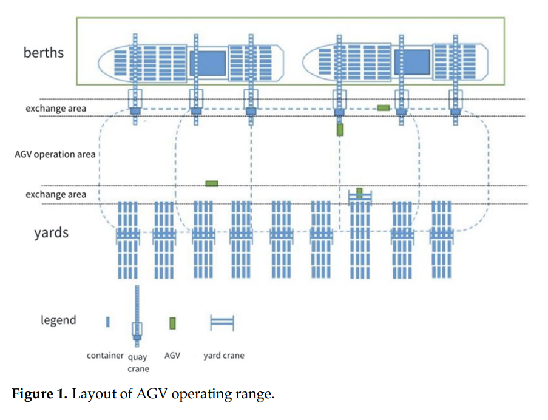

The figure shows berths with vessels and quay cranes at the top, an exchange area, the AGV operation area, a second exchange area and rows of yard blocks with yard cranes at the bottom; a legend marks container, quay crane, AGV and yard crane.

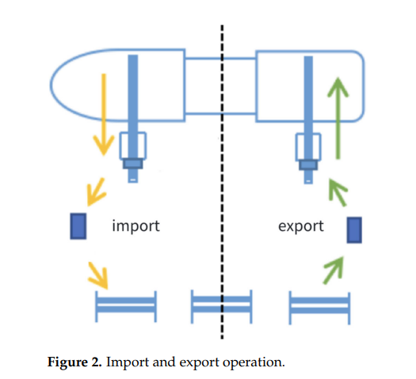

Two panels: on the left, import, with arrows from the quay crane to an AGV and on to a yard crane; on the right, export, with arrows from a yard crane to an AGV and on to the quay crane.

**Energy and states (Sec. 3.3).** Energy differs by operational state, so loading, unloading and waiting are treated separately; the loaded and empty travel times are computed from the distance between crane exchange points and multiplied by the rate of the state. Quay-crane and yard-crane energy is not considered. Following the pooled dispatching strategy of the paper's reference [3], AGVs are shared among cranes, so several AGVs can reach the same crane together.

The paper describes one container task in five stages: (1) empty drive from the charging station or the last drop point to the pick-up point; (2) arrival at the pick-up point, where the AGV compares its time axis with that of the crane and waits if needed; (3) the AGV waits while the crane loads it, then drives loaded to the drop point; (4) arrival at the drop point, with the same time-axis comparison and a possible wait; (5) the crane unloads the AGV, which then drives to the next pick-up point without waiting for the crane to stack the container.

### 2.2 Model (Sec. 4)

**Assumptions (Sec. 4.1).** (1) An AGV has sufficient power throughout and charging is not considered. (2) Congestion and AGV path planning are not considered. (3) An AGV carries one container at a time. (4) An AGV drives at a constant speed throughout.

**Symbols (Sec. 4.2).**

| Symbol | Meaning |
|---|---|
| $J$, $K$, $L$, $N$ | Sets of AGVs ($j=1..J$), yard cranes, quay cranes and containers ($i=1..N$) |
| $N^{in}$, $N^{out}$ | Sets of import and export containers |
| $T_{ji}$ | Time when AGV $j$ transports container $i$ to the yard or quay crane |
| $T_{jii'}$ | Time when AGV $j$ completes the last container $i$ and starts transporting container $i'$ |
| $ET_{ki}$, $LT_{ki}$ | Time when yard crane $k$ starts and completes operating container $i$ |
| $ET_{li}$, $LT_{li}$ | The same for quay crane $l$ |
| $t_{ji}$ | Loading time of AGV $j$ transporting container $i$ |
| $t_{jii'}$ | Unloading time of AGV $j$ between container $i$ and container $i'$ |
| $d_{jki}$, $d_{jli}$ | Waiting time of AGV $j$ with container $i$ under yard crane $k$ and under quay crane $l$ |
| $C^f$, $C^e$, $C^w$ | Energy per second of AGV in loading, unloading and waiting states |
| $t^k$, $t^l$ | Time of a yard crane and of a quay crane operating one container |
| $v^f$, $v^e$ | Loading and unloading speed of the AGV |
| $x_{ji}$ | 1 if AGV $j$ operates container $i$, otherwise 0 |
| $y_{jii'}$ | 1 if AGV $j$ operates container $i'$ after container $i$, otherwise 0 |

**Model (Eqs. 1-12).**

$$\min F=C^f\sum_{i=1}^{N}\sum_{j=1}^{J}x_{ji}t_{ji}+C^e\sum_{i=1}^{N}\sum_{i'=1}^{N}\sum_{j=1}^{J}y_{jii'}t_{jii'}+C^w\Big(\sum_{i=1}^{N}\sum_{j=1}^{J}\sum_{k=1}^{K}d_{jki}+\sum_{i=1}^{N}\sum_{j=1}^{J}\sum_{l=1}^{L}d_{jli}\Big)\qquad(1)$$

$$\sum_{i=1}^{N}x_{ji}=1,\ \forall j\in J\qquad(2)$$

$$\sum_{j=1}^{J}x_{ji}=1,\ \forall i\in N\qquad(3)$$

$$\sum_{j=1}^{J}y_{jii'}=1,\ \forall i\in N,\ \forall i'\in N\qquad(4)$$

$$T_{jii'}=T_{ji}+d_{jli}+t_{ji}+d_{jki}+t_{jii'},\ \forall i\in N^{in},\forall i'\in N,\forall j\in J,\forall k\in K,\forall l\in L\qquad(5)$$

$$T_{jii'}=T_{ji}+d_{jki}+t_{ji}+d_{jli}+t_{jii'},\ \forall i\in N^{out},\forall i'\in N,\forall j\in J,\forall k\in K,\forall l\in L\qquad(6)$$

$$LT_{ki}=ET_{ki}+t^k,\ \forall i\in N,\forall k\in K\qquad(7)$$

$$LT_{li}=ET_{li}+t^l,\ \forall i\in N,\forall l\in L\qquad(8)$$

$$d_{jki}=\max\{ET_{ki}-T_{ji},0\},\ \forall i\in N^{out},\forall j\in J,\forall k\in K\qquad(9)$$

$$d_{jki}=\max\{ET_{ki}-T_{ji}-d_{jli}-t_{ji},0\},\ \forall i\in N^{in},\forall j\in J,\forall k\in K\qquad(10)$$

$$d_{jli}=\max\{ET_{li}-T_{ji},0\},\ \forall i\in N^{in},\forall j\in J,\forall l\in L\qquad(11)$$

$$d_{jli}=\max\{ET_{li}-T_{ji}-d_{jki}-t_{ji},0\},\ \forall i\in N^{out},\forall j\in J,\forall l\in L\qquad(12)$$

The text reads these as follows. Eq. (1) minimises total AGV energy. Eq. (2) restricts an AGV to one container at a time. Eqs. (3) and (4) restrict a container to one AGV. Eqs. (5) and (6) give the time at which AGV $j$ completes the last import (export) container $i$ and starts transporting container $i'$. Eqs. (7) and (8) give the time a yard crane and a quay crane take to operate one container. Eqs. (9) and (10) give the waiting time under a yard crane for an export and an import container; Eqs. (11) and (12) give the waiting time under a quay crane for an import and an export container.

### 2.3 Solution method (Sec. 5)

**VNS (Sec. 5.1).** VNS is described as a local search that switches between neighbourhood structures and uses a shaking mechanism to avoid local optima.

**Coding (Sec. 5.2.1).** A solution is one chromosome per AGV, listing the container numbers that AGV serves from left to right. In the paper's example of 16 tasks and 3 AGVs, the task list (23, 19, 16, 44, 30, 26, 31, 29, 13, 02, 17, 05, 35, 11, 41, 27) is split into AGV 1 (23, 30, 26, 13, 11, 41), AGV 2 (19, 31, 02, 35, 27) and AGV 3 (16, 44, 29, 17, 05).

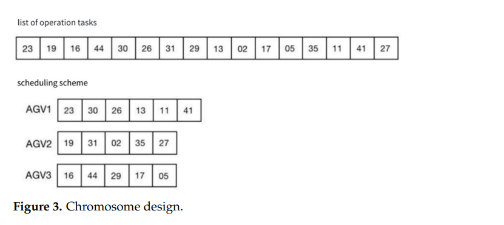

**Operators (Sec. 5.2.2).** Five operators generate neighbourhoods: insert (move one task in a chromosome to just after another in the same chromosome), swap (exchange two tasks in a chromosome), reverse (reverse the segment between two chosen tasks, both included), block swap (swap two blocks of equal length between two chromosomes) and double task swap (choose two tasks in each of two chromosomes and swap the four tasks two by two).

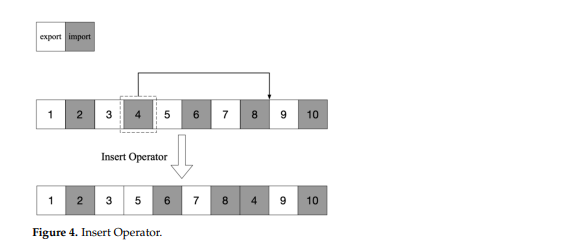

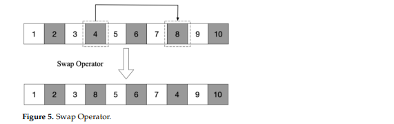

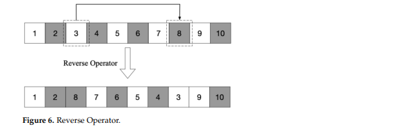

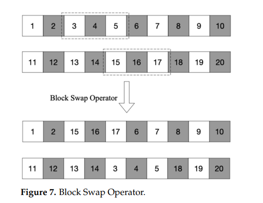

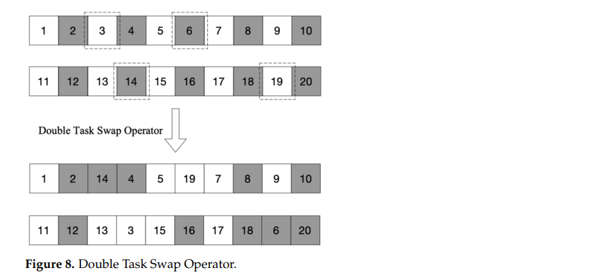

The examples use tasks numbered 1 to 10 (and 11 to 20), shaded by export or import. In Fig. 4 task 4 moves after task 8 (1 2 3 5 6 7 8 4 9 10); in Fig. 5 tasks 4 and 8 swap; in Fig. 6 tasks 3 to 8 are reversed (1 2 8 7 6 5 4 3 9 10); in Fig. 7 tasks 3, 4, 5 and 15, 16, 17 are exchanged between the two chromosomes; in Fig. 8 tasks 3 and 6 trade places with 14 and 19 (our reading of the figure).

**Initial solution (Sec. 5.2.3, Fig. 9).** Create $m$ empty chromosomes ($m$ = number of AGVs). For each container in the list, for each AGV, compute the total energy after inserting the container into that AGV's chromosome; insert the container into the chromosome with minimum total energy and remove it from the list. The output is the initial solution $s_0$.

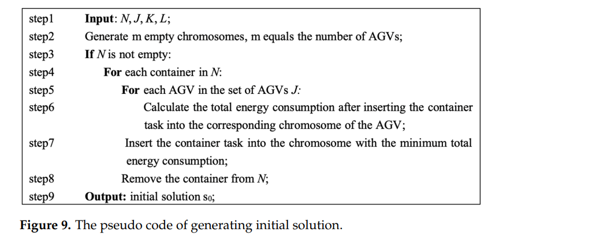

**Objective calculation (Sec. 5.2.4, Fig. 10).** The inputs are the chromosomes, the pick-up and drop point sets and the crane operating times. For each AGV and each task in it, the procedure retrieves the pick-up and drop points, computes the distance and time $t_{jii'}$ from the AGV's current position to the pick-up point and updates energy and time, then, if the container is export, computes the waiting time $d_{jki}$ at the pick-up point from the yard crane operating time (import: $d_{jli}$ from the quay crane operating time) and updates energy and time, computes the distance and time $t_{ji}$ from pick-up to drop point, updates energy and time, and updates the AGV position. The output is total energy and operating time.

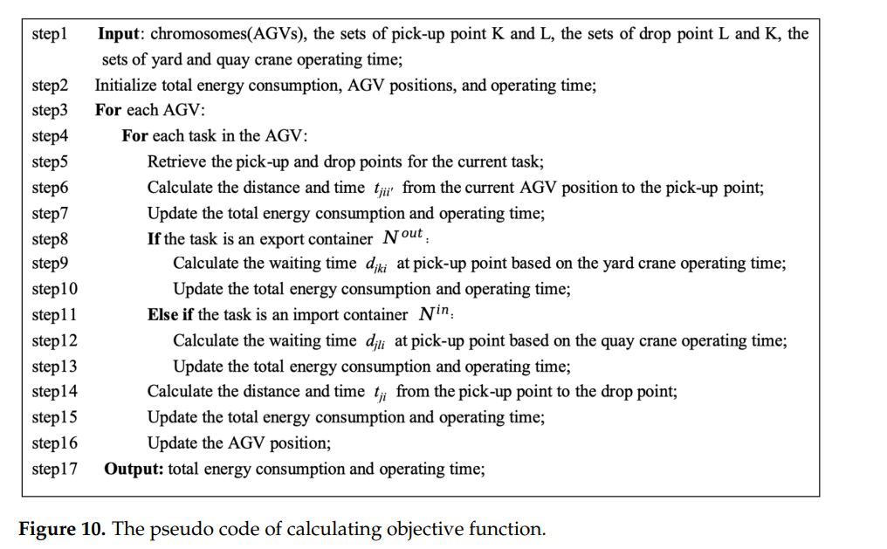

**VNS procedure (Sec. 5.3, Fig. 11).** Inputs are $s_0$, the maximum neighbourhood range $k_{max}$ and the maximum number of unoptimised iterations $\alpha_{max}$. Two sets of neighbourhood structures, $S$ for shaking and $L$ for local search, are generated and $\alpha=0$. While $\alpha\le\alpha_{max}$: set $k=1$; while $k\le k_{max}$: pick $k$ structures from $S$ at random to shake the current solution $s$ into $s'$, pick $k$ structures from $L$ at random for a local search on $s'$ giving $s''$ and $F(s'')$; if $F(s'')<F(s)$ update the current solution, otherwise $k=k+1$. After the inner loop, if $F(s'')<F(s)$ update the global best, otherwise $\alpha=\alpha+1$. The output is the global best solution and energy.

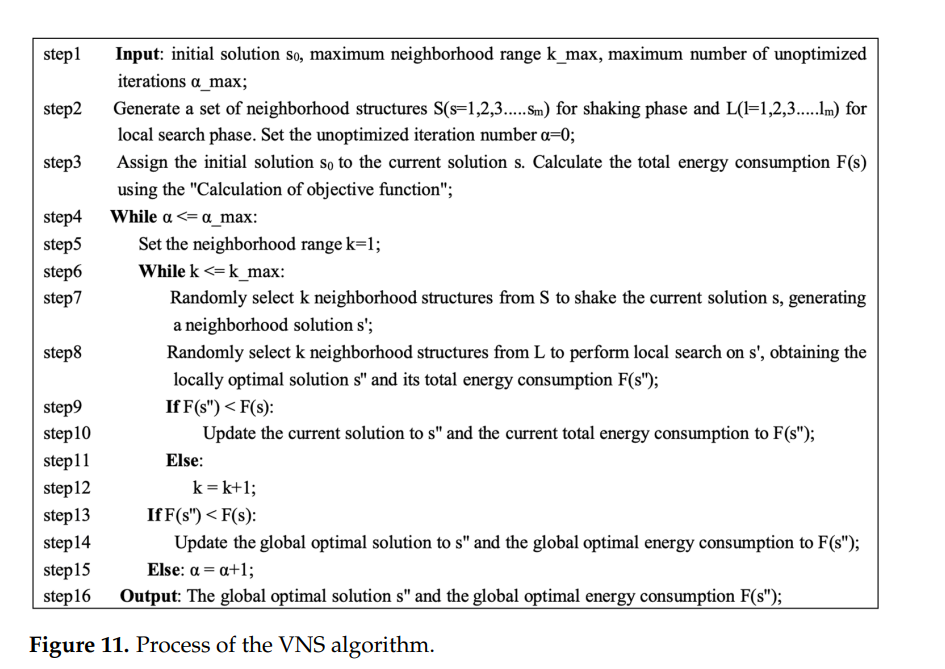

### 2.4 Experimental design (Sec. 6.1)

Computations ran on Windows 10 with a 12th Gen Intel Core i5-12600KF at 3.70 GHz and 16 GB. The small-scale example has 100 container tasks (1 to 50 export, 51 to 100 import) and the large-scale example 500 tasks (1 to 250 export, 251 to 500 import). Pick-up and drop points are generated randomly for each group of experiments. The operating time of each container at a yard crane and a quay crane is drawn from a normal distribution N(75 s, 15 s). The AGV speeds and energy rates are quoted from the paper's reference [21] (Table 1). All experiments use 10 groups. For the GA, the paper uses the one from its reference [15].

| Parameter | Description | Value |
|---|---|---|
| $v^f$ | Loading speed of AGV (m/s) | 3.5 |
| $v^e$ | Unloading speed of AGV (m/s) | 6 |
| $C^f$ | Energy consumption of AGV in loading state (kWh/s) | 0.006 |
| $C^e$ | Energy consumption of AGV in unloading state (kWh/s) | 0.004 |
| $C^w$ | Energy consumption of AGV in waiting state (kWh/s) | 0.0025 |

*Table 1. AGV parameters.*

### 2.5 Results (Sec. 6)

**Number of AGVs, small scale (Table 2, Fig. 12).** 100 tasks, 2 to 5 AGVs, mean of 10 groups; pre-optimisation is the initial solution of Fig. 9, post-optimisation the VNS result. EC is energy consumption and OT operating time.

| AGVs | Pre EC (kWh) | Pre OT (s) | Post EC (kWh) | Post OT (s) | Decrease EC | Decrease OT |
|---|---|---|---|---|---|---|
| 2 | 27.85 | 6406.64 | 20.57 | 5568.61 | 26.14% | 13.09% |
| 3 | 27.98 | 4358.53 | 20.73 | 3845.59 | 25.91% | 11.77% |
| 4 | 27.99 | 3372.59 | 20.85 | 2999.17 | 25.51% | 11.07% |
| 5 | 28.23 | 2621.11 | 20.99 | 2294.20 | 25.65% | 12.47% |

*Table 2. Results on comparison of the number of AGVs in small-scale.*

The paper states that the energy decrease stabilises at about 26% across AGV numbers, that about 7 kg of CO2 is saved, and that operating time falls by more than 10%.

**VNS against GA, small scale (Table 3, Figs. 13-16).** "OR" is the reduction ratio from the initial solution; "Gap" is VNS against GA.

| AGVs | Initial EC | GA EC | GA OR | GA CPU (s) | VNS EC | VNS OR | VNS CPU (s) | Gap EC | Gap CPU |
|---|---|---|---|---|---|---|---|---|---|
| 2 | 27.96 | 23.71 | 15.20% | 18.03 | 20.54 | 26.54% | 12.91 | 13.37% | 28.40% |
| 3 | 28.07 | 23.79 | 15.25% | 17.76 | 20.69 | 26.29% | 12.34 | 13.03% | 30.52% |
| 4 | 28.21 | 23.98 | 14.99% | 18.23 | 20.86 | 26.05% | 12.68 | 13.01% | 30.44% |
| 5 | 28.29 | 24.14 | 14.67% | 18.35 | 20.97 | 25.87% | 12.66 | 13.13% | 31.01% |

*Table 3. Results on comparison of algorithms in small-scale.*

The paper states that the VNS energy is lower than the GA energy ("an average increase of about 13%"), that VNS is more stable over single experiments (Fig. 14), that GA and VNS save about 4.2 kg and 7.4 kg of CO2, and that VNS needs about 30% less computing time.

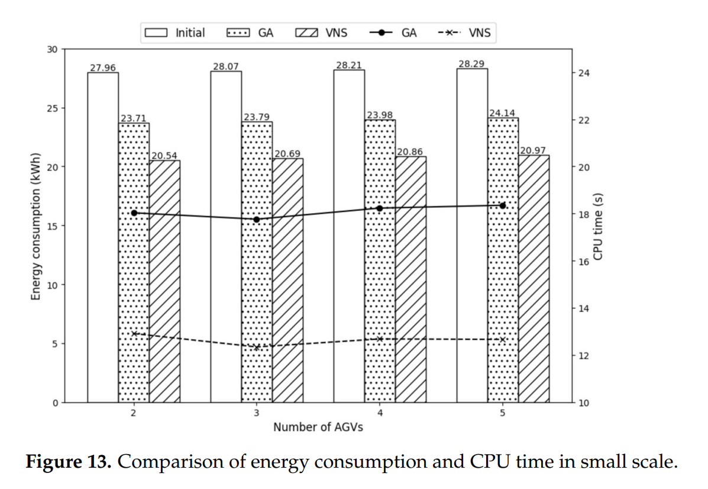

Bars for initial, GA and VNS energy (labels as in Table 3) and lines for CPU time on the right axis: GA ≈18.0, ≈17.8, ≈18.2, ≈18.35 s and VNS ≈12.9, ≈12.3, ≈12.7, ≈12.7 s for 2, 3, 4, 5 AGVs.

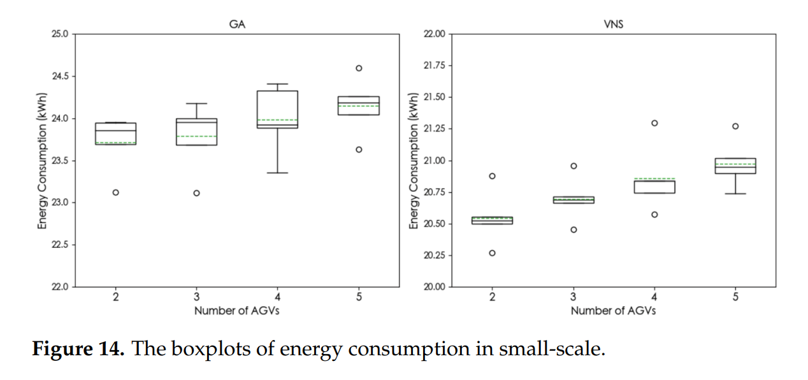

Ten-trial boxplots by number of AGVs. The VNS boxes are narrow (for 2 AGVs ≈20.50 to ≈20.55 kWh, outliers ≈20.27 and ≈20.88); the GA boxes are wider (≈23.7 to ≈24.0 kWh for 2 AGVs, one outlier ≈23.1). The y-axes differ (22 to 25 for GA, 20 to 22 for VNS); a green dashed line has no legend and lies at the table means in our reading.

**Energy by state, small scale (Fig. 15).** The paper states that loading energy is the majority of total energy and, "when the number of containers is certain", stays constant under optimisation, so the reduction comes mainly from the unloading state, with a slight decrease in waiting, which is small.

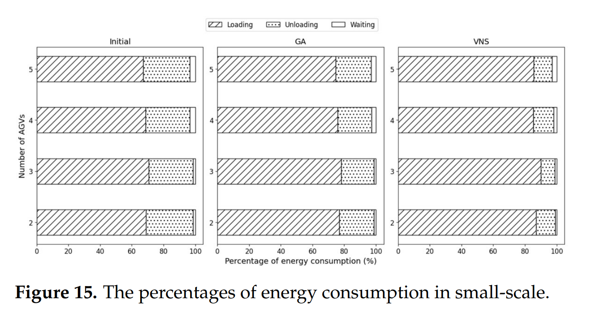

Stacked percentage bars for initial, GA and VNS by number of AGVs. Loading shares, read as ≈, for 2, 3, 4, 5 AGVs: initial ≈69, ≈70.5, ≈69, ≈67; GA ≈77, ≈78, ≈76, ≈74.5; VNS ≈87, ≈90, ≈85.5, ≈85.5. Waiting is ≈1 to ≈3.5%.

**Convergence, small scale (Fig. 16).** With 2 AGVs both algorithms start from the same initial solution of 27.96 kWh. After iteration 1 GA reaches 26.10 kWh and VNS 23.31 kWh. VNS "converges after about the 10th iteration" at about 21 kWh, GA stabilises after about the 15th iteration.

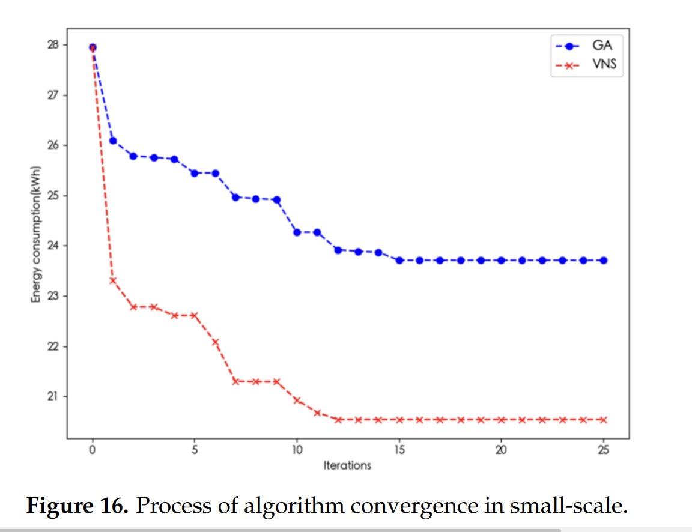

GA is ≈26.1 at iteration 1 and flat at ≈23.7 from iteration ≈15; VNS is ≈23.3 at iteration 1 and flat at ≈20.54 from iteration ≈12.

**Number of AGVs, large scale (Table 4, Fig. 17).** 500 tasks.

| AGVs | Pre EC (kWh) | Pre OT (s) | Post EC (kWh) | Post OT (s) | Decrease EC | Decrease OT |
|---|---|---|---|---|---|---|
| 2 | 139.01 | 32,013.01 | 101.66 | 27,330.87 | 26.87% | 14.63% |
| 3 | 139.18 | 21,603.92 | 101.75 | 18,374.90 | 26.89% | 14.95% |
| 4 | 139.20 | 16,201.16 | 101.86 | 13,726.88 | 26.82% | 15.27% |
| 5 | 139.36 | 13,224.88 | 101.97 | 11,539.90 | 26.83% | 12.74% |

*Table 4. Results on comparison of the number of AGVs in large-scale.*

The paper states that the energy decrease is about 26.8% and stable over AGV numbers, that about 37 kg of CO2 is saved, that the operating-time decrease is 12% to 16%, and that the gap between scales is only about 1%, which it takes to show the stability of VNS across scales.

**VNS against GA, large scale (Table 5, Figs. 18-21).**

| AGVs | Initial EC | GA EC | GA OR | GA CPU (s) | VNS EC | VNS OR | VNS CPU (s) | Gap EC | Gap CPU |
|---|---|---|---|---|---|---|---|---|---|
| 2 | 139.03 | 122.67 | 11.77% | 58.55 | 101.41 | 27.06% | 41.04 | 17.33% | 29.91% |
| 3 | 139.23 | 123.00 | 11.66% | 62.12 | 101.51 | 27.09% | 42.87 | 17.45% | 30.83% |
| 4 | 139.32 | 123.09 | 11.65% | 59.34 | 101.54 | 27.12% | 42.35 | 17.51% | 28.63% |
| 5 | 139.39 | 123.13 | 11.67% | 61.24 | 101.73 | 27.02% | 43.42 | 17.38% | 29.10% |

*Table 5. Results on comparison of algorithms in large-scale.*

The paper states that the VNS decrease is "considerably better" than the GA one, about 17.4% on average, that VNS is more stable (Fig. 19), that GA and VNS save about 16.2 kg and 37.5 kg of CO2, and that VNS needs about 30% less computing time.

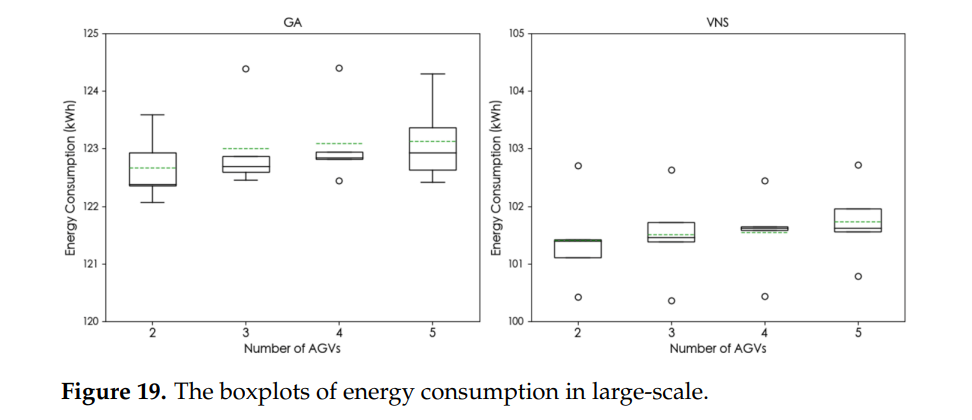

Ten-trial boxplots. VNS ≈101.1 to ≈101.7 kWh with outliers near ≈100.4 and ≈102.7; GA ≈122.4 to ≈123.0 kWh, wider at 5 AGVs; both panels span 5 kWh.

**Energy by state, large scale (Fig. 20).** The paper states that the shares are similar to the small scale, with a higher initial loading share and lower unloading and waiting shares, which it attributes to a larger choice of containers reducing idle running and waiting; after optimisation the unloading and waiting shares fall considerably, and "the VNS algorithm ... enhances the percentage of energy consumption in the loading state by more than 90%".

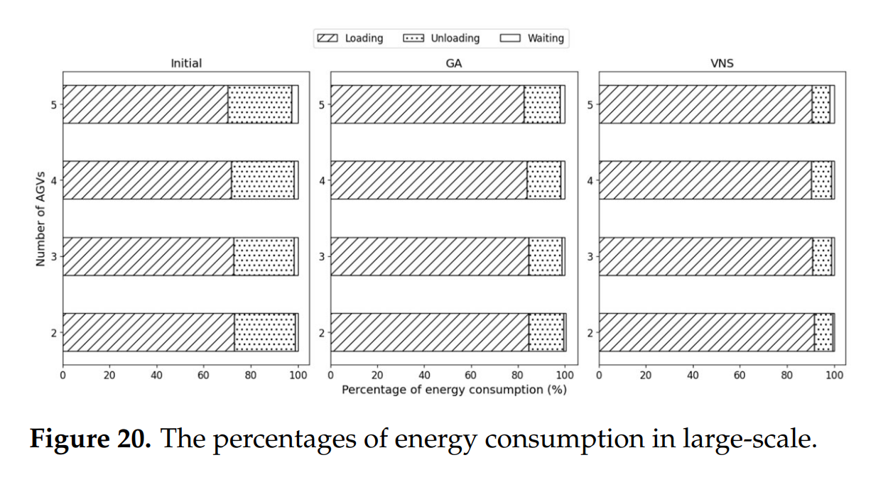

Loading shares, read as ≈, for 2, 3, 4, 5 AGVs: initial ≈73, ≈73, ≈71.5, ≈70; GA ≈84.5, ≈84.5, ≈84, ≈82.5; VNS ≈91.5, ≈91, ≈90.5, ≈90.5.

**Convergence, large scale (Fig. 21).** With 2 AGVs the initial energy is 139.03 kWh. After iteration 1 GA reaches 133.79 kWh and VNS 114.47 kWh. VNS converges after about the 40th iteration at about 101 kWh; GA is stable after about the 50th iteration.

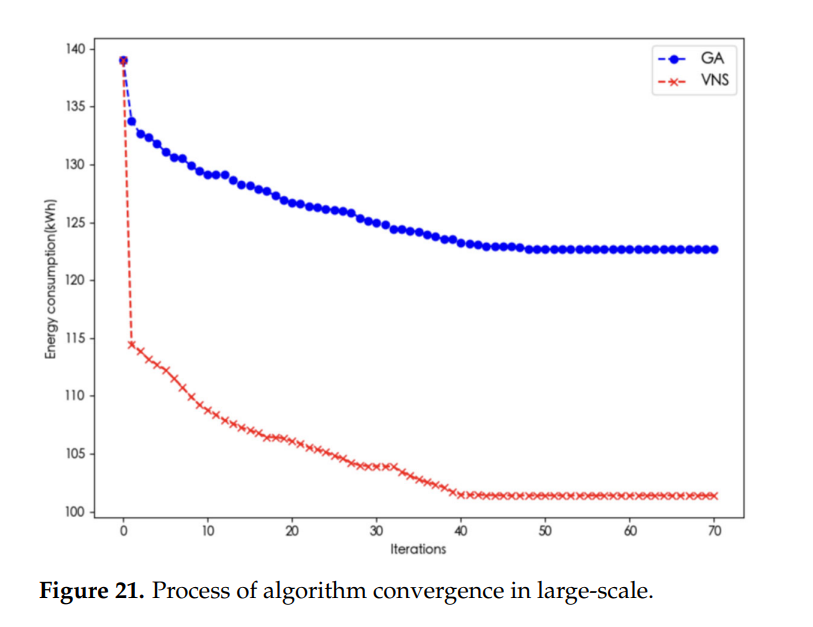

GA falls to ≈122.7 kWh by iteration ≈48 and VNS to ≈101.4 kWh by iteration ≈40; the curves run to iteration 70.

**AGV speed (Sec. 6.4, Tables 6, 7, Fig. 22).** Three more parameter sets are tested with 2 AGVs and 100 tasks, 10 groups.

| Loading speed (m/s) | Unloading speed (m/s) | Loading EC (kWh/s) | Unloading EC (kWh/s) |
|---|---|---|---|
| 3.5 | 6 | 0.006 | 0.004 |
| 4.2 | 7.2 | 0.00864 | 0.00576 |
| 5.25 | 9 | 0.0135 | 0.009 |
| 7 | 12 | 0.024 | 0.016 |

*Table 6. Different AGV speeds and corresponding energy consumption.*

| Loading speed (m/s) | Unloading speed (m/s) | Pre EC (kWh) | Post EC (kWh) | OR |
|---|---|---|---|---|
| 3.5 | 6 | 28.22 | 20.69 | 26.68% |
| 4.2 | 7.2 | 33.81 | 24.79 | 26.66% |
| 5.25 | 9 | 42.18 | 30.99 | 26.53% |
| 7 | 12 | 56.12 | 41.26 | 26.48% |

*Table 7. Results on different AGV speeds.*

The paper states that energy rises with speed "in line with the actual production situation", and that the VNS decrease stays near 26.5%, decreasing slightly with speed.

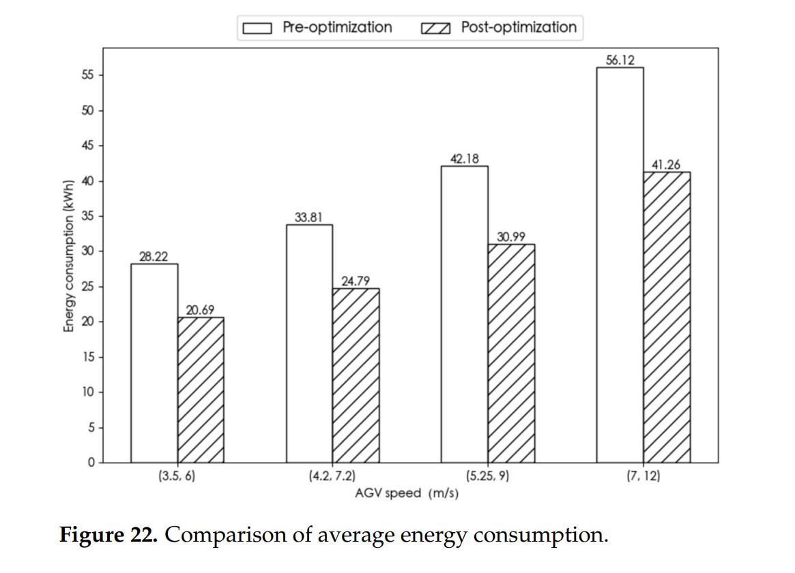

Bars of pre- and post-optimisation energy for the four speed pairs, with labels as in Table 7.

### 2.6 Conclusions (Sec. 7)

The paper concludes that VNS shows a satisfactory optimisation effect and stability on the AGV scheduling problem with energy consumption, that it offers a route other than the genetic algorithm that dominates the literature, and that it adapts to scale and speed. It also states that for large-scale problems "the solution efficiency of VNS is somewhat limited, often requiring the support of other algorithms", and that with further optimisation VNS is expected to be applied in actual intelligent scheduling of automated container terminals.

### 2.7 Gaps and inconsistencies in the printed paper

1. **Eq. (2).** As printed, $\sum_{i}x_{ji}=1$ for every AGV $j$ gives each AGV exactly one container, which does not fit 100 or 500 containers on 2 to 5 AGVs.
2. **Eq. (4).** As printed, $\sum_j y_{jii'}=1$ for every pair $i,i'$ (including $i=i'$) cannot hold for a sequence of containers on an AGV.
3. **Crane timing.** $LT_{ki}$ and $LT_{li}$ (Eqs. 7, 8) are not used in Eqs. (1)-(6) and (9)-(12), and how $ET_{ki}$ and $ET_{li}$ are determined (the crane's own sequence and the interaction of several AGVs on one crane, as Sec. 3.3 describes) is not printed. Eqs. (5) and (6) contain no crane handling time $t^k$ or $t^l$, although stages 3 and 5 of Sec. 3.3 have the AGV wait for loading and unloading. The link between $T_{jii'}$ and the next $T_{ji'}$ is not printed.
4. **Names.** "Loading" and "unloading" mean loaded and empty AGV travel, not crane operations; $t_{ji}$ is called a loading time and $t_{jii'}$ an unloading time between two containers. Assumption (4) gives a constant speed throughout, while Table 1 gives different speeds for loaded and empty travel.
5. **Fig. 10.** The pseudocode computes waiting only at the pick-up point, while Eqs. (5), (6), (10), (12) and stage 4 of Sec. 3.3 include waiting at the drop point. It loops over AGVs one at a time without a step that updates a crane's time axis between AGVs.
6. **Fig. 9.** The position at which a container is inserted into a chromosome is not stated, nor the order in which containers are taken; step 6 computes the energy "after inserting the container task into the corresponding chromosome" while the text says the total energy of all AGV operations.
7. **Fig. 11.** After step 10 the current solution is $s''$, so at step 13 the test $F(s'')<F(s)$ cannot be true as printed, which means the global best would never be updated and the output $s''$ is the last local solution (our reading of the printed steps). The values of $\alpha_{max}$ and $k_{max}$ are not given, and which operators belong to $S$ and which to $L$ is not stated.
8. **Missing experiment data.** The numbers of quay cranes and yard cranes, the layout and distances behind the random pick-up and drop points, the AGV start location and the number of containers per crane are not described. The Data Availability Statement says some of the data come from cooperative enterprises, without saying which.
9. **Operating time.** OT is not defined; the product of OT and the number of AGVs in Tables 2 and 4 is about 12,800 to 13,500 s (100 tasks) and about 64,000 to 66,100 s (500 tasks) (our arithmetic), which is what a total of AGV times divided among AGVs would give.
10. **Tables 2-5.** Initial energies differ between tables of the same setting (2 AGVs: 27.85 in Table 2 and 27.96 in Table 3; 139.01 and 139.03 in Tables 4 and 5), as do the VNS results (20.57 and 20.54; 101.66 and 101.41), although the text says the setup is the same. The OT decrease for 2 AGVs recomputes to 13.08% against 13.09% printed, and in Table 5 for 3 AGVs the gaps recompute to 17.47% (EC) and 30.99% (CPU) against 17.45% and 30.83% printed (our arithmetic).
11. **Fig. 15, Fig. 20 and the constancy of loading energy.** The text states that loading energy does not change with optimisation. With the ≈ shares and the table totals, loading energy for 2 AGVs comes to ≈19.2 kWh before (0.69 × 27.85) and ≈17.9 kWh after (0.87 × 20.57) at 100 tasks, and ≈101.5 kWh before (0.73 × 139.01) and ≈93.0 kWh after (0.915 × 101.66) at 500 tasks (our arithmetic from graph readings). The phrase "enhances the percentage ... by more than 90%" can be read as a share above 90% or an increase of 90%; the figure shows shares near 90% to 91.5%.
12. **Wording.** The VNS gap to GA is called an "average increase of about 13%" for what is a decrease of energy. The conclusion says VNS efficiency is limited for large problems; Table 5 reports about 30% less CPU time than GA at 500 tasks.
13. **GA.** Population size, crossover and mutation settings, encoding and stopping rule of the GA are not stated beyond reference [15]; GA and VNS "iterations" in Figs. 16 and 21 are not the same unit of work.
14. **Convergence examples.** The final values in Fig. 16 (≈23.7, ≈20.54) and Fig. 21 (≈122.7, ≈101.4) equal the ten-trial means of Tables 3 and 5 for 2 AGVs; how a single example reaches the mean is not explained.
15. **Boxplots.** Fig. 14 uses different y-axis ranges for GA and VNS, and the dashed line has no legend. Ten trials support the statement about stability only at that sample size.
16. **Speed experiment.** The energy rates in Table 6 equal the Table 1 rates multiplied by the square of the speed ratio (1.2² = 1.44, 1.5² = 2.25, 2² = 4; our arithmetic), so with loaded and empty travel time inversely proportional to speed the energy rises about in proportion to speed (28.22 → 33.81 → 42.18 → 56.12, ratios 1.198, 1.495, 1.989). The rule used to derive the rates is not stated, and the waiting rate stays at its Table 1 value (not listed in Table 6).
17. **Practical application.** The abstract mentions "practical application potential"; no case with real terminal data is described.

---

## 3. Structured summary

| Field | Value |
|---|---|
| Problem | Assign containers to AGVs and sequence them to minimise total AGV energy in three states (loaded, empty, waiting) |
| Decision trigger | Offline optimisation of a whole container list; no event described |
| Decision | Container-to-AGV assignment and the order per AGV |
| Objective | Total energy (Eq. 1); operating time reported, not optimised |
| Scale | 100 and 500 tasks, 2 to 5 AGVs; quay and yard crane numbers not described |
| Randomness: quay-crane cycle time | Operating time per container N(75, 15) s, drawn once per instance |
| Randomness: travel time / congestion | Excluded by assumption (2); constant speeds |
| Randomness: task arrival | Whole list known at the start; no arrival process |
| Randomness: stowage / workload | Not described |
| Randomness: yard crane | Operating time per container N(75, 15) s, drawn once per instance |
| Randomness: AGV breakdown, battery | Breakdown not described; battery sufficient by assumption (1) |
| Method | VNS with five operators, greedy initial solution |
| Evaluation | 10 groups per setting, means and boxplots, one convergence example per scale |
| Benchmarks | Initial greedy solution; GA from reference [15] (settings not stated) |

**Citation sentence supported by the paper:** *Zhao et al. (2025) report, for 100 randomly generated container tasks and 2 AGVs, a total AGV energy of 20.57 kWh after variable neighbourhood search against 27.85 kWh for the initial solution (26.14% lower), and 13.37% lower energy than a genetic algorithm (Tables 2, 3).*

---

## 4. What the paper does not support

- **Disruptions or stochastic operation.** Crane times are drawn from N(75, 15) s per instance, but the scheduler works with the drawn values and each solution is evaluated on that same instance; no breakdown, delay, arrival or travel-time variation is tested.
- **Real-time dispatching.** The method optimises a whole container list offline; CPU time is about 12 to 13 s for 100 tasks and about 41 to 43 s for 500 tasks (Tables 3, 5), without any per-decision timing.
- **Quay-crane idle time.** The objective is AGV energy; crane waiting is not measured, and AGV waiting is one of the three energy terms.
- **Congestion.** Assumption (2) excludes it.
- **General superiority over GA.** The GA settings are not stated, only one family of generated instances is used, and the number of trials is ten.
- **Constant loading energy.** The statement that loading energy stays constant is not supported by the shares in Figs. 15 and 20 combined with Tables 2 and 4 (Sec. 2.7, item 11).
- **Practical readiness.** No case with terminal layout, crane counts or real data is reported.
- **Reproducibility.** Crane and block counts, distances, GA settings, $\alpha_{max}$, $k_{max}$ and the operator split between shaking and local search are not given.

---

## 5. Our reading (interpretation, not from the paper)

### 5.1 What we can use

- **A deterministic offline benchmark of the kind our study contrasts with.** The method assigns and sequences a known list of containers in one optimisation; with random crane times drawn once and then treated as known, it is optimising against a realised sample. This is a clear example of the setting whose degradation under unrevealed randomness we want to measure, though the paper itself does not test that.
- **A greedy insertion rule and five operators.** The initial solution of Fig. 9 (insert each container where total energy rises least) and the operators of Figs. 4-8 are a compact, reproducible description of a baseline search that we could implement and re-run on our own instances.
- **Three-state energy model.** Loaded, empty and waiting travel with rates of 21.6, 14.4 and 9 kW (0.006, 0.004, 0.0025 kWh/s × 3600; our arithmetic). Energy per container is about 0.28 kWh before and about 0.21 kWh after VNS at both 100 and 500 tasks (our arithmetic), so energy is nearly linear in the number of tasks in this setup.
- **Instance recipe and scale.** 50/50 export and import tasks, crane times N(75, 15) s and 2 to 5 AGVs for 100 and 500 tasks give a worked example, with 20 to 50 tasks per AGV at 100 tasks and 100 to 250 tasks per AGV at 500 tasks (our arithmetic). The number of cranes is not stated, so a vehicle-to-crane ratio cannot be derived.
- **Runtime data point.** About 12 to 13 s at 100 tasks and about 41 to 43 s at 500 tasks on a desktop CPU, about 3.2 to 3.4 times longer for 5 times more tasks (our arithmetic).
- **Leads.** The paper cites Drungilas et al. (deep reinforcement learning for AGV speed and energy), Chu and Liang (DQN for AGV scheduling), Xing et al. (dispatching with speed optimisation), Yang et al. (energy with changing and constant speed, the GA source) and Bae and Kim (pooled dispatching); these are worth reading.
- **Cautions.** Eqs. (2) and (4), the crane timing, the VNS pseudocode (step 13) and the loading-energy shares cannot be taken as printed without choices of our own; Sec. 2.7 lists the places.
