# Multi-AGV Dynamic Scheduling in an Automated Container Terminal: A Deep Reinforcement Learning Approach

**Zheng, Liang, Wang, Shi & Lim (2022)** · *Mathematics* 10, 4575 · [DOI 10.3390/math10234575](https://doi.org/10.3390/math10234575)

> **How to read this note.** Sections 1-4 summarise what the paper says, by section, equation, table and figure number. Section 5 is *our* interpretation for the thesis and is labelled as such.

---

## Key takeaways

- **What it did:** models seaside AGV dispatching as an MDP and trains a single-agent DQN against a Plant Simulation model. At every trigger (a QC releases a container, or an AGV becomes idle) the network chooses one of 36 actions, a combination of a scheduling rule (FCFS, STD or LWT) and an AGV index. The reward combines AGV completion time and QC waiting time.
- **Numbers to remember:** training model with 8 QCs, 12 AGVs, 8 yards, 384 tasks, 5,000 episodes; network 28-350-140-36. Table 4 (DQN against GA, minutes): at 384 x 12, QC waiting 397.40 against 801.61, makespan 93.08 against 143.93, but AGV completion time 937.09 against 829.30. At 48 x 4 the GA has the lower makespan (27.29 against 28.14) and AGV completion time (96.93 against 103.74). Tables 6-7 (against FCFS, STD, LWT): DQN has the lowest AGV completion time at all four sizes, and the lowest QC waiting at three of four (at 48 x 4 STD 138.670 and LWT 128.690 are below DQN's 142.891). CPU time (Table 8): DQN 3.24-21.02 s against 1.10-8.28 s for the rules; GA 20-135 min (Table 5).
- **Used in the thesis for:** a DQN precedent with a small mixed-rule action set, an objective precedent (AGV completion plus QC waiting), and the FCFS/STD/LWT rule set as baselines.
- **Not evidence for:** dominance over GA or rules at every size, robustness to breakdowns, battery or yard-crane delay, or generalisation to unseen scenarios (no seeds, intervals or train/test description).

---

## 1. Summary in five points

1. The paper formulates dynamic multi-AGV scheduling at an automated terminal's seaside as an MDP and proposes a DQN whose action is a pair (scheduling rule, AGV), so that the network selects both the rule that orders the waiting container tasks and the AGV that takes the selected task (Sec. 3.3, 4).
2. The state is five features: number of waiting tasks, their average waiting time, their average transport distance, AGV working status and AGV positions (Sec. 3.2). The reward is a weighted sum of a completion-time term and a QC-waiting term per task, each written as a large constant minus a time (Eq. 4-9).
3. The agent is trained for 5,000 episodes on a Siemens Tecnomatix Plant Simulation model (8 QCs, 12 AGVs, 8 yards, 384 import tasks) coupled to TensorFlow by a socket; the reward curve rises around episodes 1,500-2,000 (Sec. 5, Fig. 7).
4. Against a static GA, the paper reports lower QC waiting at all four sizes and lower makespan at the three larger ones, but higher total AGV completion time at all four (Table 4). Against the three single rules, it reports the lowest AGV completion time at all four sizes and the lowest QC waiting at three (Tables 6-7).
5. The paper states that the DQN has no particularly obvious advantage in small cases and that the advantage grows with tasks and AGVs (Sec. 7). It gives no network or reward hyperparameters, no GA parameters, no seeds or intervals, and does not describe how test instances relate to training scenarios.

---

## 2. What the paper does

### 2.1 Setting and problem (Sec. 1-3)

The paper considers import unloading at an automated terminal (Fig. 1): QCs take containers from berthed ships and hand them to AGVs, AGVs carry them to a designated yard block where an AGV mate buffers the container until a yard crane (YC) picks it up. The authors name early or late ship arrival, equipment conflicts and failures, and AGV stops or delays as reasons why static methods do not adapt (Sec. 1). Their literature review (Sec. 2) groups earlier work into static analytical models with GA, SA or PSO solvers, dynamic dispatching rules (FCFS, shortest travel distance, longest waiting time) and a few RL studies, and states that DQN "has not been applied" to dynamic AGV scheduling in an automated terminal (an authors' statement; no search procedure is described).

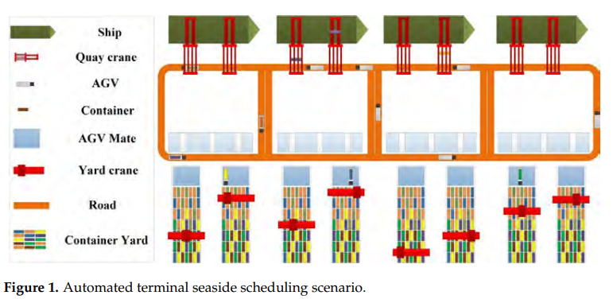

Contributions as listed (Sec. 1): the MDP formulation; a DQN approach that selects "the optimal mixed rule and AGV assignments" to minimise total AGV completion time and total QC waiting time; and a Plant Simulation model of a Shanghai terminal with experiments against GA and rule-based scheduling.

The MDP is written as $(S, a, P, R, \gamma, \pi)$ (Sec. 3.1).

**State (Sec. 3.2).** A five-tuple $s_t = (N_t, T_{awt}, D_{adt}, A_{st}, A_{iloc})$:

- $N_t$: number of container tasks on QCs currently waiting for AGV transport.
- $T_{awt}$: their average waiting time,

$$T_{awt} = \frac{\sum_{k=1}^{N_t} t_k}{N_t} \tag{1}$$

- $D_{adt}$: their average transport distance, with $d_k$ the distance from the task's QC to its yard destination,

$$D_{adt} = \frac{\sum_{k=1}^{N_t} d_k}{N_t} \tag{2}$$

- $A_{st}$: working status of all AGVs as a binary vector, with $n_i = 1$ for "Working" and $n_i = 0$ for "Idle",

$$A_{st} = n_1 n_2 \dots n_i \tag{3}$$

- $A_{iloc}$: position of AGV $i$ as coordinates $(x_i, y_i)$.

**Action (Sec. 3.3).** $a_t = (Ru_t, AGV_t)$, where $Ru_t \in \{1\ (\text{FCFS}), 2\ (\text{STD}), 3\ (\text{LWT})\}$ "determines the order of the task assignments" and $AGV_t = i$ is the AGV assigned to the selected task. Rules come from Klein and Kim and from Sabuncuoglu (refs. 7, 8 in the paper).

**Table 1. Scheduling rules (entries condensed).**

| Rule | Description | Advantage stated | Shortcoming stated |
|---|---|---|---|
| FCFS | Tasks selected in order of arrival | Overall efficiency and smoothness | Not effective for metrics other than efficiency, such as task priorities and travel costs |
| STD | Task with the shortest trip first | Improves overall efficiency to a certain extent | Can cause longer waiting times and longer trips |
| LWT | Task with the longest waiting time first | Reduces task waiting time | Not effective for metrics other than waiting time, such as efficiency and travel costs |

**Reward (Sec. 3.4).** With $t^r_{ik}$ the completion time of AGV $i$ after handling task $k$, $t^w_{ik}$ the time the QC waits for the AGV when AGV $i$ performs task $k$, $M$ and $N$ "sufficiently large" constants, $\alpha$ and $\beta$ cost coefficients, and $\mu_1, \mu_2$ weights:

$$C_{ik}^r = \alpha(M - t_{ik}^r) \tag{4}$$

$$C_r = \alpha \sum_i \sum_k C_{ik}^r = \alpha \sum_i \sum_k (M - t_{ik}^r) \tag{5}$$

$$C_{ik}^w = \beta(N - t_{ik}^w) \tag{6}$$

$$C_w = \beta \sum_i \sum_k C_{ik}^w = \beta \sum_i \sum_k (N - t_{ik}^w) \tag{7}$$

$$R_t = \mu_1 C_{ik}^r + \mu_2 C_{ik}^w \tag{8}$$

$$R_f = \mu_1 C_r + \mu_2 C_w \tag{9}$$

$R_t$ is "the current reward" for each container task and $R_f$ the "final reward" for the overall schedule. $C^r$ is called the completion-time cost, $C^w$ the penalty cost of QCs waiting for the AGV.

**Value function (Sec. 3.5).** The paper defines

$$Q^\pi(s, a) = E_\pi\{R \mid s_t = s, a_t = a\} \tag{10}$$

$$Q^\pi(s, a) = E_\pi\{R \mid s_t = s, a_t = a\} = E_\pi\{R_{t+1} + \gamma R_{t+2} + \dots + \gamma^{*} R_{t+k+1}\} \tag{11}$$

$$Q^{\pi^*}(s, a) = \max E_\pi\{R \mid s_t = s, a_t = a\} = \max Q^\pi(s, a), \forall s \in S, \forall a \in A \tag{12}$$

and states the goal as finding an optimal "mixed rule policy" $\pi^*$.

### 2.2 Method (Sec. 4)

**Networks.** A main and a target Q-network with identical structure: one input layer, two hidden layers and one output layer, fully connected (Sec. 4.1). The first three input nodes carry $N_t$, $T_{awt}$, $D_{adt}$; the remaining input nodes carry each AGV's working status and coordinates. Each output node is one AGV-rule combination. ReLU is used between the input and first hidden layer and between the hidden layers; softmax between the second hidden layer and the output. Hidden-layer sizes are "decided by the simulations". For 12 AGVs and 3 rules the paper gives 28 input and 36 output nodes (Sec. 5.2).

**Table 2. Network parameter settings.**

| Layer | Number of nodes | Activation | Description |
|---|---|---|---|
| Input layer | 28 | None | Accepts system state $s_t$ |
| Hidden layer 1 | 350 | ReLU | None |
| Hidden layer 2 | 140 | ReLU | None |
| Output layer | 36 | Softmax | Value function $Q(s, a)$ for output action |

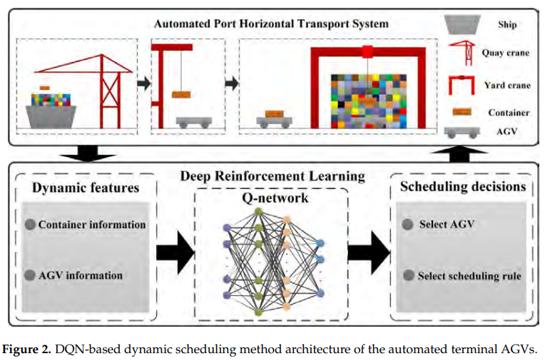

**Training procedure (Sec. 4.1, Steps 1-9, Fig. 3).**

1. Initialise main and target network parameters $\theta$, discount factor $\gamma$, number of training episodes $M$ and replay memory size $D$.
2. "When a QC completes the unloading of a container from ships or an AGV completes its current task", scheduling is triggered, the state $s_t$ is computed and sent to the main network.
3. The main network outputs $Q(s_t; \theta)$; an $\varepsilon$-greedy rule draws $r$ and picks a random action if $r < \varepsilon$, otherwise the action with the maximum Q-value.
4. The environment parses the action into AGV ID and rule, executes it, and returns reward $R_t$ and next state $s_{t+1}$; $(s_t, a_t, R_t, s_{t+1})$ is stored in replay memory.
5. Once memory reaches a "predetermined amount", records are sampled at random and sent to both networks; the loss is

$$Q(s_t, a_t; \theta') = \begin{cases} R_t, & s_t = Terminal \\ R_t + \gamma \max Q(s_{t+1}; \theta'), & else \end{cases} \tag{13}$$

$$L(\theta) = (Q(s_t, a_t; \theta') - Q(s_t, a_t; \theta))^2 = (R_t + \gamma \max Q(s_{t+1}; \theta') - Q(s_t, a_t; \theta))^2 \tag{14}$$

6. $\theta$ is updated by gradient descent,

$$\theta_{t+1} = \theta_t - \eta \nabla_{\theta_t} L(\theta_t) \tag{15}$$

7. The target network copies $\theta$ every $C$ steps, until the reward converges or the iteration limit is reached.
8. If all tasks are done, start the next episode; otherwise set $s_t = s_{t+1}$ and return to Step 2.
9. Stop when the number of episodes reaches $M$.

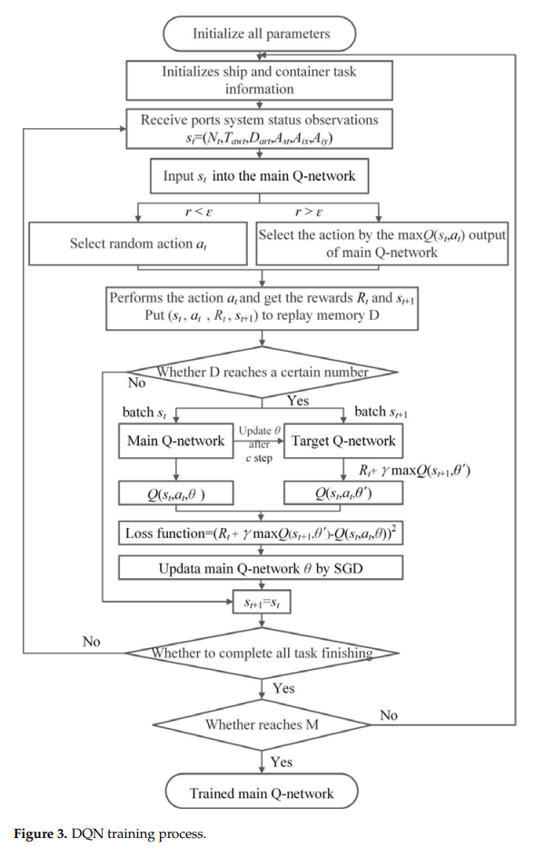

Algorithm 1 gives the same loop as pseudocode (reproduced from the paper; see 2.6 for its printed inconsistencies):

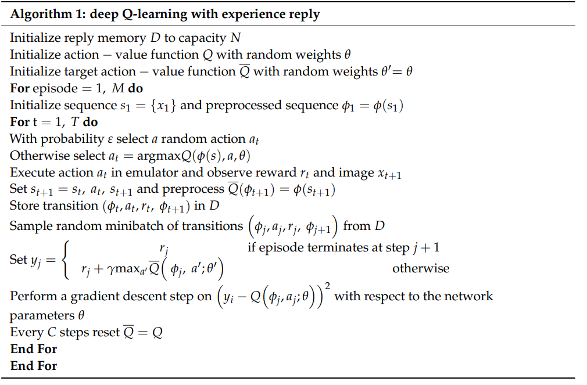

**Scheduling with the trained network (Sec. 4.2, Fig. 4).** When a QC spreader grabs a new container task, or an AGV completes a task and becomes idle, a scheduling request fires; the state goes to the main network, the action with the largest output is converted into a rule and an AGV index, and when AGV $i$ completes its task the state is recalculated for the next selection. The process ends when all ships and containers are handled.

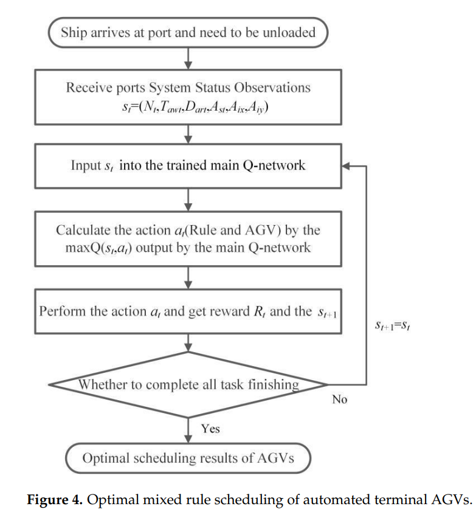

### 2.3 Experimental design (Sec. 5, 6.1, 6.2.1)

**Simulation (Sec. 5.1).** Siemens Tecnomatix Plant Simulation 15.0 with SimTalk models seaside horizontal transport and vertical handling. The terminal has 4 berths, 8 QCs, 12 AGVs, 8 container yards and 8 YCs (Fig. 5). Four ships are waiting in one training session, each with 96 container tasks, 384 in total. Assumptions: (1) all containers are standardised 20 ft TEUs; (2) container turn-over is not considered; (3) container task information is randomly generated; (4) the unloading order of the QCs is predetermined; (5) all containers are imports; (6) all AGV roads are one-way; (7) an AGV carries one container at a time; (8) an AGV's task is "completed" only after the YC has unloaded its container; (9) an AGV with no incoming task returns to the AGV waiting area; (10) all AGVs navigate by the shortest-path policy. Container attributes include ID, QC of origin, destination, yard, current waiting time and estimated distance.

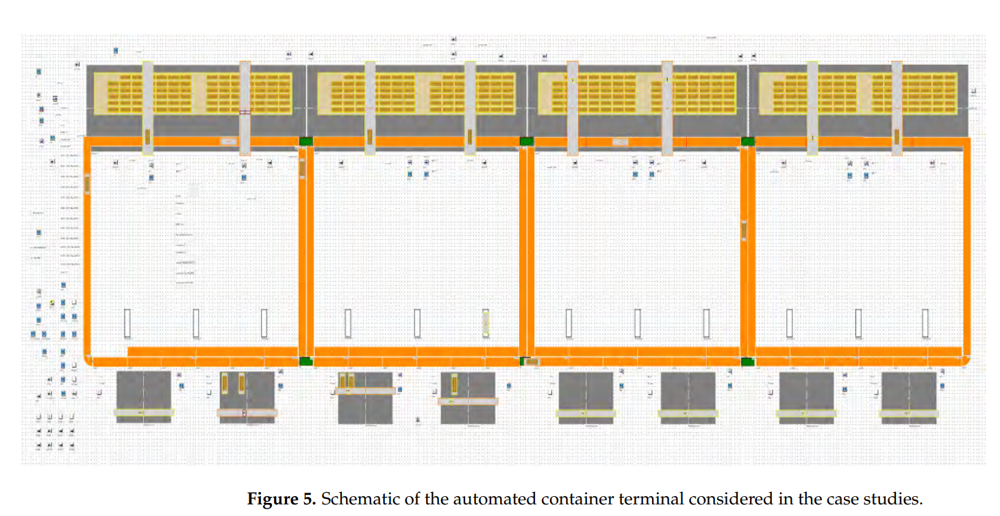

**Implementation (Sec. 5.2).** The DQN is programmed in TensorFlow and connected to the simulation through a socket module over TCP/IP (Fig. 6). The simulation has terminal-operation, state-calculation, communication and scheduling subprograms; the scheduling subprogram contains an AGV-selection method and the three rule methods.

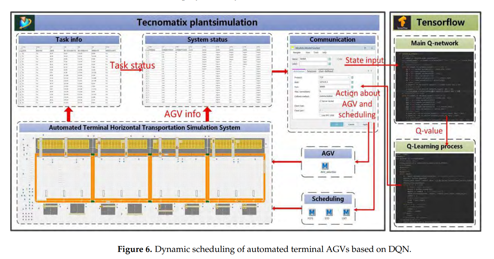

**Worked example (Sec. 5.2, Table 3).** For the five tasks of Table 3, with AGV1, 2, 4, 8, 11 working and the other seven idle, the paper writes the state as $s_t = (5, 194.0, 258.68, 1920.0, 20.0, 34.0, 53.0, 41.0, 39.0, 13.0 \dots)$, with the first three AGV positions (20.0, 34.0), (53.0, 41.0), (39.0, 13.0). The action is (2, 9): AGV 9 performs STD and carries container 004; the reward is $R_t = 2.41$ and the next state $s_{t+1} = (3, 191.0, 129.0, 3872.0, 66.0, 39.0, 53.0, 41.0, 15.0, 33.0 \dots)$.

**Table 3. Container task information.**

| ID | From | Destination | Waiting time | Transport distance |
|---|---|---|---|---|
| 001 | QC1 | container yard6 | 55 s | 284.54 |
| 002 | QC4 | container yard2 | 186 s | 247.0 |
| 003 | QC3 | container yard7 | 255 s | 278.9 |
| 004 | QC5 | container yard4 | 78 s | 203.6 |
| 005 | QC8 | container yard3 | 396 s | 279.4 |

Our arithmetic: the mean of the five waiting times is 970/5 = 194.0 s, and the mean distance is 1293.44/5 = 258.688, printed as 258.68. STD selects the shortest trip, which is task 004 (203.6).

**Training (Sec. 5.2).** 5,000 training episodes on a server with an i7-6700 CPU at 3.40 GHz and 16 GB RAM. Fig. 7 plots "Final Reward" per episode; the text states that the reward begins to converge after about 1,500 episodes and stabilises after about 2,000.

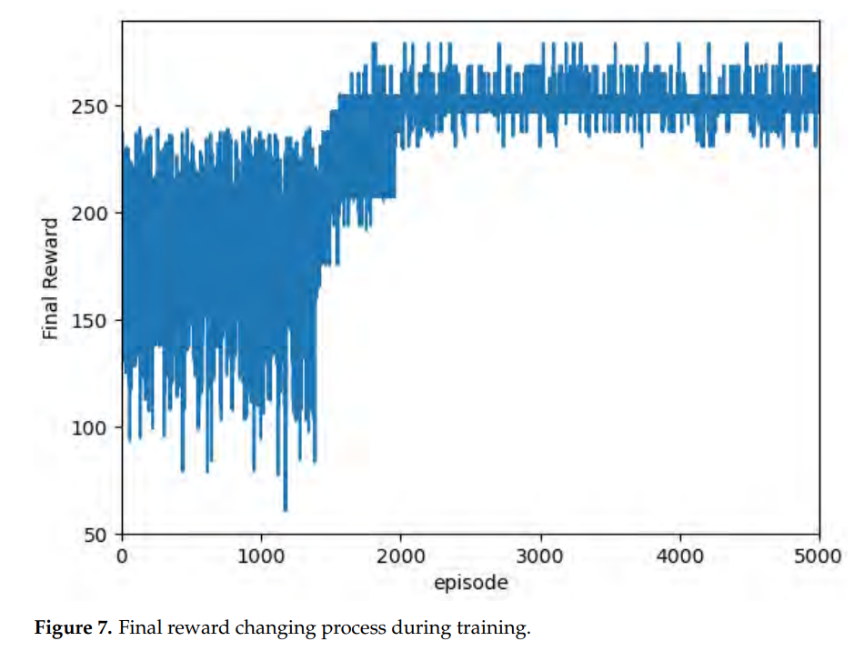

**Test cases (Sec. 6.1).** Four sizes, tasks x AGVs: 48 x 4, 96 x 6, 192 x 8, 384 x 12. Indicators: total QC waiting time, total AGV completion time, computational efficiency; makespan is added in the GA comparison (Sec. 6.2.1). Fig. 8 shows the DQN schedules as Gantt charts, using AGV subsets: (a) AGV 1, 4, 7, 10; (b) AGV 1, 3, 5, 7, 9, 11; (c) AGV 1, 3, 4, 6, 7, 9, 10, 12; (d) all twelve (read from the figure).

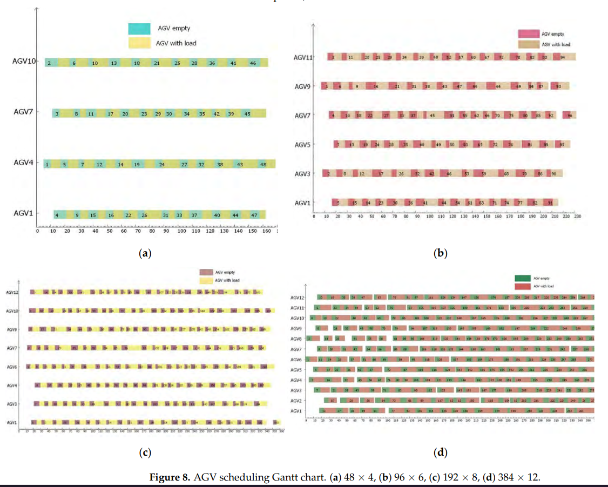

**GA baseline (Sec. 6.2.1).** A GA solves the "static version" of the problem on the testing data: the random features of the simulation (ship arrival times and AGV travel speeds are named) are treated as deterministic instances. The chromosome is real-coded with length equal to the number of container tasks; gene position is the task number and gene value the AGV number (Fig. 9: genes 4, 5, 8, 1, 2, 4 mean tasks 1 to 6 go to AGVs 4, 5, 8, 1, 2, 4). Steps: random AGV numbers from 1 to 12 at each locus; Python sends chromosomes to the simulation over TCP/IP; the simulation dispatches each QC-grabbed task to the AGV named in the chromosome and each AGV works through its own task sequence; the objective is converted to a fitness value and returned; selection, crossover and variation produce a new population; repeat until the iteration ends and report the best individual.

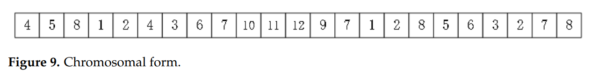

**Comparison with single rules (Sec. 6.2.2).** For 384 tasks and 12 AGVs, tasks "were randomly generated in the four different scenes", with "twenty episodes for each scene", and average performance is reported (Fig. 10). The same four size instances are used for Tables 6-8.

### 2.4 Results (Sec. 6.2)

**Table 4. Comparison of the results of DQN and GA at different instance scales** (minutes).

| N x A | QC waiting DQN | QC waiting GA | AGV completion DQN | AGV completion GA | Makespan DQN | Makespan GA |
|---|---|---|---|---|---|---|
| 48 x 4 | 142.89 | 144.84 | 103.74 | 96.93 | 28.14 | 27.29 |
| 96 x 6 | 181.54 | 217.58 | 210.43 | 198.57 | 38.64 | 41.56 |
| 192 x 8 | 294.54 | 425.63 | 439.78 | 405.20 | 60.21 | 73.45 |
| 384 x 12 | 397.40 | 801.61 | 937.09 | 829.30 | 93.08 | 143.93 |

The text states that DQN "could always sharply reduce" QC waiting compared with the GA, that the DQN total AGV completion time is "slightly worse", and that the final makespan "appears to be improved" for each instance. Our arithmetic from Table 4 (DQN against GA): QC waiting is lower by 1.35%, 16.56%, 30.80% and 50.42% at the four sizes; AGV completion time is higher by 7.03%, 5.97%, 8.53% and 13.00%; makespan is higher by 3.11% at 48 x 4 and lower by 7.03%, 18.03% and 35.33% at the other three.

**Table 5. Comparison of the computational efficiency.**

| N x A | DQN | GA |
|---|---|---|
| 48 x 4 | 3.24 s | 20 min |
| 96 x 6 | 7.95 s | 42 min |
| 192 x 8 | 10.95 s | 69 min |
| 384 x 12 | 21.02 s | 135 min |

The paper states that the GA takes "significantly longer", and attributes the DQN's lower QC waiting and makespan to AGVs being occupied more during dynamic decision-making.

**Table 6. Total waiting time of QCs (min) under different scales.**

| N x A | DQN | FCFS | STD | LWT |
|---|---|---|---|---|
| 48 x 4 | 142.891 | 162.609 | 138.670 | 128.690 |
| 96 x 6 | 181.545 | 204.300 | 189.323 | 207.723 |
| 192 x 8 | 294.548 | 350.697 | 325.924 | 318.611 |
| 384 x 12 | 397.404 | 426.185 | 424.501 | 422.681 |

**Table 7. Total completion time of AGVs (min) under different scales.**

| N x A | DQN | FCFS | STD | LWT |
|---|---|---|---|---|
| 48 x 4 | 103.748 | 107.570 | 111.710 | 110.347 |
| 96 x 6 | 210.433 | 219.130 | 217.960 | 211.420 |
| 192 x 8 | 439.785 | 441.478 | 442.928 | 442.493 |
| 384 x 12 | 937.090 | 958.891 | 947.500 | 947.610 |

**Table 8. Comparison of the computational efficiency.**

| N x A | DQN | FCFS | STD | LWT |
|---|---|---|---|---|
| 48 x 4 | 3.24 s | 1.11 s | 1.15 s | 1.10 s |
| 96 x 6 | 7.95 s | 2.08 s | 2.29 s | 2.05 s |
| 192 x 8 | 10.95 s | 4.05 s | 4.16 s | 4.03 s |
| 384 x 12 | 21.02 s | 8.06 s | 8.28 s | 7.91 s |

For 384 x 12, Fig. 10 compares DQN with the three rules; the text states "maximum improvements are 2.2%" for AGV completion time and "7.2%" for QC waiting time, and that DQN outperforms each individual rule under all input scales (Tables 6-7). It states that DQN's CPU time is "slightly higher" than the rules' but acceptable.

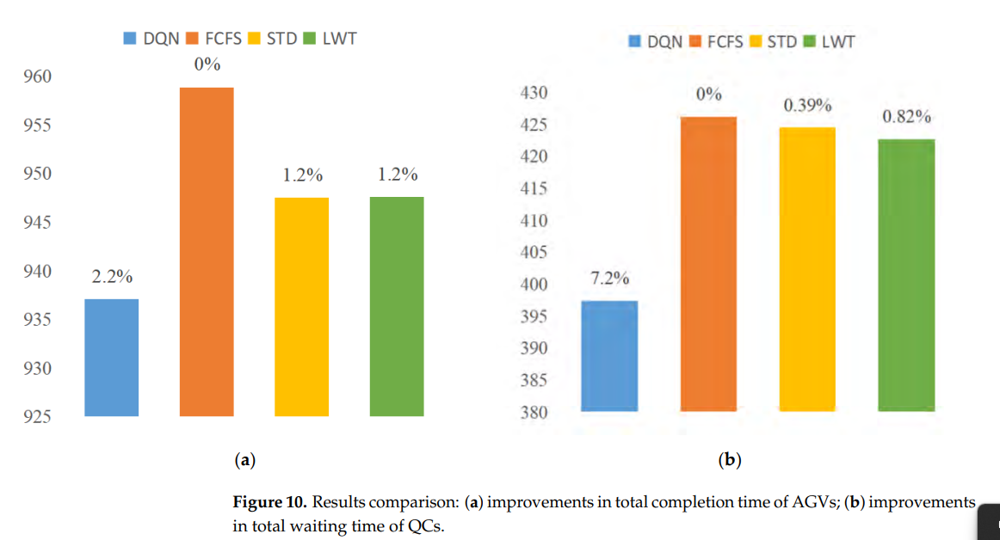

Bar labels in Fig. 10(a): DQN 2.2%, FCFS 0%, STD 1.2%, LWT 1.2%; in Fig. 10(b): DQN 7.2%, FCFS 0%, STD 0.39%, LWT 0.82%. The DQN bars sit at about 937 (a) and 397 (b), read from the figure (≈); the y-axes are truncated (about 925-960 and 380-430).

Our arithmetic from Tables 6-7 (DQN lower than the rule by): QC waiting at 48 x 4: 12.13% against FCFS, but 3.04% and 11.04% higher than STD and LWT; at 96 x 6: 11.14%, 4.11%, 12.60%; at 192 x 8: 16.01%, 9.63%, 7.55%; at 384 x 12: 6.75%, 6.38%, 5.98%. AGV completion time at 48 x 4: 3.55%, 7.13%, 5.98%; at 96 x 6: 3.97%, 3.45%, 0.47%; at 192 x 8: 0.38%, 0.71%, 0.61%; at 384 x 12: 2.27%, 1.10%, 1.11%. From Table 8 the DQN time is 2.54 to 3.88 times the rules' time across the four sizes.

### 2.5 Conclusions (Sec. 7)

The authors state that the DQN-based mixed-rule approach has a better optimisation performance than rule-based scheduling and the GA, that "DQN does not have a particularly obvious advantage in small-scale cases" while the advantage becomes more obvious as tasks and AGVs increase, and that DQN is slightly slower than the rules but much faster than the GA, increasingly so at larger sizes. In Sec. 6.2.2 they write that the results "prove" a large efficiency improvement. Future work named: collision avoidance and dynamic path planning, more dynamic uncertainty features, and mixed import and export handling.

### 2.6 Gaps and inconsistencies in the printed paper

Listed as printed; none has been corrected.

- **Cross-references.** Sec. 4 refers to "the problem formulation described in Section 2" (the formulation is Sec. 3). Sec. 5.2 refers to "Section 3.1" and "4.1" for the networks and the simulation scenario, and to "the system state in Section 2" (the state is Sec. 3.2). Sec. 6.1 refers to the scheduling procedure "described in Section 3.2" (Sec. 4.2), to the GA comparison "detailed in Section 5.1" and to the rule comparison "described in Section 5.2" (Sec. 6.2.1 and 6.2.2). Sec. 6.2.1 refers to "the simulation case in 4.1" and Sec. 6.2.2 to the instances "in 5.1".
- **Eq. (11).** The last term is printed $\gamma^{*} R_{t+k+1}$; the range of $k$ is not given. Eq. (10) and the first equality of Eq. (11) are identical.
- **Eq. (13).** The terminal condition is printed $s_t = Terminal$; the left-hand side is written $Q(s_t, a_t; \theta')$ although it is the target built from $R_t$ and $\max Q(s_{t+1}; \theta')$.
- **Algorithm 1.** The title reads "experience reply". The pseudocode speaks of an "emulator" and an "image $x_{t+1}$", sets $s_{t+1} = s_t, a_t, s_{t+1}$, builds the target from $\overline{Q}(\phi_j, a'; \theta')$ (not $\phi_{j+1}$), takes the gradient step on $(y_i - Q(\phi_j, a_j; \theta))^2$ while defining $y_j$, and gives neither $T$ nor the minibatch size. The replay capacity is called $N$ here.
- **Notation clashes.** $M$ is the number of training episodes (Steps 1 and 9, Algorithm 1) and the large constant of Eq. (4). $N$ is the replay capacity (Algorithm 1), the large constant of Eq. (6)-(7), the number of container tasks (Sec. 6.1, Tables 4-8) and, as $N_t$, the number of waiting tasks. Position is written $A_{iloc}$ in Sec. 3.2 but $A_{ix}, A_{iy}$ in Sec. 5.2 and Figs. 3-4.
- **State dimension and $A_{st}$.** Eq. (3) and Sec. 4.1 describe a per-AGV status vector, which with 12 AGVs would give 3 + 12 + 24 = 39 inputs (our arithmetic); Sec. 5.2 and Table 2 give 28. In the worked example $A_{st}$ appears as a single number (1920.0, then 3872.0), which fits 3 + 1 + 24 = 28 (our arithmetic). The example lists five working AGVs (1, 2, 4, 8, 11); read as a 12-bit binary number that set is 3346 or 1163 depending on bit order, and 1920 has four set bits (our arithmetic). How $A_{st}$ is encoded into one value is not described.
- **Softmax output.** Table 2 and Sec. 4.1 give a softmax output layer described as the value function $Q(s, a)$, while Eq. (13) forms targets $R_t + \gamma \max Q$. Softmax outputs are positive and sum to one; the worked example reports $R_t = 2.41$ (our derivation). The paper does not discuss this.
- **Worked example.** The record $Re$ is printed with the current state $(5, 194.0, 258.68, 1920.0, \dots)$ as its last element, not the stated $s_{t+1}$. The stated $s_{t+1}$ has 3 tasks and $D_{adt} = 129.0$; the four tasks left in Table 3 after removing task 004 have mean distance 272.46, and any three of them at least 268.43 (our arithmetic), so $s_{t+1}$ includes tasks not in Table 3 or was observed after further events. The paper does not say what happens between $s_t$ and $s_{t+1}$. Table 3 gives no unit for transport distance.
- **Transition timing.** Step 2 and Sec. 4.2 fire a decision at QC and AGV events; Sec. 4.2 and Sec. 5.2 describe the next state and the task information being returned when the AGV finishes its task. How decisions that fire while an earlier action is still being executed are paired with rewards and next states is not described.
- **Reward definitions.** $C^r$ and $C^w$ are called "cost" and "penalty cost" but enter $R_t$ and $R_f$ with weights $\mu_1, \mu_2$ as the reward; each has the form constant minus a time. Whether $t^r_{ik}$ is a clock time or a duration is not stated. $R_f$ is defined but its use in training is not stated; Fig. 7's axis reads "Final Reward" and the text calls it the total reward over the scheduling process, without tying it to Eq. (9). The reward in the worked example is not broken down.
- **Values not given.** $\alpha$, $\beta$, $\mu_1$, $\mu_2$, $M$, $N$ (constants), $\gamma$, the $\varepsilon$ value or schedule, $\eta$, $C$, replay capacity, minibatch size, $T$, the training time, and any random seed. For the GA: population size, number of generations, crossover and mutation rates, and the fitness definition beyond "the objective function".
- **Action validity.** The paper does not say whether busy AGVs are masked from the action choice; the worked example selects an idle AGV.
- **Test instances.** Sec. 6.1 says the trained network is tested and Sec. 6.2.1 says the GA uses "the testing data"; how test instances are generated, and how they differ from training scenarios, is not described. The network of Table 2 has 28 inputs and 36 outputs for 12 AGVs; whether networks were retrained or adapted for 4, 6 and 8 AGVs is not described (Fig. 8 shows AGV subsets).
- **Ships.** Sec. 5.1 has four ships waiting in one training session while Sec. 6.2.1 names ship arrival time as a random feature; the paper does not reconcile the two.
- **Scenes and AGV indices.** Sec. 6.2.2 describes the 384-task case with "12 AGVs with odd indices", while Fig. 8(d) shows AGVs 1 to 12 for 384 x 12 and Fig. 8(b) shows the odd-numbered AGVs 1 to 11 for 96 x 6. "Scene" is not defined, so whether the 20 episodes are per scene (80 in total) is not stated. Only the 384 x 12 case is described as averaged over episodes; the run count behind the other sizes is not stated.
- **Tables 4-8.** The text calls the AGV completion time of DQN "slightly worse" than the GA (Table 4: 5.97-13.00% higher); says DQN "always" outperforms the single rules (Table 6, 48 x 4: STD and LWT are lower); says makespan improves "for each of the instances" (Table 4, 48 x 4: 28.14 against 27.29); and says DQN's CPU time is "slightly higher" (Table 8: 2.54-3.88 times). Table 4 values appear truncated rather than rounded relative to Table 6 (181.54 and 181.545; 294.54 and 294.548). Tables 5 and 8 carry the same caption and the same DQN column; what the times measure (a whole run or a decision, whether training is included) is not stated. The unit of the Gantt time axis in Fig. 8 is not stated.
- **Fig. 10 labels.** The AGV-completion labels (2.2%, 1.2%, 1.2%) and the STD and LWT labels in (b) (0.39%, 0.82%) match percentages taken from Tables 6-7 against FCFS (2.27%, 1.19%, 1.18%, 0.40%, 0.82%). The DQN label in (b), 7.2%, does not match FCFS as base (6.75%); it equals (426.185 − 397.404) / 397.404 = 7.24% (our arithmetic). The base is not stated.
- **Related-work statements.** Sec. 2 describes Choe et al.'s OnPL as reducing waiting times for outside container trucks and lists it among the RL-based studies. Choe et al. state QC productivity and empty-travel distance as their objectives, and OnPL is online preference learning, not reinforcement learning (see the Choe 2016 note).

---

## 3. Structured summary

| Field | Value |
|---|---|
| Problem | Multi-AGV dynamic scheduling for seaside import unloading in an automated terminal |
| Decision trigger | Both: a QC finishes unloading a container, or an AGV becomes idle |
| Decision | A (rule, AGV) pair: rule in {FCFS, STD, LWT}, AGV index; the rule selects the container task |
| Objective | Total AGV completion time and total QC waiting time (time the QC waits for the AGV), through $R_t = \mu_1 C^r_{ik} + \mu_2 C^w_{ik}$ |
| Scale | 8 QCs, 12 AGVs, 8 yards, 8 YCs, 384 tasks in training; tests 48x4, 96x6, 192x8, 384x12 |
| Randomness: quay-crane cycle time | Not described |
| Randomness: travel time / congestion | AGV travel speed random (Sec. 6.2.1), parameters not given; one-way roads, shortest paths |
| Randomness: task arrival | Ship arrival time random (Sec. 6.2.1); task information randomly generated (assumption 3); no distributions |
| Randomness: stowage / workload | Unloading order of QCs predetermined; 96 tasks per ship; 20 ft imports only |
| Randomness: yard crane | Not described (AGV completion includes YC unloading, assumption 8) |
| Randomness: AGV breakdown, battery | Not described |
| Method | Single-agent DQN, 28-350-140-36, replay, target network, epsilon-greedy |
| Evaluation | 5,000 training episodes; four test sizes with single values; 384x12 against rules averaged over 4 scenes x 20 episodes; no seeds, intervals or tests |
| Benchmarks | Static GA; FCFS, STD, LWT |

**Citation sentence supported by the paper:** *Zheng et al. (2022) report a single-agent DQN that selects a dispatching rule and an AGV at each QC or AGV trigger; in a Plant Simulation model of a Shanghai terminal (8 QCs, 12 AGVs, 384 import tasks) it is reported to give lower total QC waiting time than a static GA at four sizes and lower makespan at three, and the lowest AGV completion time among DQN and three single rules at four sizes, with single values and no confidence intervals.*

---

## 4. What the paper does not support

- No hyperparameter values for the network, reward constants or training loop, no GA parameters, no random seeds and no training time are given.
- Results are single values per size (Tables 4-8); no confidence intervals, tests or run counts are given, except that the 384 x 12 comparison against the rules is described as an average of 20 episodes per scene over four scenes.
- How test instances relate to training scenarios is not described, nor whether the network was retrained or adapted for the 4-, 6- and 8-AGV cases.
- The GA is a static baseline that sees the realised random features, its parameters are not given, and its run time (20-135 min) and the DQN time (3.24-21.02 s) are not stated to measure the same thing; training time is not reported.
- The DQN is not shown to beat every rule at every size: at 48 x 4, STD and LWT have lower QC waiting (Table 6) and the GA has lower makespan and AGV completion time (Table 4). Its total AGV completion time is higher than the GA's at all four sizes.
- No breakdown, battery or yard-crane delay model is described, QC handling-time variation is not described, and congestion is limited to one-way shortest-path travel with a random speed (collision avoidance is future work). Only import containers are handled.
- No other learning method (for example a different DRL algorithm or Choe-style preference learning) is compared, and no ablation of the state features or of the mixed-rule action design is reported.
- QC waiting time is defined only as the time the QC waits for the AGV (Sec. 3.4); no other source of QC idle time is measured.
- The statement that DQN has not been applied to terminal AGV scheduling is the authors' own; no literature search is described.
- Words such as "prove" in Sec. 6.2.2 describe a simulation comparison of single values.

---

## 5. Our reading (interpretation, not from the paper)

### 5.1 What we can use

- **A DQN precedent with a small action set (our reading).** The action is a pair of one of three rules and one of twelve AGVs, 36 outputs, with the rule choosing the container task. This is a different decision shape from "which QC's next job" and from choosing among several QCs and blocks, and its output size grows linearly with fleet size and rules.
- **Trigger (our reading).** The paper fires decisions on both vehicle and task events. Our notes on Kim and Bae 2004, Briskorn 2006 and Choe 2016 record vehicle-initiated dispatching, so this is a precedent for the "both" option in the open trigger question.
- **Objective (our reading).** The objective pairs AGV completion time with QC waiting for the AGV. Because the reward is a constant minus a time, shorter times give larger reward; if we adopt a similar form we should state whether the time is a duration or a clock time and how QC idle is defined.
- **Baselines (our reading).** FCFS, STD and LWT are in the paper's own action set, so DQN is not guaranteed to beat the best fixed rule; at 48 x 4 LWT has lower QC waiting. They are natural fixed-rule baselines for the thesis, cited in the paper to Klein and Kim and to Sabuncuoglu.
- **Reporting to improve on (our reading).** Report seeds, repetitions, intervals, hyperparameters, how training and test scenarios differ, and what computation times include.
- **Small scale (our reading).** At 48 x 4 the paper's DQN advantage is absent or reversed on several indicators, so a small-scale start should not assume a learned policy beats rules.

### 5.2 Cautions

- Treat the 2.2% and 7.2% figures as best-case numbers for 384 x 12 with an unstated base for the second one.
- Do not quote the GA comparison as a proof of real-time superiority: the GA is a static solver on realised randomness, and the paper's own timing tables do not define what is timed.
- Before reusing the state design, resolve the $A_{st}$ encoding question in 2.6; the dimension of the input depends on it.
